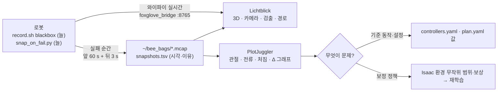

# 실기 디버깅 가이드 — 기록 · 보기 · 고치기

> 2026-11-03 준비. 실기 실험에서 **문제를 빨리 찾고 → 보정·학습 설정을 고치는** 흐름입니다.
> 코드 (11-09 develop `3a6d668` 확인): `rl_arm_correction` `~/debug` 토픽 · `lv2_module6/tools/bag/` (11-08 `tool/` → `tools/`)

---

## 0. 한눈에



| 도구 | 하는 일 | 설치 |
|---|---|---|
| `tools/bag/record.sh` | 기록 — 블랙박스(최근 N초만 메모리) · 전부 · 손으로 저장 | 저장소에 있음 (`rosbag2-storage-mcap` 필요) |
| `tools/bag/snap_on_fail.py` | 실패를 보면 블랙박스를 파일로 | 저장소에 있음 |
| `rl_arm_correction/debug` | 팔 보정이 매 순간 무엇을 했는지 (20 Hz) | 저장소에 있음 (`ml/ArmCorrectionDebug`) |
| **Lichtblick** 1.30 | Foxglove 오픈소스 판 — 3D · 카메라 · 그래프 · 시간축 | ✅ Mac `/Applications/Lichtblick.app` · ✅ pa27 `~/apps/lichtblick-1.30.0-linux-x64/lichtblick` |
| **PlotJuggler** 3.17 | 많은 신호를 빠르게 겹쳐 보기 (MCAP 바로 열기) | pa27 · 로봇: 아래 apt 명령 (sudo 필요) |
| `foxglove_bridge` | 로봇 → 노트북 실시간 (웹소켓) | ✅ pa27 설치됨 · 로봇: 아래 apt |
| `rosbag-timing-inspector` | 메시지 주기·지연 보기 (손 카메라가 늦나?) | 아래 apt |

### 직접 하실 설치 (sudo)
```bash
# 로봇 (Jetson) — 기록 · 실시간
sudo apt install ros-lyrical-rosbag2-storage-mcap ros-lyrical-foxglove-bridge
# pa27 (분석 PC)
sudo apt install ros-lyrical-plotjuggler ros-lyrical-rosbag-timing-inspector
```
- lyrical에는 PlotJuggler의 ROS 실시간 플러그인(`plotjuggler-ros`) 꾸러미가 아직 없음 → **PlotJuggler는 bag 파일 보기**, 실시간은 Lichtblick
- Mac에서 PlotJuggler는 설치가 번거로움 → Mac은 Lichtblick (그래프 패널도 있음), 무거운 분석은 pa27

---

## 1. 기록

로봇에서 (bringup과 같은 `ROS_DOMAIN_ID`):
```bash
cd lv2_module6/tools/bag
./record.sh blackbox 60 &        # 최근 60 s만 메모리 (최대 400 MB) — 실험 내내 켜 둠, 디스크 안 참
python3 snap_on_fail.py &        # 실패 → 3 s 더 담고 저장 (10 s 안에 또 오면 한 번)
./record.sh snap                 # "방금 이상했다" — 손으로 저장
./record.sh full                 # 짧은 실험 전체 (zstd 압축, 5분마다 파일 나눔)
```
- 저장 위치: `~/bee_bags/blackbox_<시각>/` (저장할 때마다 `.mcap` 하나) · `~/bee_bags/snapshots.tsv` = `시각 · 이유`
- 자동 저장 이유: `/task/status` FAILED (`grasp_failed_all` · `nav_failed` …) · `/arm_safety_event` (과전류 접촉) · `/state/emergency`
- 담는 토픽: 관절·TF·주행 명령·odom · 팔/그리퍼 컨트롤러 · `rl_arm_correction/debug` · `skill_context` · `hand_relative*` · `arm_safety_event` · 모터 상태 · 미션·coordinator·task · 검출 결과 · 진단(`diagnostics_agg` — skill 노드 상태 포함) · rosout · Nav2 경로 · **압축 영상만** (원본 영상·점구름은 뺌 — 필요하면 `full`에 `--topics`로)
- 11-09 확인: `record.sh` 토픽 목록(`TOPICS`)에 `FollowPath` 디버그(`/controller_server/FollowPath/debug`)와 `/skills/*` 액션 토픽은 **없음** — 필요하면 `TOPICS`에 추가
- 노트북·pa27로 가져오기: `rsync -av robot:~/bee_bags/ ~/bee_bags/`

pa27에서 시험함 (11-03): 가짜 `/joint_states` 50 Hz + `/state/emergency` → `snapshots.tsv`에 `emergency` 한 줄, 새 `.mcap` 생김.

---

## 2. 보기

### 실시간 (Lichtblick)
```bash
ros2 launch foxglove_bridge foxglove_bridge_launch.xml port:=8765     # 로봇에서
```
- 띄우기 전에 워크스페이스 `install/setup.bash`를 source — 안 하면 `ml/ArmCorrectionDebug` 같은 우리 메시지를 못 풂 (foxglove_bridge는 저장소 launch에 없음 · 따로 띄움)
Lichtblick → *Open connection* → Foxglove WebSocket → `ws://<로봇 IP>:8765`
- 3D 패널: TF · 지도 · 경로 · `/mission/markers` · 검출 · 로봇 모델
- 이미지 패널: 손 카메라 압축 영상 + 검출
- Plot 패널: `/rl_arm_correction/debug.corr[1]` 같은 식으로

### 기록 (PlotJuggler · Lichtblick)
```bash
ros2 run plotjuggler plotjuggler     # pa27 — File → Load data → .mcap
```
Lichtblick은 `.mcap` 파일을 끌어다 놓으면 됨. 화면 구성(레이아웃)은 저장해 두고 매번 같은 화면으로.

추천 화면 3개:

| 화면 | 겹쳐 볼 것 | 보면 아는 것 |
|---|---|---|
| **팔 보정** | `debug.ref[i]` · `debug.q[i]` · `debug.corr[i]` · `debug.delta[i]` · `/joint_states.effort[i]` | 처짐이 얼마나 · 보정이 어디서 쌓였나 · 정책이 무엇을 했나 · 전류 |
| **닿는 구간** | `debug.policy_on` · `debug.cam_ok` · `debug.cam_age` · `/hand_relative.rel.*` · `/skill_context.phase` | 정책이 실제로 돌았나 · 손 카메라 값이 늦거나 빠졌나 |
| **주행·도킹** | `/cmd_vel_nav` (Nav2 `RlNavController` · skill_approach가 기준 + 보정을 더해 냄) · `/cmd_vel_mux` · odom | 도킹 보정 · 미끄러짐 |
| **skill 진행** | `/diagnostics_agg` skill 묶음 (`skill_<이름>: 상태` — 단계 · 마지막 결과) · `/task/status` reason | 어느 skill · 어느 단계에서 실패했나 |

### `rl_arm_correction/debug` (`ml/ArmCorrectionDebug`, 20 Hz)
| 필드 | 뜻 |
|---|---|
| `skill` · `run_id` | 지금 닿는 구간 skill ("" = 보정 꺼짐) |
| `ref[5]` · `q[5]` | 들어온 목표 · 실제 관절각 — **보낸 명령 = ref + corr + delta** |
| `corr[5]` | 처짐 적분 (상한 0.2 rad) |
| `delta[5]` | 학습 정책 Δ (상한 0.05 rad) |
| `sag_blocked[5]` | 상한에 2 s 붙어 풀고 쉬는 관절 — **무언가에 닿아 밀고 있었음** |
| `still` · `rest` | 처짐 적분 도는 중 · stow라 쉬는 중 |
| `policy_on` · `cam_ok` · `cam_age` | 정책 있음 · 손 카메라 값이 쓸 만함 · 그 나이 [s] |
- 끄기: `controllers.yaml` `rl_arm_correction` `debug_hz: 0`

---

## 3. 증상 → 볼 곳 → 고칠 곳

| 증상 | 먼저 볼 것 | 고칠 곳 |
|---|---|---|
| 손이 목표보다 처짐 | `ref − q`가 멈춘 뒤 줄어드나 · `corr` | `sag_gain` · `sag_max` · 처짐 큰 관절은 Isaac 처짐 범위 |
| stow 주행 중 모터 뜨거움 | `rest`가 켜졌나 · `corr` · `effort` · `/motor_status` 온도 | `rest_pose` · `rest_tol` · stow 자세 띄우기 |
| `sag_blocked` 켜짐 | 어느 관절 · 그때 자세 | 그 자세가 몸체·적재함에 닿음 → 자세 · 경로 |
| 집기·놓기 실패 (`grasp_failed`) | `policy_on` · `cam_ok` · `delta` · `/hand_relative.rel` | 손 카메라 늦음 → `max_cam_age_s` · 검출 / Δ가 엉뚱 → 시뮬과 다름 (아래 4) |
| 과전류 접촉 (`arm_safety`) | `effort` · `delta` · 그 순간 영상 | `effort_threshold` · 기준 궤적 높이 |
| 도킹이 비뚤 | `cmd_vel_nav` vs `cmd_vel` (충돌 감시 뒤) · odom | approach 기준 제어 · `dock_box` 무작위 범위 |

---

## 4. 실기 ↔ 시뮬 맞추기 → 재학습

1. 실패 bag에서 그 skill 구간(`skill_context` run_id)만 고름
2. 같은 시작 자세·목표로 Isaac 환경을 돌려 **`ref · q · corr · delta`를 같은 그래프에** (실기 vs 시뮬)
3. 차이가 어디서 나나
   - 처짐·마찰·지연이 시뮬보다 큼 → 학습 환경 **무작위 범위**를 실측 쪽으로 넓힘 (`--cfg`)
   - 손 카메라 값 오차·늦음 → 관측 잡음·지연을 환경에 넣음
   - 기준 동작이 다름 (MoveIt vs IK) → 배포 조건 (`skills.yaml` `deploy`)
4. 고친 설정으로 `train_queue.sh <skill>` → 1024판 평가 → 기준선보다 좋으면 `.onnx`(`export_onnx.py`) · `.policy` 교체

> 2번(실기 구간을 Isaac에서 다시 돌리는 스크립트)은 아직 없음 — 첫 실기 bag이 생기면 그 모양에 맞춰 만듦.
