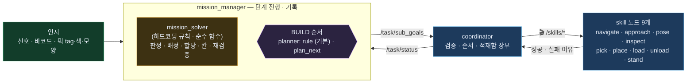
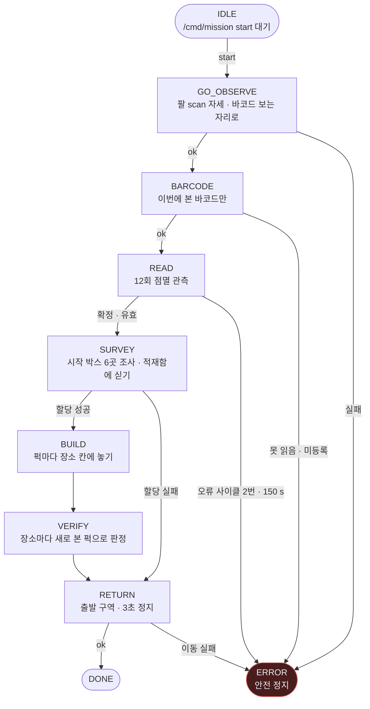
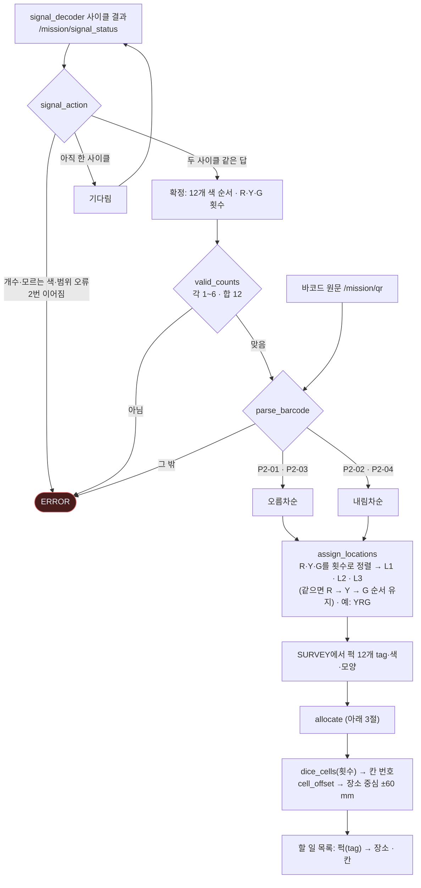
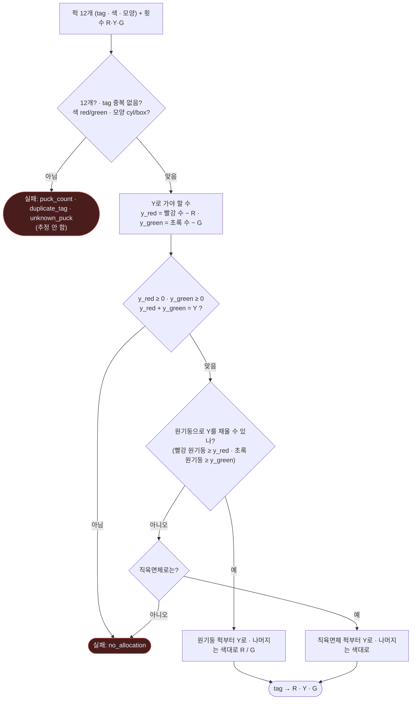
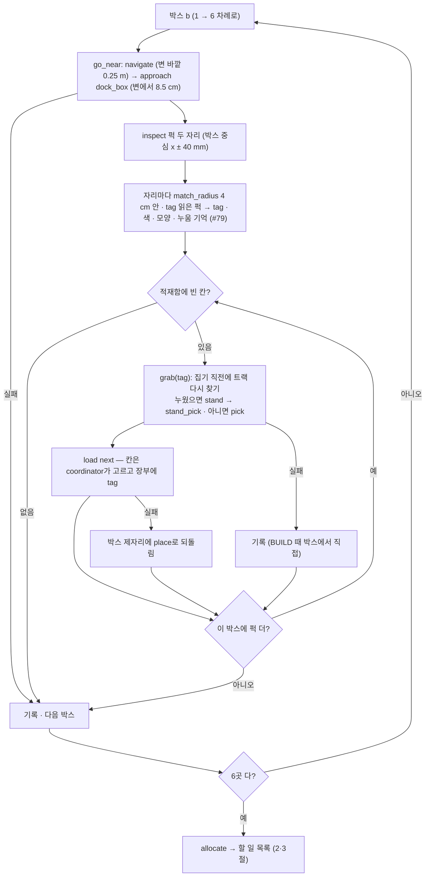
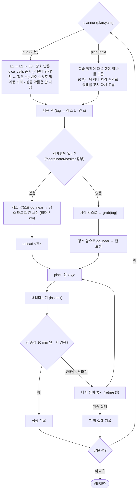
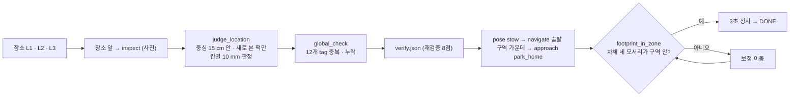

# 문제 풀이 흐름 — mission_manager · mission_solver · planner (11-09 develop)

> develop `a6e5072` 코드 기준 (`plan/src/mission_manager.cpp` · `plan/src/mission_solver.cpp` · `plan/config/plan.yaml`).
> 관련: [지금 구조 — 노드 · 플러그인](system-now.html) · [skill 노드 구성](skill-nodes.html) · [할 일 · 진행](work-plan.html) · 발제: `documents/mission/README.md`

---

## 0. 누가 무엇을 정하나

- **"무엇을 어디에"** (배정 · 할당 · 칸)는 언제나 **mission_solver 규칙**이 정합니다.
- **planner**는 그 결과를 받아 **BUILD 단계의 순서만** 정합니다 — `rule`(기본, 하드코딩) 또는 `plan_next`(학습 정책).

---

## 1. 미션 단계 전체 (`next_phase`)

**실패 원칙:** skill은 `retries: 2`번 다시 시도 → 그래도 안 되면 **그 퍽 · 장소만 실패로 기록하고 다음으로**(복귀까지 감).
멈추는 것(ERROR)은 **관측(신호·바코드) 오류와 복귀 이동 실패**뿐 — 발제 "추정 금지 → 오류 기록 · 안전 정지".

---

## 2. 관측 → 정답 계산 (mission_solver)

**주사위 칸 (`dice_cells`, 3×3, 4 = 가운데) — 가운데 먼저** (이웃이 놓인 뒤엔 가운데 성공률이 81~83 %로 떨어짐)

| 눈 | 1 | 2 | 3 | 4 | 5 | 6 |
|---|---|---|---|---|---|---|
| 칸 순서 | 4 | 0 · 8 | 4 · 0 · 8 | 0 · 2 · 6 · 8 | 4 · 0 · 2 · 6 · 8 | 0 · 3 · 6 · 2 · 5 · 8 |

---

## 3. 할당 (`allocate`) — 퍽 12개를 R · Y · G에

발제 규칙: **R = 빨간 퍽만 · G = 초록 퍽만 · Y = 색은 섞여도 되지만 모양은 하나로 통일**. 남는 빨강 · 초록이 Y가 되고, Y가 한 모양으로 모이는 쪽을 고릅니다.

---

## 4. SURVEY — 시작 박스 6곳

---

## 5. BUILD — 순서 정하기 (planner) + 퍽 하나 처리

---

## 6. plan_next — 학습된 순서 정하기

| 항목 | 내용 |
|---|---|
| 맡는 범위 | **BUILD 순서만** — 다음에 어느 퍽에 무엇을 할지 · 언제 포기하고 복귀할지 |
| 입력 (167) | 퍽 12개마다 상태(박스에 섬 · 누움 · 손 · 적재함 · 칸 맞음 · 어긋남 · 칸에 누움 · 잃음) · 목표 장소 · 가운데 칸 · 시도 횟수 + 로봇 위치 10곳 + 지난 시간 |
| 출력 (97) | `퍽 i × {집기 · 세우기 · 싣기 · 꺼내기 · 놓기 · 밀어 맞추기 · 다시 집기 · 칸에서 세우기}` + `복귀`. 시작 조건 안 맞는 행동 · **로봇에 없는 skill(밀어 맞추기 · 칸에서 세우기)은 막음** |
| 학습 | 가상 미션(`learning/plan/mission_sim.py`, 물리 없이 skill 성공을 확률로) · 보상 = 채점표(장소 주사위 +10 · 복귀 +10 · 시간 벌점) · 규칙 따라 하기 → MaskablePPO |
| 로봇 | `planner: "plan_next"`로 켬 (**지금 기본은 `rule`**) · 정책 파일 `models/plan/plan_next.onnx` (PR #97 · `plan_model`에 `.policy` 경로를 주면 기존 계산) · 못 읽으면 rule로 |
| 상태 | skill 성공률이 **임시값으로 학습됨** → 측정값으로 다시 학습 필요. 가상 미션에서 최단 순서 계산기도 38.11 / 40 — **점수는 순서보다 skill 성공률이 좌우** |

**rule과의 차이:** rule은 "L1부터 고정 순서 · 실패하면 2번 다시 후 포기". plan_next는 확률을 보고 "다시 시도할지 · 다른 장소를 먼저 할지 · 시간이 없으면 복귀할지"를 고름.

---

## 7. VERIFY · RETURN

---

## 8. skill별 결과 (`/skills/<skill>` — 결과 = 성공 여부 + 이유)

| skill | 하는 일 | 성공하면 | 대표 실패 이유 |
|---|---|---|---|
| `navigate` | Nav2 먼 이동 | 목표 근처 | `nav_failed` |
| `approach` | 마지막 몇 cm (돌기-직진-돌기 + 도킹 정책) | 도킹 자리 (1 cm · 1.5°) | `approach_blocked` · `approach_no_tf` · `approach_bad_policy` |
| `pose` | 이름 붙은 팔 자세 (stow · scan · carry) | 그 자세 | `pose_unknown` |
| `inspect` | 점 위에서 내려다보기 | 인지 트랙에 tag · 색 · 모양 | `inspect_failed` · `inspect_partial` · `inspect_no_look_pose` |
| `pick` | 파지 후보 → 내려가 쥐기 → 들기 (닿는 구간 정책 보정) | 퍽이 손에 | `no_grasp` · `pick_no_target` · `grasp_empty` · `arm_contact` |
| `stand` · `stand_pick` | 누운 퍽 세우기 → 그 자리에서 쥐기 | 선 퍽이 손에 | `stand_no_tf` · `stand_pick_no_stand` (미션: `stand_still_lying`) |
| `load` | 손의 퍽 → 적재함 칸 | **장부에 칸 → tag** | `basket_table_missing` · 칸 꽉 참 |
| `unload` | 적재함 칸 → 손 | 퍽이 손에 · 장부에서 지움 | `basket_table_missing` |
| `place` | 손의 퍽 → 칸 좌표 | 퍽이 칸에 | `place_bad_target` |

---

## 9. mission_solver 함수 한눈에

| 함수 | 규칙 |
|---|---|
| `signal_action` | 두 사이클 같은 답이면 확정 · 오류 사이클 2번이면 정지 |
| `valid_counts` | R·Y·G 각 1~6 · 합 12 |
| `parse_barcode` | `P2-01`·`P2-03` 오름 · `P2-02`·`P2-04` 내림 · 그 밖 미등록 |
| `assign_locations` | 횟수 정렬 → L1·L2·L3 (같으면 R→Y→G) |
| `group_count` | 그룹 → 횟수 |
| `allocate` | 3절 |
| `dice_cells` · `cell_offset` | 눈 → 칸 (가운데 먼저) · 칸 → ±60 mm |
| `arena_to_map` | 경기장 좌표 → 지도 (출발 자세 기준) |
| `approach_poses` | 박스 변 바깥 standoff 자리 후보 |
| `tag_correction` | 장소 태그로 칸 보정 (최대 5 cm) |
| `judge_location` · `global_check` | 재검증 칸 판정 · 중복·누락 |
| `footprint_in_zone` | 복귀 판정 |
| `next_phase` | 단계 전이 (1절) |
