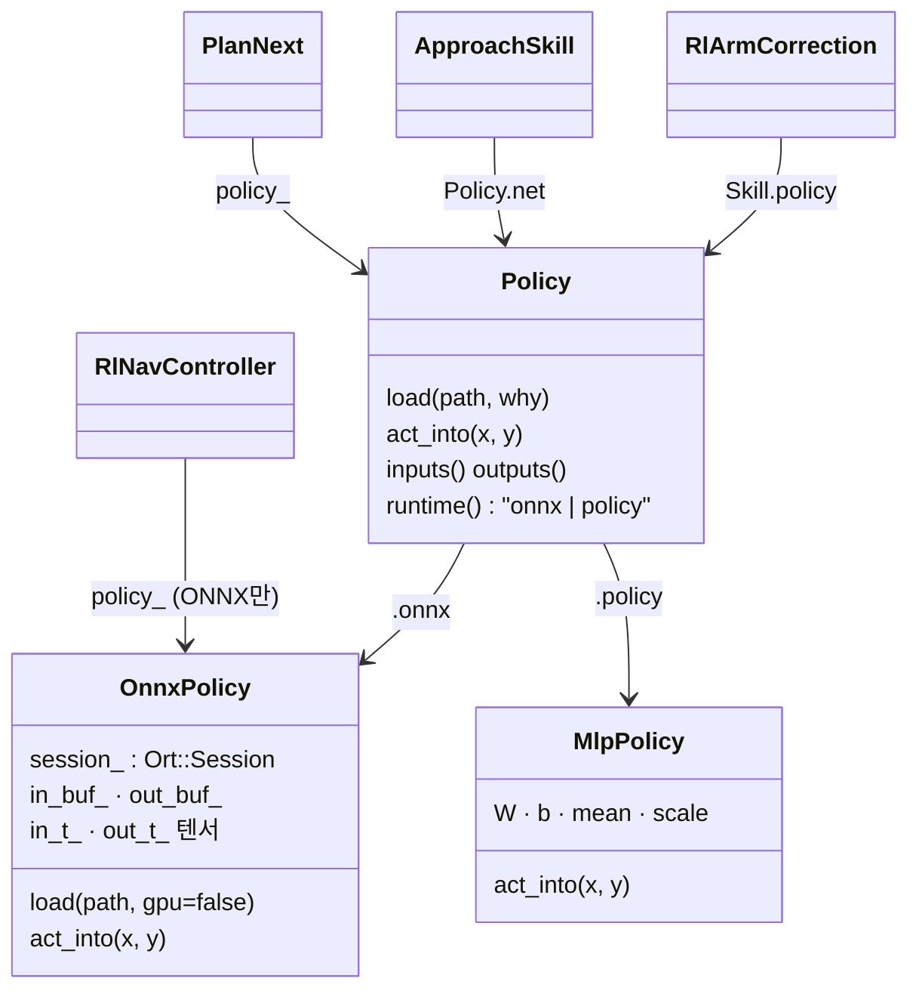
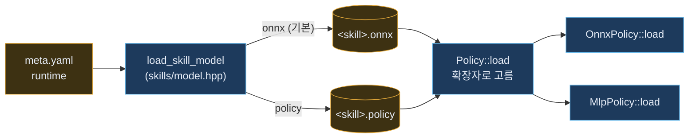
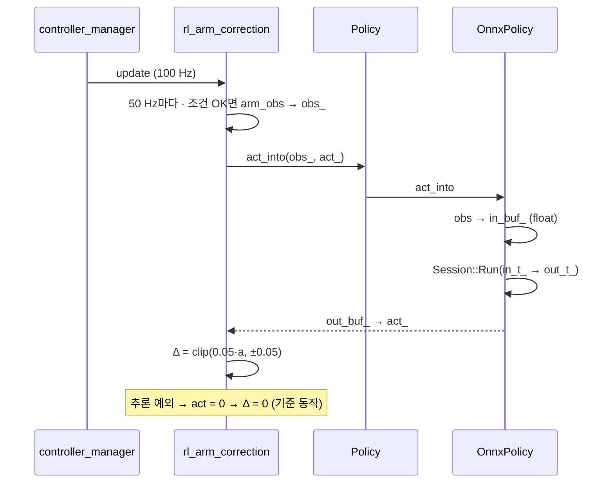
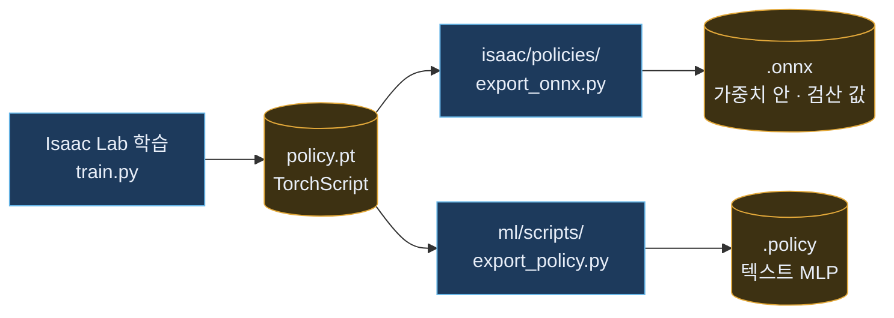

# 학습 정책 ONNX 실행 구조 (11-09 · PR #97)

> PR [#97](https://github.com/visualkhh/Lv2_bee_Assignment/pull/97) (브랜치 `feat/onnx-all-policies` → develop) 기준. 파일 경로는 `lv2_module6/ros2_ws/src/` 기준.
> 바꾸기 전 구조: [정책 실행 순서](policy-runtime.html) · 관련: [팔 정책은 어디서 도나](policy-path.html) · [지금 구조 — 노드 · 플러그인](system-now.html)
> **상태:** PR 생성, CI 확인 중 · 로봇·시뮬 실측 전. **실측에서 ONNX가 나쁜 정책은 기존 `.policy`로 되돌림** (아래 5절)

---

## 1. 한눈에 — 무엇이 바뀌나

| 정책 | 실행 위치 (그대로) | 전 | 후 (기본) | 되돌리기 |
|---|---|---|---|---|
| 팔 보정 — pick · place · load · unload (+ regrasp, 꺼짐) | `rl_arm_correction` 컨트롤러 플러그인, 100 Hz 루프 안 50 Hz | `MlpPolicy` + `.policy` | `OnnxPolicy` + `.onnx` (CPU) | `meta.yaml` `runtime: policy` |
| 도킹 — dock_box · park_home · drive_straight · drive_arc | `skill_approach` 20 Hz | `MlpPolicy` + `.policy` | `OnnxPolicy` + `.onnx` | `meta.yaml` `runtime: policy` |
| 순서 — plan_next | `mission_manager` (BUILD 퍽마다) | `MlpPolicy` + `.policy` | `OnnxPolicy` + `.onnx` | `plan.yaml` `plan_model`에 `.policy` 경로 |
| Nav2 주행 | `RlNavController` (controller_server) | `OnnxPolicy` | 그대로 (CUDA 먼저 시도 · #92) | — |

**바뀌지 않는 것:** 누가 정책을 고르고(skill 노드 · mission_manager), 어디서 실행하는지(컨트롤러 · 노드). **파일 형식과 계산기만** 바뀝니다.

---

## 2. 객체 구조



| 객체 | 파일 | 하는 일 |
|---|---|---|
| `ml::Policy` | `ml/include/ml/policy.hpp` (새로) | 파일 확장자로 계산기 하나를 고름 — `.policy`면 `MlpPolicy`, 아니면 `OnnxPolicy` |
| `ml::OnnxPolicy` | `ml/include/ml/onnx_policy.hpp` · `ml/src/onnx_policy.cpp` | ONNX Runtime 세션 · 미리 묶은 텐서로 실행 · 불러올 때 검산 |
| `ml::MlpPolicy` | `ml/include/ml/mlp_policy.hpp` (그대로 둠) | 텍스트 MLP 직접 계산 — 되돌릴 때 |
| `ml_onnx` 라이브러리 | `ml/CMakeLists.txt` | 공유 라이브러리로 설치·공개 (`ml::ml_onnx`) — skills · plan도 링크. ONNX Runtime은 안쪽(PRIVATE)이라 쓰는 쪽은 ORT 헤더가 필요 없음 |

---

## 3. 고르기 → 불러오기



| 정책 | 경로가 정해지는 곳 | `Policy::load`를 부르는 곳 (실시간 루프 밖) |
|---|---|---|
| 팔 | 팔 skill 노드 → `load_skill_model` → `ArmIO`가 `/skill_context.policy`로 보냄 | `rl_arm_correction` 구독 콜백 `policy_for` (경로마다 한 번, 캐시) |
| 도킹 | `skill_approach` 생성자 → `load_skill_model` | `skill_approach` 생성자 (4개) |
| plan_next | `plan.yaml` `plan_model` (비면 `share/ml/model/plan/plan_next.onnx`) | `mission_manager` 생성자 |

**`OnnxPolicy::load` 순서** — 하나라도 실패하면 예외, **이전 모델 유지**

| # | 하는 일 |
|---|---|
| 1 | 세션 만들기 — 기본 **CPU · 스레드 1개** (`gpu=true`면 CUDA 먼저, 실패하면 CPU) |
| 2 | 입력·출력이 하나씩이고 모양이 `[1, n]`인지 |
| 3 | 입력·출력 버퍼(`in_buf_` · `out_buf_`)를 잡고, 그 버퍼에 묶인 텐서(`in_t_` · `out_t_`)를 한 번 만듦 |
| 4 | 파일 메타데이터 `bee_test_x` · `bee_test_y`가 있으면 → 그 입력으로 실행해 출력 차이 ≤ 0.001인지 (**검산** — 예전 `.policy`의 `test` 줄과 같은 일) |
| 5 | 다 통과하면 통째로 교체 |

쓰는 쪽은 그 뒤 입력·출력 크기를 확인 — 팔 39/41 → 5 · 도킹 13 → 2 · plan_next 167 → 97. 안 맞으면 그 정책은 끔 (기준 동작).

---

## 4. 실행 — 팔 보정 (100 Hz 제어 루프 안)



| 점 | 내용 |
|---|---|
| 루프 안에서 직접 (선택지 A) | 정책이 작아(입력 39~41 · 출력 5 MLP) 별도 스레드 없이 루프 안에서 실행. `test_onnx_policy`가 한 번 추론 시간 p99 < 1 ms(제어 주기 10 ms의 1/10)인지 확인 |
| 할당 줄이기 | 입출력 버퍼·텐서는 불러올 때 한 번 — 매 호출 새로 안 잡음 |
| 실패 | 추론 예외면 그 주기 Δ = 0. 정책 파일이 없거나 크기가 틀리면 처음부터 끔 |
| 같은 객체 동시 호출 금지 | 버퍼를 공유하므로 한 `Policy`는 한 스레드에서만 (지금 구조가 그럼) |

도킹(`skill_approach` 20 Hz 타이머)과 plan_next(BUILD 퍽마다)도 같은 `act_into`를 부름. Nav2는 그대로 `OnnxPolicy::run`.

---

## 5. 되돌리기 — 정책마다 (실측 비교용)

**기본은 전부 `.onnx`.** 실측에서 ONNX가 나쁜 정책만 설정으로 되돌림 — 코드 수정 없음. `meta.yaml`은 설치 폴더(`share/skills/model/<skill>/`)에 복사되므로 거기서 바로 고치거나, 소스를 고치고 `colcon build --packages-select skills`. 노드를 다시 띄우면 적용

| 되돌릴 정책 | 바꿀 곳 |
|---|---|
| 팔 · 도킹 skill 하나 | `models/skills/<skill>/meta.yaml` → `runtime: policy` |
| plan_next | `plan.yaml` → `plan_model: <…>/plan_next.policy` |

```yaml
# models/skills/place_cell/meta.yaml
use: true
runtime: onnx         # onnx (기본, ONNX Runtime) | policy (같은 정책의 .policy · 실측에서 ONNX가 나쁘면)
```

- **두 파일이 같은 정책인지 시험** (`Policy.OnnxAndPolicyFilesAgree`): `.policy` · `.onnx` 쌍 10개가 같은 입력에 같은 출력 → 실측 차이는 **계산기 차이만**
- 확인: 로그 `place: 정책 …/place_cell.onnx (place 모양 · onnx)`
- 실측으로 어느 쪽을 쓸지 정해지면 안 쓰는 쪽 파일을 그때 지움

---

## 6. 파일 · 내보내기



| 파일 | 상태 |
|---|---|
| `models/skills/<skill>/<skill>.onnx` 9개 · `models/plan/plan_next.onnx` | **새로 만듦** — 지금 `.policy` 가중치를 그대로 옮김 (무작위 입력 500개 최대 차이 < 0.0001). 예전 skill `.onnx`는 가중치(`.onnx.data`)가 없어 **열리지도 않던 파일** |
| `models/**/*.policy` 10개 | 그대로 둠 (되돌리기용) |
| `models/rl_nav_controller/policy.onnx` + `.onnx.data` | 그대로 |
| `export_onnx.py` | rsl_rl · sb3 둘 다 · **가중치를 파일 안에** · 메타데이터 `bee_test_x/y` (예전 `.check` 파일 대신) |
| `train.py`가 같이 내는 `.onnx` | 가중치가 옆 파일로 빠지는 참고용 — **로봇용은 `export_onnx.py`로** |

---

## 7. 시험

| 시험 | 확인 |
|---|---|
| `ml` `test_onnx_policy` | 저장소 `.onnx` 11개가 모두 열리고 검산 통과 · 잘못된 파일 거부 · 팔 정책 p99 < 1 ms · `.policy`/`.onnx` 쌍 같은 출력 |
| `ml` `test_mlp_policy` | `.policy` 검산 (그대로) |
| `skills` `test_skills` | 정책 폴더마다 meta · `runtime`에 맞는 파일 · 입력 크기 |
| `plan` `test_plan_next` | Python 플래너와 같은 행동 40개 (`.onnx`로) |
| 로컬 (Python ONNX Runtime) | 11개 검산 최대 차이 7.6e-06 ✅ |

---

## 8. 남은 일

| 일 | 상태 |
|---|---|
| CI `test-all` (빌드 · 시험) | ⏳ 확인 중 — 로컬 ROS 빌드는 못 함 |
| 시뮬·실기 실측 (ONNX vs `.policy`, 정책별) | ⏳ — 나쁘면 5절로 되돌림 |
| Jetson(arm64)에 ONNX Runtime 설치 가능한지 | ⏳ — 없으면 ONNX 정책은 꺼짐(기준 동작) · `runtime: policy`로 돌리면 ONNX 없이 동작 |
| #83 (develop에 아직 없음) 새 입력 모양 pick_box 67 · unload_slot 58 | 들어오면 같은 규칙 — `export_onnx.py`로 내보내고 `meta.yaml` |
