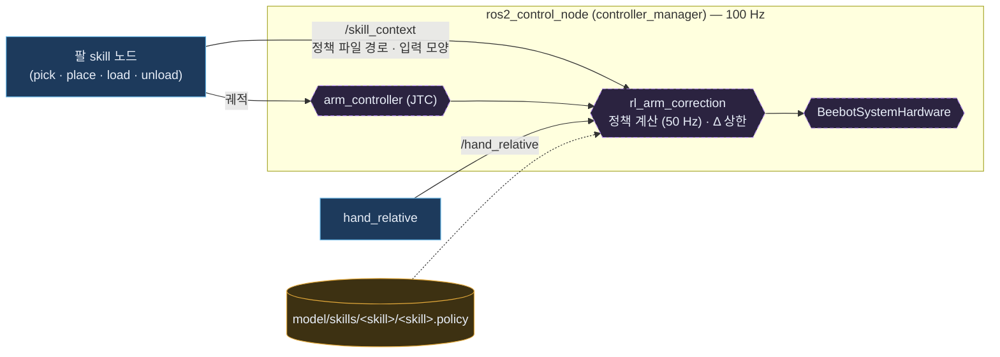
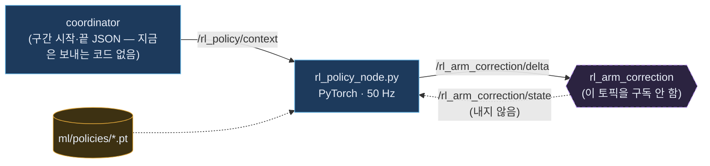

# 팔 정책은 어디서 도나 — 두 방식 비교 (11-06 결정)

> 팔 skill(집기 · 놓기 · 싣기 · 꺼내기)의 학습된 보정 정책을 로봇에서 **어디서 계산할지**에 대해 develop에 두 방식이 함께 들어와 있었습니다.
> 결론: **방식 A(컨트롤러 안 C++)** 하나로 정리 — 방식 B 코드는 PR #77로 지움.
> 관련: [지금 구조 — 노드 · 플러그인](system-now.html) · [정리 · 결정 기록 (결정 19)](wrapup-1103.html)

---

## 1. 두 방식 한눈에

**방식 A — 지금 쓰는 것: skill 노드가 정책을 고르고, 컨트롤러 플러그인 안에서 C++로 계산**

**방식 B — #75로 들어왔지만 연결 안 됨: 별도 파이썬 노드가 계산해 토픽으로 보냄**

---

## 2. 비교

| 기준 | 방식 A (컨트롤러 안 C++) | 방식 B (파이썬 노드 → 토픽) |
|---|---|---|
| **시뮬과 같은 타이밍** | 정책이 제어 주기에 맞춰 50 Hz로 바로 계산되고 **같은 주기에** 명령에 들어감 = 학습 때 조건 | 토픽 왕복 지연 · 흔들림. 잔차 정책은 Δ가 들어가는 시점에 민감해 시뮬과 달라질 수 있음 |
| **어떤 정책이 켜졌나** | skill 노드가 자기 단계에 맞춰 `/skill_context`로 알림 — skill 상태와 정책이 한 곳에서 묶임 | 구간 정보를 JSON으로 따로 보내야 함. #59 뒤로 coordinator는 팔을 안 움직여 보낼 주체가 없음 |
| **실패할 때** | 정책 파일이 없거나 이상하면 **Δ = 0, 기준 동작만** · Δ 상한을 컨트롤러가 직접 자름 | 노드가 죽거나 늦으면 Δ가 끊기거나 옛 값이 남을 수 있음 |
| **Jetson 부담** | 작은 MLP를 C++로 — PyTorch 필요 없음 | Jetson에 PyTorch 필요 (메모리 · 시작 시간) |
| **보정 층 나누기** | 하드웨어 = 처짐 상태 · 컨트롤러 = 앞먹임 · 적분 · 정책 Δ · skill = 언제 어떤 정책 | 정책 계산이 제어 루프 밖 층으로 하나 더 생김 |
| **실험 속도** | 학습 결과 `.pt` → `.policy` 변환 필요 | **빠름** — `.pt`를 바로 꽂음 (방식 B를 만든 이유로 보임) |
| **관측(입력) 만들기** | C++(`arm_obs`)로 다시 만듦 — 시뮬 관측이 바뀌면 같이 고쳐야 함 | 파이썬이라 학습 코드와 가깝게 쓸 수 있음 |
| **큰 모델** | 100 Hz 루프 안이라 모델이 크면 루프가 늦어질 수 있음 (지금 정책은 1 ms 미만) | 루프 밖이라 상관없음 |
| **지금 상태** | ✅ 연결 · 빌드 · CI 시험 · 시뮬에서 정책 읽기 확인 (실기 끝까지는 아직) | ❌ 설치 · launch 없음 · 입력 주는 곳 없음 · 컨트롤러가 출력을 안 받음 |

---

## 3. 결정 — 방식 A 하나로

**이유:** 잔차 정책은 시뮬에서 배운 타이밍 그대로 돌아야 맞고(A가 같은 주기), 실패해도 기준 동작으로 안전하게 떨어지며, Jetson에 PyTorch를 올리지 않아도 됩니다. 방식 B는 지금 구조에서 입력을 줄 주체도, 출력을 받을 곳도 없습니다.

**A의 약점은 이렇게 막습니다**

| 약점 | 막는 방법 | 상태 |
|---|---|---|
| `.pt` → `.policy` 변환이 틀리면 조용히 다르게 돎 | 같은 입력에 `.pt`와 `.policy`가 같은 출력인지 시험 (`plan_next`가 이미 이렇게 함) | ⏳ |
| 관측을 C++로 다시 만듦 (예: #75 `twist_state`로 관측 해석이 바뀜) | skill 폴더 `meta.yaml`에 관측 구성 · 크기 · CI에서 확인 | ⏳ |
| 실험은 B가 빠름 | "학습 → `.policy` 변환 → 같은 출력 시험"을 명령 하나로 | ⏳ |
| 큰 모델이 오면 100 Hz 루프가 늦어짐 | 그때 다시 검토 (지금은 1 ms 미만) | — |
| 실기에서 정책 보정을 켜고 끝까지 돌린 적 없음 | 실기 확인 | ⏳ 실기 |

---

## 4. 방식 B와 함께 들어온 것 — 같은 일은 이미 A 쪽 코드가 함

| 지운 것 (PR #77) | 하려던 일 | 같은 일을 지금 하는 곳 |
|---|---|---|
| `ml/scripts/rl_policy_node.py` · 시험 | 파이썬 정책 계산 | `rl_arm_correction` (위 방식 A) |
| `plan/arm_ik` | 손이 아래를 보는 IK (수치해) | `skills/stand_plan` `ik_down` · `ik_down_sym` (해석해) → `ArmIO::ik_ee` · `ik_ee_yaw` |
| `plan/rl_segment` | 시뮬과 같은 구간 시간표 + B 노드용 JSON | `ArmIO::contact_step` · `traj_step` · `stand_plan` `trapezoid_duration` · `move_s` |
| `plan/stand_geometry` | 세우기 손끝 경로 · 받침 높이 맞추기 | `skills/stand_plan` `waypoints` · `plan_ik` (대각선 끌기 포함) · `stand_box_top_m` · `standing_grasp_z` |
| `model/arm_correction/*.onnx` 10개 · `ml/policies/*` | B가 쓰려던 정책 사본 | `model/skills/<skill>/` |
| `isaac/scripts/calib/gravity_comp.py` | B의 `~/delta` 입력을 빌려 중력 앞먹임을 넣던 실험 스크립트 | `rl_arm_correction` `gravity_enabled` (기본 켬) |

모두 #59 이전 구조(coordinator가 팔을 직접 움직이던 때)용이라 빌드 · 실행 경로가 없었고, 지워도 잃는 기능이 없습니다.
