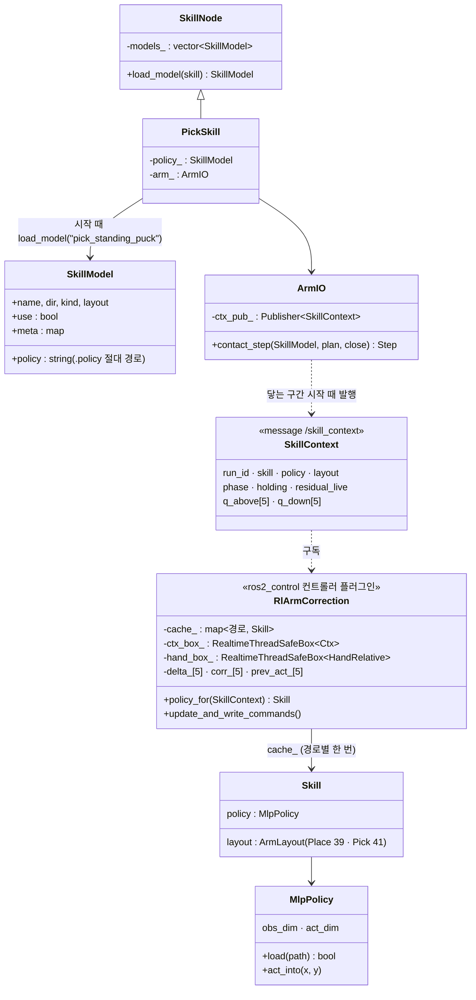
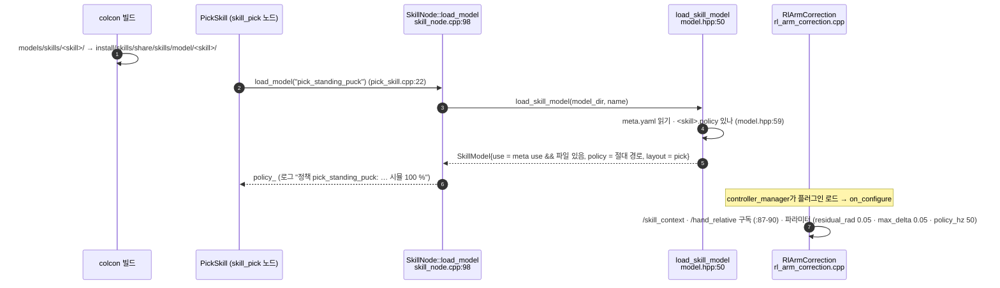
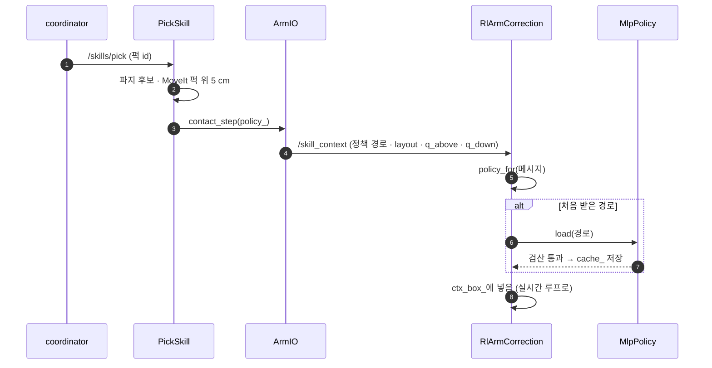
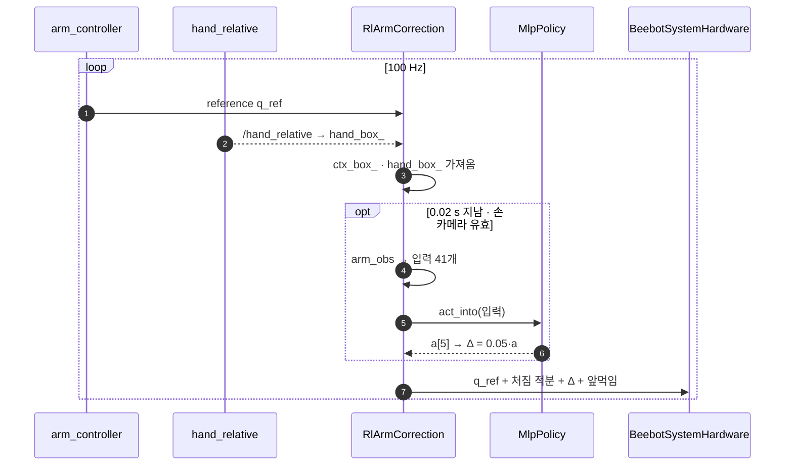
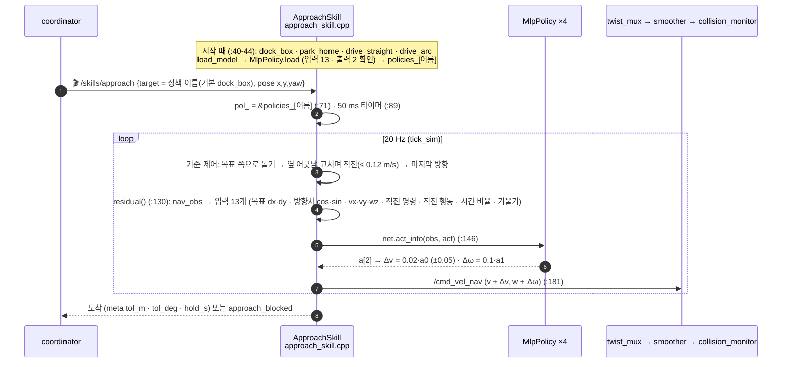
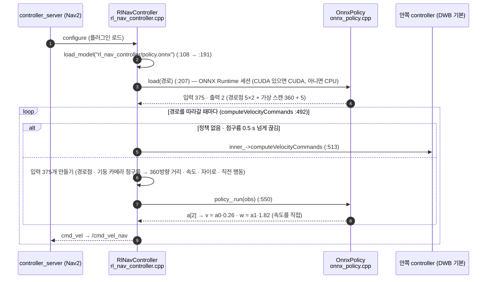
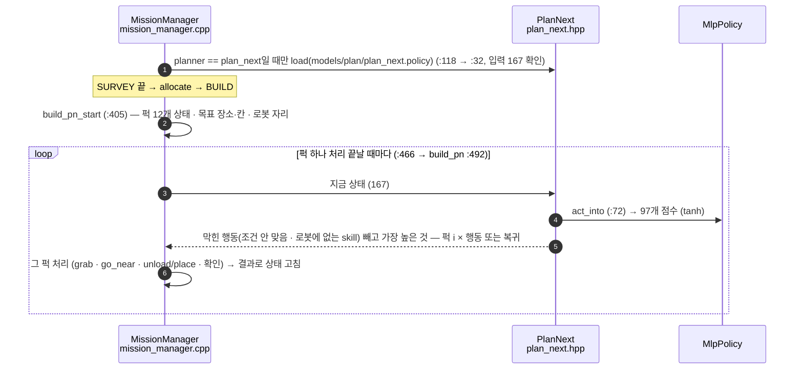

# 정책은 어떤 코드가 어떤 순서로 실행하나 (11-09 develop)

> develop `a6e5072` 코드 기준. 파일 경로는 `lv2_module6/ros2_ws/src/` 기준, `파일:줄`은 그 시점 줄 번호.
> 관련: [팔 정책은 어디서 도나 — 두 방식 비교](policy-path.html) · [지금 구조 — 노드 · 플러그인](system-now.html) · [문제 풀이 흐름](mission-solve.html)
> **11-09: 모든 정책을 ONNX로 실행하도록 바꾸는 PR #97** — 아래는 바꾸기 전(지금 develop) 구조. 바뀐 구조: **[ONNX 실행 구조](onnx-runtime.html)**

---

## 0. 한눈에 — 정책 하나가 쓰이려면 세 단계

| 단계 | 뜻 |
|---|---|
| **① 고르기** | 어떤 정책 파일을 쓸지 정함 (주인) |
| **② 불러오기** | 파일을 읽어 메모리에 올림 |
| **③ 실행** | 입력을 넣어 값(Δ · 속도 · 행동)을 뽑음 |

| 정책 | 파일 | ① 고르기 (주인) | ② 불러오기 | ③ 실행 | 계산기 |
|---|---|---|---|---|---|
| 팔 4개 — pick_standing_puck · place_cell · load_slot · unload_slot | `models/skills/<skill>/<skill>.policy` | 각 팔 skill 노드 | `rl_arm_correction` (컨트롤러 플러그인) | `rl_arm_correction` 100 Hz 루프 안, 50 Hz마다 | `MlpPolicy` (C++) |
| 도킹 4개 — dock_box · park_home · drive_straight · drive_arc | `models/skills/<skill>/<skill>.policy` | `skill_approach` | `skill_approach` | `skill_approach` 20 Hz | `MlpPolicy` |
| Nav2 주행 | `models/rl_nav_controller/policy.onnx` | `RlNavController` (Nav2 플러그인) | 〃 | 〃 (경로 따라갈 때) | `OnnxPolicy` (ONNX Runtime) |
| 순서 (plan_next) | `models/plan/plan_next.policy` | `mission_manager` | 〃 | 〃 (BUILD 퍽 하나 끝날 때) | `MlpPolicy` |

> skill 폴더의 `<skill>.onnx`는 **아무도 읽지 않는 보관용** — 그리고 가중치 파일(`.onnx.data`)이 레포에 없어 열리지도 않음 (11-09 확인).

---

## 1. 객체 관계 (팔 정책)

---

## 2. 팔 정책 — 시작할 때

(place_skill.cpp:20 → `place_cell` · load_skill.cpp:17 → `load_slot` · unload_skill.cpp:18 → `unload_slot` · stand_skill.cpp:59 → `regrasp_after_stand`(use: false))

---

## 3. 팔 정책 — 집기 한 번 (닿는 구간)

**3-1. 구간 시작: 정책을 알려 주고 불러 둠**

| 번호 | 코드 | 내용 |
|---|---|---|
| 1 | `coordinator` → 🎬 `/skills/pick` | 목표 퍽 id · 모양 · tag |
| 2 | `pick_skill.cpp` | `/score_grasps` 파지 후보 → MoveIt으로 퍽 위 5 cm (pregrasp — 정책 없음) |
| 3 | `pick_skill.cpp:87` → `ArmIO::contact_step` | 닿는 구간 시작 |
| 4 | `arm_io.cpp:317-329` | `/skill_context` = {run_id+1 · skill · **policy = .policy 절대 경로** · layout = pick · phase · holding · residual_live · q_above · q_down}. 정책을 안 쓰면 policy = "" (:322) |
| 5 | `rl_arm_correction.cpp:88` → `:156 policy_for` | 구독 콜백 (실시간 루프 밖) |
| 6~7 | `:165` → `mlp_policy.hpp:19 MlpPolicy::load` | 처음 받은 경로만 읽음 · 파일 안 `test` 값으로 검산 · 입력 41 · 출력 5 확인 → `cache_[경로]` |
| 8 | `ctx_box_.set(Ctx)` | 실시간 루프가 가져갈 상자에 넣음 |

**3-2. 100 Hz 제어 루프: 매 주기**

| 번호 | 코드 | 내용 |
|---|---|---|
| 1 | JTC → `rl_arm_correction/<joint>/position` | 궤적의 이번 주기 관절값 (IK + 보간, 시뮬과 같은 시간표: 내려가기 → 쥐기 → 들기) |
| 2 | `hand_relative` → `/hand_relative` | 퍽 − 손끝 x·y · 면 방향 · is_box (4 Hz 이하 — 다음 값 올 때까지 유지) |
| opt | `rl_arm_correction.cpp:242` | 조건: 0.02 s(50 Hz) 지남 · q_above·q_down 있음 · 손 카메라 값 유효하고 1 s 안 |
| 4 | `arm_obs.hpp` (Pick 41 / Place 39) | q−q_ref (5) · q_down−q_ref (5) · 0.1·qd (5) · q_ref−q_above (5) · 이전 행동 (5) · 단계 one-hot (6) · 진행 [s] (1) · 100·카메라 x·y (2) · [Pick만: 면 방향 · is_box (2)] · 10·처짐 적분 (5) |
| 5~6 | `:257` → `mlp_policy.hpp:66 act_into` | 행렬 곱 + ELU 4층 → a[5] → −1..1로 자름 → `residual_live`면 Δ = 0.05·a (상한 0.05 rad) |
| 7 | `command_interfaces` → `BeebotSystemHardware::write` → OpenCR | 명령 = q_ref + 처짐 적분 + Δ + 중력 앞먹임 |

끝나면 `PickSkill` → coordinator: {success, reason} (잡기 판정).

**정책이 Δ를 바꾸지 않는 경우:** `/skill_context`의 policy가 빈 문자열(meta `use: false` 또는 파일 없음) · 손 카메라 값이 없거나 1초보다 오래됨 · `residual_live: false`(손을 열거나 닫은 뒤 — 마지막 Δ 유지).

---

## 4. 도킹 정책 — skill_approach (한 노드가 다 함)

---

## 5. Nav2 주행 정책 — RlNavController (유일하게 ONNX)

---

## 6. 순서 정책 — plan_next (mission_manager)

---

## 7. ONNX 전환 → [ONNX 실행 구조](onnx-runtime.html)

PR #97: 고르는 곳·실행 위치는 이 페이지 그대로, **파일(`.onnx`)과 계산기(`OnnxPolicy`)만** 바뀜. 정책마다 `meta.yaml` `runtime: policy`로 위 구조(`MlpPolicy`)로 되돌릴 수 있음. 자세한 객체·순서도는 [ONNX 실행 구조](onnx-runtime.html).
