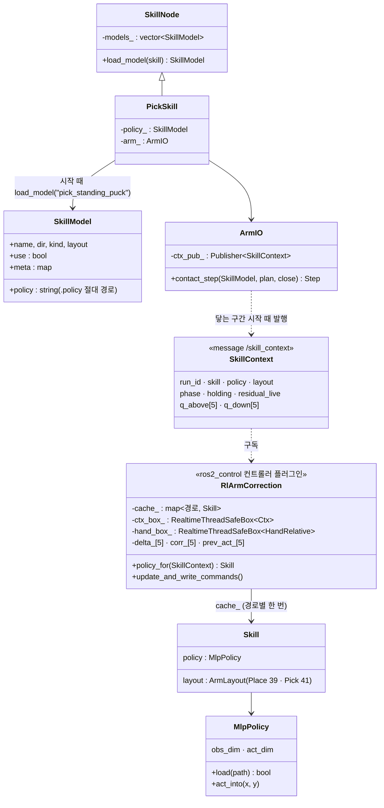
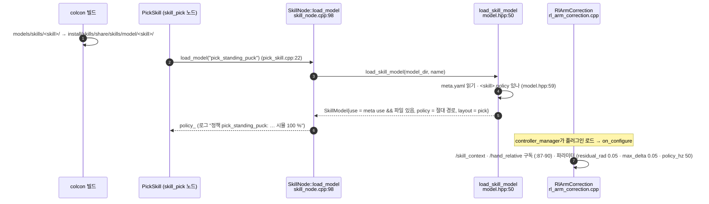
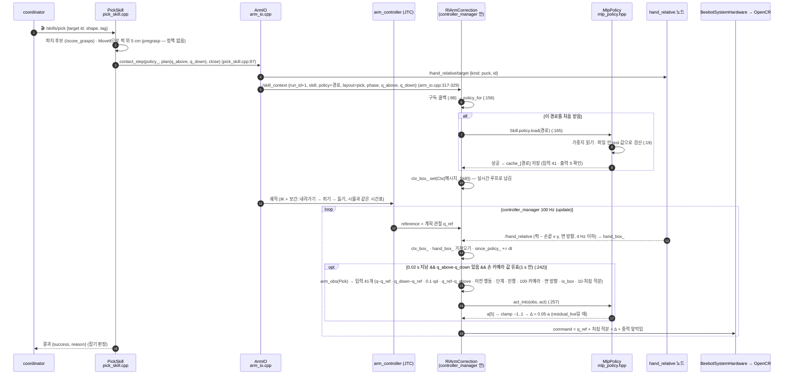
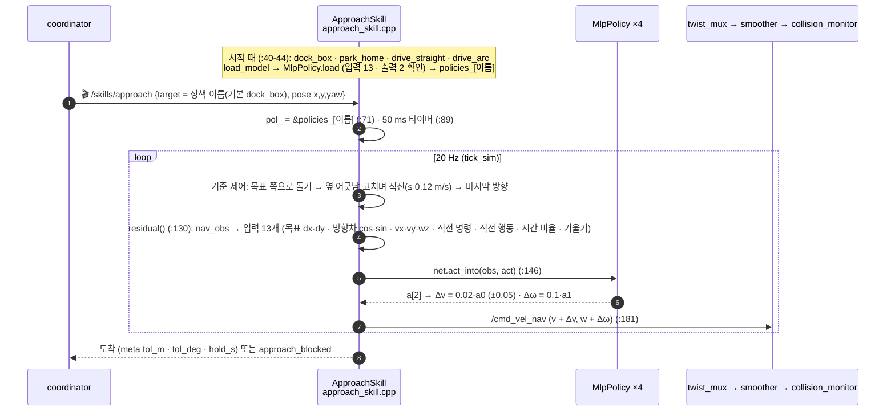
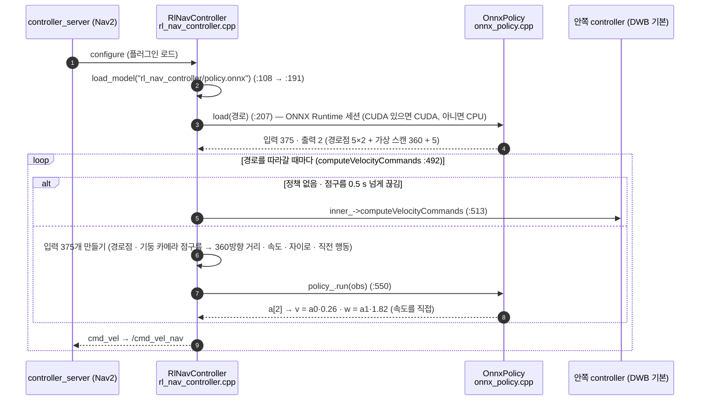
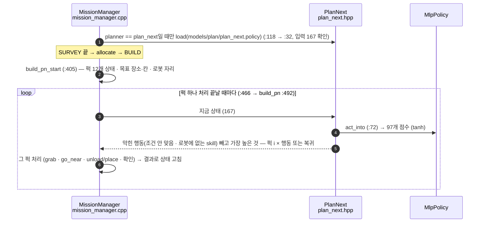

# 정책은 어떤 코드가 어떤 순서로 실행하나 (11-09 develop)

> develop `a6e5072` 코드 기준. 파일 경로는 `lv2_module6/ros2_ws/src/` 기준, `파일:줄`은 그 시점 줄 번호.
> 관련: [팔 정책은 어디서 도나 — 두 방식 비교](policy-path.html) · [지금 구조 — 노드 · 플러그인](system-now.html) · [문제 풀이 흐름](mission-solve.html)
> **⚠️ 11-09: 모든 정책을 ONNX로 실행하도록 바꾸는 작업 진행 중** — 아래는 바꾸기 전(지금 develop) 구조. 바뀌면 이 페이지를 고침.

---

## 0. 한눈에 — 정책 하나가 쓰이려면 세 단계

| 단계 | 뜻 |
|---|---|
| **① 고르기** | 어떤 정책 파일을 쓸지 정함 (주인) |
| **② 불러오기** | 파일을 읽어 메모리에 올림 |
| **③ 실행** | 입력을 넣어 값(Δ · 속도 · 행동)을 뽑음 |

| 정책 | 파일 | ① 고르기 (주인) | ② 불러오기 | ③ 실행 | 계산기 |
|---|---|---|---|---|---|
| 팔 4개 — pick_standing_puck · place_cell · load_slot · unload_slot | `models/skills/<skill>/<skill>.policy` | 각 팔 skill 노드 | `rl_arm_correction` (컨트롤러 플러그인) | `rl_arm_correction` 100 Hz 루프 안, 50 Hz마다 | `MlpPolicy` (C++) |
| 도킹 4개 — dock_box · park_home · drive_straight · drive_arc | `models/skills/<skill>/<skill>.policy` | `skill_approach` | `skill_approach` | `skill_approach` 20 Hz | `MlpPolicy` |
| Nav2 주행 | `models/rl_nav_controller/policy.onnx` | `RlNavController` (Nav2 플러그인) | 〃 | 〃 (경로 따라갈 때) | `OnnxPolicy` (ONNX Runtime) |
| 순서 (plan_next) | `models/plan/plan_next.policy` | `mission_manager` | 〃 | 〃 (BUILD 퍽 하나 끝날 때) | `MlpPolicy` |

> skill 폴더의 `<skill>.onnx`는 **아무도 읽지 않는 보관용** — 그리고 가중치 파일(`.onnx.data`)이 레포에 없어 열리지도 않음 (11-09 확인).

---

## 1. 객체 관계 (팔 정책)

---

## 2. 팔 정책 — 시작할 때

(place_skill.cpp:20 → `place_cell` · load_skill.cpp:17 → `load_slot` · unload_skill.cpp:18 → `unload_slot` · stand_skill.cpp:59 → `regrasp_after_stand`(use: false))

---

## 3. 팔 정책 — 집기 한 번 (닿는 구간)

**정책이 Δ를 바꾸지 않는 경우:** `/skill_context`의 policy가 빈 문자열(meta `use: false` 또는 파일 없음) · 손 카메라 값이 없거나 1초보다 오래됨 · `residual_live: false`(손을 열거나 닫은 뒤 — 마지막 Δ 유지).

---

## 4. 도킹 정책 — skill_approach (한 노드가 다 함)

---

## 5. Nav2 주행 정책 — RlNavController (유일하게 ONNX)

---

## 6. 순서 정책 — plan_next (mission_manager)

---

## 7. ONNX 전환 (11-09 진행 중)

| 바꾸는 곳 | 지금 | 바꾼 뒤 |
|---|---|---|
| 정책 파일 | `<skill>.policy` (텍스트) · `.onnx`는 가중치 없는 껍데기 | **가중치를 품은 단일 `<skill>.onnx`** — 지금 `.policy`의 가중치를 그대로 옮겨 만듦 (출력 같음 확인) |
| 계산기 | `MlpPolicy` (C++ 직접) | `OnnxPolicy` (ONNX Runtime) — 제어 루프용은 **CPU 고정 · 미리 잡은 버퍼** |
| 팔 · 도킹 · plan_next | 위 2~6절 경로 그대로 | 경로 그대로, 파일과 계산기만 바뀜 |
| 필요 설치 | 없음 | 로봇 · PC에 ONNX Runtime (`ros-lyrical-onnxruntime-vendor`) — 없으면 정책 꺼지고 기준 동작 |
