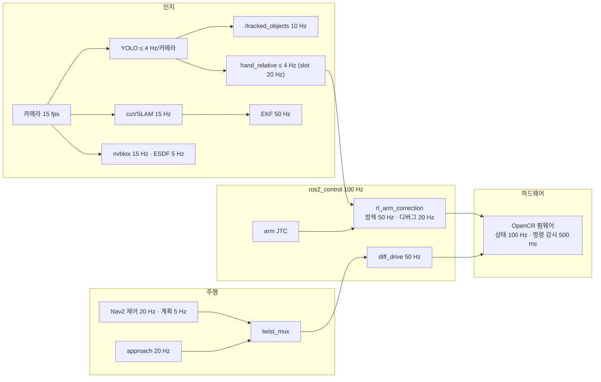

# 로봇 스펙 · 파라미터 한 장

> 2026-11-04 기준 · 값은 저장소 파일 그대로 (브랜치 `feature/skill-all`) · 각 줄 끝 `파일:줄`은 근거
> 🔧 = **실기에서 조정이 필요한 값** (코드 주석에 TODO · 실측 필요 · 추정 · 다시 맞출 값) — 맨 아래 [6장](#6-조정이-필요한-값-실기)에 따로 모음
> 관련: [실기 디버깅](debug-guide.html) · [skill별 학습 조건](skill-training.html) · [11-03 정리](wrapup-1103.html)

---

## 1. skill 성능표 (시뮬 1024판, 기준선 = 학습 없이 기준 동작만)

| 영역 | skill | 기준선 | 학습 뒤 | 되돌릴 수 없는 실패 | 로봇 | 비고 |
|---|---|---|---|---|---|---|
| 주행 | `dock_box` | 30.2 % | **98.6 %** | — | ✅ 정책 | 상자 앞 도킹 (1 cm · 1.5°) |
| 주행 | `drive_straight` | 61.4 % | **100 %** | — | ✅ 정책 (로봇에서 아직 안 부름) | 허용 1 cm |
| 주행 | `park_home` (동료) | 81.1 % | **96.5 %** | — | 넣는 중 | 출발 구역 5 cm · 10° · 3 s 정지 |
| 주행 | `drive_arc` (동료) | 91.8 % | **100 %** | — | 넣는 중 | 곡선 |
| 주행 | `drive_turn` | 100 % | — | — | 기준선 | |
| 팔 | `load_slot` | 94.8 % | **99.0 %** | 놓침 0.49 % | ✅ 정책 (재학습본) | 1차 98.3 % · 놓침 1.0 % |
| 팔 | `unload_slot` | 93.7 % | **98.1 %** | 놓침 0.1 % | ✅ 정책 | |
| 팔 | `place_cell` (팀원) | 96.3 % | **99.0 %** | | ✅ 정책 | |
| 팔 | `pick_standing_puck` (팀원) | 평가 필요 | | | ✅ 정책 | 예전 `pick_upright` |
| 팔 | `regrasp_after_stand` (동료, 세우기+다시 쥐기) | 74.6 % | **78.2 %** ⚠️ | 놓침 2.6 % → 1.6 % | 합격 기준 못 넘음 · 로봇 입력 모양 만드는 중 | 예전 `regrasp_stood` · 중심 오차 중앙값 21 mm |
| 팔 | `stand_lying_puck` (팀원) | 평가 필요 | | | 위와 같은 정책 | 예전 `stand_up` |
| 팔 | `pregrasp` | **99.5 %** | 99.6 % | — | 기준선 (MoveIt) | 손 못 가는 목표 1개 뺌 |
| 팔 | `move_pose` · `camera_clear_view` · `camera_look_down` | 100 % | — | — | 기준선 | |
| 플랜 | `plan_next` | 계산기 38.11점 | 37.55점 (가상 1000판) | | 파일 있음 · `planner: rule` 기본 | 마지막 단계 |

- 합격 기준: 성공 ≥ 97 % · 되돌릴 수 없는 실패(놓침·넘어뜨림) ≤ 0.5 % · 기준선보다 나음
- 자세한 조건·보상: [skill별 학습 조건](skill-training.html)

---

## 2. 하드웨어 기본

### 차체
| 항목 | 값 | 근거 |
|---|---|---|
| 플랫폼 | TurtleBot3 Waffle Pi 차동 구동 · **LiDAR 없음** (카메라 2대 + SLAM) | `00-overview.md:12` |
| 바퀴 반경 · 간격 | 0.033 m · 0.287 m | `controllers.yaml:42-43` |
| 최대 속도 | 0.26 m/s · 1.82 rad/s | `nav2_params.yaml:100,105` |
| 가속 | ±2.5 m/s² · ±3.2 rad/s² | `nav2_params.yaml:115-122` |
| Nav2 로봇 반경 | 0.18 m (원) | `nav2_params.yaml:248` |
| 외곽 (mission_manager) | 앞 0.069 · 뒤 −0.233 · 옆 반폭 0.153 m | `plan.yaml:83` |
| 무게 | 3404 g (base_link 2401 g) | `urdf/README.md:96-111` |

### 팔 (OpenMANIPULATOR-X + 손목 회전 joint5)
| 관절 | 범위 [rad] | |
|---|---|---|
| joint1 | −3.14 ~ 3.14 | |
| joint2 | −1.92 ~ 1.92 | stow −1.91 (하한 바로 옆) |
| joint3 | −1.57 ~ 1.40 | |
| joint4 | −1.70 ~ 1.97 | |
| joint5 | −3.14 ~ 3.14 | |
- 속도·가속 한계 (MoveIt) 3.0 rad/s · 5.0 rad/s², 계획 배율 0.3 🔧 (`joint_limits.yaml:2-13`, 추정)
- 닿는 거리 약 0.38 m · 들 수 있는 무게 약 0.5 kg (`00-overview.md:13`)
- 명령 지연 (시뮬 실측 모델) 관절별 45~62 ms · 그리퍼 20 ms (`bee_common.py:48-49`)

### 그리퍼 · 모터
| 항목 | 값 | 근거 |
|---|---|---|
| 그리퍼 | 손가락 하나 0 ~ 0.0265 m (0 = 닫힘) | `urdf.xacro:773-781` |
| 쥐는 힘 (전류) | 범위 2.69 ~ 1200 mA · 기본 600 mA 🔧 · 컨트롤러 max_effort 0.6 A | `config.h:37-39`, `controllers.yaml:88` |
| 모터 | Dynamixel XM430-W350-T × 8 (바퀴 1·2 · 팔 11~15 · 그리퍼 16), 1 Mbps | `config.h:6-18` |
| 모터 온도 | 70 °C 경고 (진단) · **80 °C 과열로 토크 꺼짐** · 0.5 s마다 읽음 | `beebot_system_hardware.cpp:22`, `config.h:46,59` |

### 센서 · 컴퓨터 · 전원
| 항목 | 값 | 근거 |
|---|---|---|
| 카메라 | RealSense 2대: `pole_front_cam` (기둥, 앞 18° 아래) · `gripper_cam` (손목) · **640×360 @ 15 fps** · depth 정렬 | `ros_system.launch.py:175-180` |
| IMU | OpenCR MPU9250 (자이로 ±2000°/s · 가속 ±2 g) | `config.h:66-68` |
| 컴퓨터 | Jetson Orin Nano Super · JetPack 7 (L4T R39.2.1) · CUDA 13 | `DOCTOR.md:39-48` |
| 배터리 | 11.1 V 3S LiPo · 11.0 V 아래 경고 | `beebot_system_hardware.cpp:19-20` |

---

## 3. 주기 · 지연

| 고리 | 주기 | 근거 |
|---|---|---|
| controller_manager | **100 Hz** | `controllers.yaml:9` |
| 펌웨어 상태 · 명령 감시 | 100 Hz (10 ms) · 500 ms 끊기면 정지 | `config.h:44-45` |
| 팔 보정 정책 | 50 Hz (학습과 같음) · 디버그 토픽 20 Hz | `rl_arm_correction.cpp:26`, `controllers.yaml:67` |
| diff_drive odom | 50 Hz | `controllers.yaml:52` |
| EKF | 50 Hz | `ekf.yaml:5` |
| Nav2 제어 · 계획 · BT | 20 Hz · 5 Hz · 10 ms | `nav2_params.yaml:23,47,191` |
| 비용 지도 (지역 · 전역) | 갱신 5 / 1 Hz · 발행 2 / 1 Hz | `nav2_params.yaml:239-240,288-289` |
| velocity_smoother | 20 Hz | `nav2_params.yaml:327` |
| approach (도킹) | 20 Hz | `coordinator.cpp:723` |
| YOLO 추론 | 0.25 s 타이머 (카메라마다 ≤ 4 Hz) · CPU 2스레드 | `perception_node.py:765`, `perception.yaml:10-13` |
| `/tracked_objects` | 10 Hz | `perception.yaml:4` |
| `hand_relative` | 검출 올 때마다 (≤ 4 Hz) · 적재함 20 Hz | `hand_relative.py:10` |
| cuVSLAM | 15 Hz (실측) | `CUVSLAM.md:186` |
| nvblox | 깊이 15 Hz · ESDF 5 Hz · 메시 2 Hz | `nvblox.yaml:20-24` |
| MoveIt 계획 | 최대 5 s · 3번 시도 · 속도 배율 0.3 | `coordinator.cpp:632-635` |

**알려진 지연**
| 지연 | 값 | 근거 |
|---|---|---|
| 팔 명령 → 움직임 | 45~62 ms (관절별) | `bee_common.py:48` |
| diff_drive 회전 속도 늦음 | 40~90 ms | `ekf.yaml:14-15` |
| cuVSLAM map→odom | 0.2 s 앞 시각으로 발행 (영상 처리 지연 덮음) | `cuvslam_slam.py:87-90` |
| 시뮬 주행 명령 지연 (학습 범위) | 20~60 ms | `drive_env.py:88` |
| 카메라 끝단 지연 | **기록 없음** 🔧 — 실기에서 디버그 기록으로 잴 것 | |

---

## 4. QoS (코드에 만든 그대로)

RL/TL = reliable + transient_local (늦게 붙어도 마지막 값) · 숫자만 = reliable · volatile · 깊이 · SDQ = SensorData (best_effort)

| 토픽 | 보내는 쪽 | 받는 쪽 |
|---|---|---|
| 카메라 영상·깊이·점구름 | SENSOR_DATA (best_effort, 5) | perception best_effort 5 · cuVSLAM SDQ |
| `/joint_states` | ros2_control 기본 | 10 |
| `/imu` | ros2_control 기본 | SDQ 1 |
| `/odom` | diff_drive 기본 | 10 |
| `/cmd_vel_nav` → `/cmd_vel_corrected` | 10 → reliable 1 | rl_nav_correction 10 → twist_mux |
| `/tracked_objects` | 5 | reliable 5 |
| `/perception/<cam>/detections` | 5 | 5 |
| `/skill_context` | reliable 10 | reliable 10 |
| `/hand_relative` | 10 | 10 |
| `/hand_relative/target` | RL/TL 1 | RL/TL 1 |
| `/task/sub_goals` · `/task/status` | RL/TL 10 | RL/TL 10 |
| `/mission/state` · `/mission/signal` · `/mission/qr` | RL/TL 1 | RL/TL 1 |
| `/coordinator/basket` | RL/TL 1 | RL/TL 1 |
| `/state/*` (모드 · 비상정지 · 지도) | RL/TL 1 | RL/TL 1 |
| `/arm_safety_event` | reliable 10 | reliable 10 |
| `/motor_status` | RL/TL 1 (0.5 s, 바뀔 때만) | RL/TL 1 |
| `/map` (nvblox) | RL/TL 1 | RL/TL 1 |
| `/rl_arm_correction/debug` | 시스템 기본 | (bag) |

**twist_mux 우선순위**: 자동 `/cmd_vel_corrected` 10 · 수동 100 · 비상정지 잠금 255 · 끊김 0.5 s (`twist_mux.yaml:9-21`)

---

## 5. 동작 파라미터 (지금 값)

| 묶음 | 파라미터 | 값 | 파일 |
|---|---|---|---|
| 팔 보정 | max_delta · residual_rad | 0.05 · 0.05 rad | `controllers.yaml` |
| 처짐 적분 (팀원) | sag_gain · sag_max · still_rate | 4.2 /s · 0.2 rad · 0.005 rad/s | `controllers.yaml` |
| 발열 방지 | rest_pose · rest_tol · windup_s | stow · 0.03 rad · 2 s | `controllers.yaml` |
| 손 카메라 | max_cam_age_s | 1.0 s | 코드 기본 |
| 잡기 판정 | grasp_min_pos_m · grasp_min_effort · grip_current_a | 3 mm · 0.25 A · 0.35 A | `plan.yaml` |
| 놓기 | held_bottom_m · place_release_m · place_spacing | 0.0606 · 0.02 · 0.08 m | `plan.yaml` |
| 다가가기 | reach_m · approach_m | 0.30 · 0.24 m | `plan.yaml` |
| 도킹 | standoff · approach_gap · 허용 | 0.25 · 0.085 m · 5 mm · 0.03 rad | `plan.yaml` |
| 태그 읽기 | inspect_height_m · inspect_wait_s | 0.15 m · 1.0 s | `plan.yaml` |
| 미션 | place_tol · tag_correction_max · retries | 10 mm · 0.05 m · 2 | `plan.yaml` |
| Nav2 도착 | xy · yaw | 0.10 m · 0.15 rad | `nav2_params.yaml:86-88` |
| Nav2 경로 | 계획기 | NavFn **A*** (PR #58) · tolerance 0.20 m | `nav2_params.yaml:193-197` |
| 장애물 | inflation · cost_scaling | 0.25 m · 8.0 | `nav2_params.yaml:275-276` |
| 충돌 감시 | 접근 원 · 감속 구역 | 0.20 m / 1 s · 0.30 m × 0.5 | `nav2_params.yaml:365-378` |
| 인지 | confidence · imgsz | 0.4 · 416 | `perception.yaml:10-11` |
| 신호등 | min_on/off · gap · 점멸 수 | 0.3 / 0.3 s · 2.5 s · 12 | `perception.yaml:59-66` |
| nvblox | voxel · 최대 거리 | 0.05 m · 3.0 m | `nvblox.yaml:11` |

---

## 6. 조정이 필요한 값 (실기)

코드 주석에 TODO · 실측 · 추정이라고 적힌 것만 모았습니다. **실기 첫날 순서대로** 잡는 것을 추천합니다.

| 순서 | 무엇 | 지금 값 | 왜 · 어떻게 | 파일 |
|---|---|---|---|---|
| 1 | 팔 관절 부호 · 0점 | 모두 +1 · 0.0 | 관절마다 부호 확인 (TODO 김현하) · 0점 실측 | `config.h:22-25`, `urdf.xacro:942-977` |
| 2 | 과전류 접촉 문턱 | 3.0 A (전체) | 퍽 든 정상 전류를 재고 관절별로 | `control.yaml:7` |
| 3 | 잡기 판정 | 3 mm · 0.25 A · 쥐는 힘 0.35 A | "실기에서 다시 맞출 값" — 원기둥 0.33~0.42 A 측정치 참고 | `plan.yaml:32-43` |
| 4 | 그리퍼 기본 전류 · 75 mm 끝점 | 600 mA · 외삽 | 실측 | `config.h:32-37` |
| 5 | 세우기 쥐는 힘 | 5.5 mA | mA ↔ N 실측 필요 (0.6 N부터 퍽이 안 돎) | `plan.yaml:49` |
| 6 | 처짐 적분 · 발열 방지 | 4.2 /s · 0.2 rad · 2 s · 0.03 rad | stow 주행 중 전류·온도·`corr` 기록 ([디버깅](debug-guide.html)) | `controllers.yaml:54-67` |
| 7 | 팔 속도·가속 한계 | 3.0 · 5.0 (추정) | XM430 실측 | `joint_limits.yaml` |
| 8 | 적재함 사용 칸 | 0~11 전부 | 팔이 잘 못 닿는 칸 확인 후 뺌 | `plan.yaml:37-38` |
| 9 | 바코드 보는 자리 | [0.950, 0.800, 3.31] | 실물 카메라 시야로 다시 | `plan.yaml:107-109` |
| 10 | Nav2 도착 판정 | stateful false | 실기에서 보고 결정 | `nav2_params.yaml:83-84` |
| 11 | EKF 공분산 | 기본 | 실기 튜닝 (TODO 권형중) | `ekf.yaml:29` |
| 12 | cuVSLAM 분산 | 0.0025 | 실측으로 | `cuvslam_slam.py:93-95` |
| 13 | 카메라 끝단 지연 | 기록 없음 | bag으로 영상 시각 ↔ 처리 시각 | |
| 14 | MoveIt 충돌 행렬 | 임시 | 실기 치수 확정 뒤 SRDF 다시 | `beebot.srdf:67` |
| 15 | `camera_look_down` 높이 | 0.15 m | 시뮬은 0.08 m에서 100 % — 태그 크기 보고 0.08~0.10 | `plan.yaml:75` |

**알아 둘 것**
- `urdf:=default`(launch 기본)와 `urdf/README.md`의 기본(`beebot_mesh`)이 다르게 적혀 있음 — 실기 bringup 전에 어느 모델인지 확인
- 로봇에 LiDAR가 없어 `/scan` 없음 — 장애물은 `pole_front_cam` 점구름(본체 제거 `body_filter`)과 nvblox

---

## 7. 파라미터 파일 위치 (`lv2_module6/`)

| 파일 | 무엇 |
|---|---|
| `firmware/beebot_opencr/config.h` | 모터 ID · 통신 · 그리퍼 표·전류 · 펌웨어 주기 · IMU |
| `urdf/beebot_mesh/urdf.xacro` | 관절 한계 · 카메라·IMU 위치 · 0점 |
| `ros2_ws/src/ros_system/config/controllers.yaml` | 제어 주기 · diff_drive · JTC · 그리퍼 · rl_arm_correction |
| `ros2_ws/src/ros_system/config/nav2_params.yaml` | Nav2 전부 · 비용 지도 · 충돌 감시 |
| `ros2_ws/src/ros_system/config/{ekf,twist_mux,nvblox,scan_pose}.yaml` | 위치 융합 · 속도 우선순위 · 지도 · 스캔 자세 |
| `ros2_ws/src/ros_system/config/moveit/` | 관절 한계 · IK · OMPL · SRDF |
| `ros2_ws/src/plan/config/plan.yaml` | coordinator · mission_manager · explorer · VLM |
| `ros2_ws/src/perception/config/perception.yaml` | YOLO · 추적 · hand_relative · 신호등 · body_filter |
| `ros2_ws/src/control/config/control.yaml` | 접촉 감시 · 수동 조작 |
| `ros2_ws/src/ml/config/ml.yaml` | grasp_scorer · rl_nav_tuner · rl_nav_correction |
| `ros2_ws/model/` | 학습 정책 파일 (`.policy`) · YOLO |
| `isaac/lab/bee_common.py` | 시뮬 지연 · 팀 관절 한계 |
