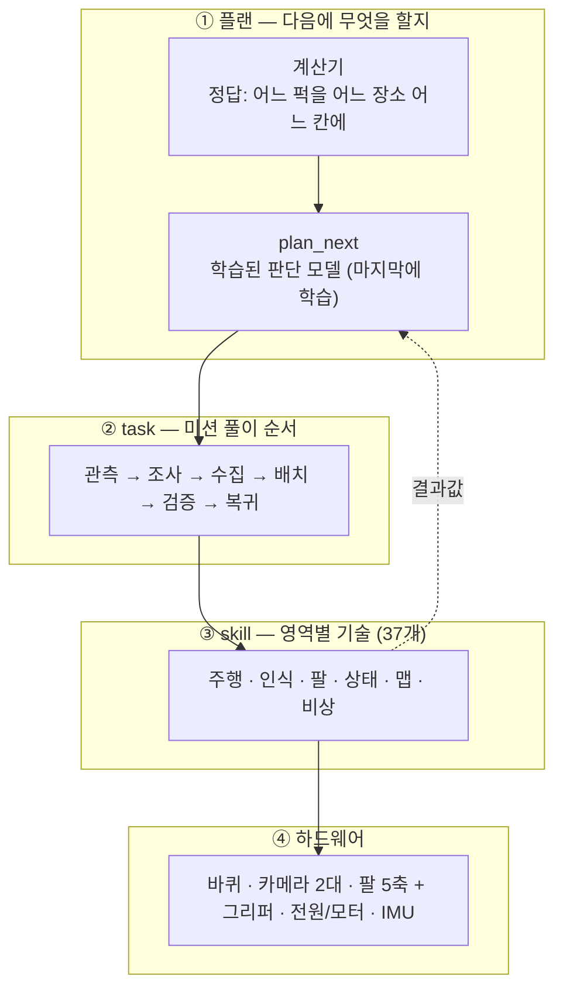
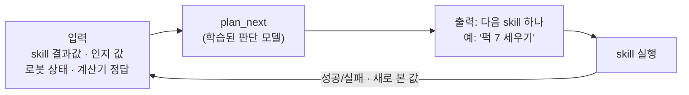
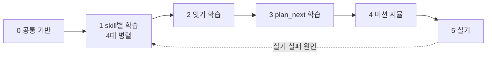

# beebot 학습용 skill 구성과 학습 플랜

> 주사위 기억 미션 · 2026-11-03 정리. 아직 결정 중인 문서입니다. **확인 필요** 표시가 붙은 것은 정해지지 않았습니다.
> 표 아래의 ▶ 줄을 누르면 skill마다 자세한 내용(하는 일 · 시작 조건 · 성공 판정 · 보상 함수 · 이유)이 펼쳐집니다.

---

## 1. 한눈에 보기

**목표**: 미션을 풀기 위해 로봇 능력을 **학습할 수 있는 작은 skill**로 나누고, skill마다 학습시킵니다. 개수를 채우는 것이 목표가 아닙니다. 우리 하드웨어와 실제 문제 풀이에 맞게 나눕니다.

**요리에 비유하면**

| | 요리 | 로봇 |
|---|---|---|
| 기술 (skill, 영역별) | 칼질 · 불 조절 · 간 맞추기 — 어떤 요리든 쓰는 기본기, 따로 연습 | 주행 · 인식 · 팔 · 상태 · 맵 · 비상 — skill마다 따로 학습 |
| 요리 순서 (task) | 손질 → 볶기 → 끓이기 → 담기 — 단계마다 기술을 섞어 씀 | 관측 → 조사 → 수집 → 배치 → 검증 → 복귀 |
| 요리사의 머리 (플랜) | "짜네, 물 붓자" — 상황 보고 다음 할 일을 정함 | `plan_next` — skill 결과를 보고 다음 skill을 고름 |
| 레시피 (계산기) | 무엇을 얼마나 넣을지 정해져 있음 | 신호·바코드·퍽 정보 → 어느 퍽을 어디에 놓을지 정답 |

기술만 있고 요리 순서가 없으면 찌개를 못 끓이고, 순서만 있고 기술이 따로 없으면 요리마다 칼질을 새로 배워야 합니다. 그래서 **skill은 영역별로 만들고, 미션은 task 순서로 풉니다.**

---

## 2. 정해진 것과 확인할 것

| 구분 | 내용 |
|---|---|
| ✅ 정해짐 | <ul><li>필요한 능력을 학습할 수 있는 작은 skill로 나누고 **skill마다 학습**</li><li>개수가 목표가 아님 · 기존 학습 상태에 묶이지 않음</li><li>영역: 주행 · 인식 · 팔 · 상태 · 맵 · 비상 (레퍼런스 로봇과 같음)</li><li>학습: 강화학습(Isaac Lab) 중심 · Isaac Lab이 도는 컴퓨터 4대</li><li>실기는 학습이 끝난 뒤 시험</li><li>구조는 맞게 리팩터링해도 됨</li><li>플랜 = 다음 skill을 고르는 **학습된 skill** (`plan_next`), 입력은 skill 결과값과 로봇 값, 학습은 **마지막**</li><li>LLM이 플랜을 만드는 방식은 아님</li><li>판단만 하는 skill(인식·상태·비상)은 **새로 학습하지 않음** — 인식은 팀 YOLO(이미 학습됨)·규칙, 상태·비상은 문턱값 규칙. 실기에서 틀리면 그때 데이터를 모아 학습</li><li>새로 학습할 것 = 움직이는 skill 18개(강화학습) + 실측 2개</li><li>**배포 (11-03)**: 빈 공간 이동은 MoveIt·Nav2, 퍽에 닿는 짧은 구간과 상자 앞 도킹은 **시뮬과 같은 기준 동작 + 학습 보정** → [skill별 학습 조건 9장](skill-training.html)</li></ul> |
| ❓ 확인 필요 | <ul><li>맵(SLAM)도 학습할지 — 제안: 지금 방식 유지</li><li>모터 모델용 짧은 실측(관절 응답, 그리퍼 힘)을 학습 전에 해도 되는지</li><li>4대 컴퓨터의 GPU 사양</li><li>Isaac Lab 버전 (지금 3.0.0-EA로 보임 → 3.0.0 정식판?)</li></ul> |

---

## 3. task — 미션 풀이 순서

task는 미션 규칙의 수행 순서와 채점 항목에서 나눴습니다. **실패했을 때 대응이 달라지는 곳**에서 끊었습니다.

| task | 하는 일 | 쓰는 skill | 실패하면 | 관련 점수 |
|---|---|---|---|---|
| **관측** | 신호 12회와 바코드 읽기 | `camera_clear_view` · `read_signal_barcode` | 안전 정지 (규칙: 추정 금지) | 25 |
| **조사** | 시작 박스 6곳의 퍽 12개 색·모양·자세 파악 → 계산기가 할당 | `navigate` · `dock_box` · `camera_look_down` · 인식 skill | 그 박스·퍽만 기록하고 계속 | 27 (할당) |
| **수집** | 퍽을 집어 적재함에 (누웠으면 세워서) | `pregrasp` · `pick_standing_puck` · `stand_lying_puck` · `regrasp_after_stand` · `load_slot` | 그 퍽만 기록하고 계속 | — |
| **배치** | 장소로 가서 꺼내 주사위 칸에 놓고 확인, 틀어졌으면 고침 | `navigate` · `dock_box` · `detect_location_box` · `unload_slot` · `place_cell` · `judge_cell` · `nudge_cell` · `stand_puck_in_cell` | 그 퍽만 기록하고 다음 | **30** |
| **검증** | 장소마다 새로 보고 칸 판정 | `navigate` · `dock_box` · `camera_look_down` · `judge_cell` | 기록만 | 8 |
| **복귀** | 출발 구역 안에 3초 정지 | `move_pose` · `navigate` · `park_home` | 정지 | 10 |

▶ 왜 이렇게 나눴나

| task | 근거 |
|---|---|
| 관측 | 실패 대응이 유일하게 다릅니다. 신호가 불확실하면 "추정 금지 → 오류 기록 후 안전 정지"가 규칙입니다. |
| 조사 | 결과가 동작이 아니라 **정보**입니다. Y 그룹은 모양이 하나여야 해서 12개를 다 본 뒤에 할당해야 합니다(규칙 4절). |
| 수집 | 조사와 같은 박스 앞에서 번갈아 하지만 결과(적재함 상태)와 실패(보기는 됐는데 못 집음)가 다릅니다. |
| 배치 | 장소 하나의 주사위 눈이 전부 맞아야 10점이고, 빈 칸에 퍽이 더 있으면 그 장소가 실패라서 **고치기**가 이 안에 있어야 합니다. |
| 검증 | 규칙이 **새 관측**을 요구합니다(목표 상태를 복사한 기록은 인정 안 함). 배치 중 확인과 섞으면 안 됩니다. |
| 복귀 | 따로 10점이고, 앞에서 실패해도 그때까지 점수는 유효해서 어떤 상태에서도 들어갈 수 있어야 합니다. |

시간 제한이 없고 2회 중 높은 회차만 칩니다. 그래서 속도보다 **실패를 알아채고 다시 하는 것**이 점수를 정합니다. 퍽 12개 × 5단계 ≈ 접촉 동작 60번 → skill마다 99%여도 다시 하기 없이는 0.99⁶⁰ ≈ 55%, 실패를 알아채고 한 번 다시 하면 97%로도 약 95%.

---

## 4. skill — 영역별 전체 표

**학습 방식**
- **RL**: 강화학습. 기존 방식(기준선) 위에 학습한 보정을 더합니다. 학습이 잘 안 돼도 기존 방식만큼은 동작합니다.
- **YOLO (학습됨)**: 팀 YOLO 모델(`bee_yolo11n_v3`)에 이미 들어 있음. 틀리는 게 보이면 데이터를 더 모아 다시 학습합니다.
- **규칙**: AprilTag·바코드 디코드, 거리 계산, 문턱값처럼 규칙으로 정확히 풀리는 것. 실기에서 틀리면 그때 학습합니다.
- **측정 모델**: 실기 측정 데이터로 관계를 학습합니다.
- **학습 없음**: 기록이나 버튼.

학습한 모델은 시뮬에서 **기준선보다 좋을 때만** 실제로 씁니다.

**공통 벌점** (모든 RL skill에 똑같이): 퍽 넘어뜨림·떨어뜨림(큰 벌점) · 충돌 · 차체 기울기(비상 정지와 같은 기준) · 관절 한계 · 모터 과전류 · 보정값이 너무 큼.

### 4-1. 주행

우리 로봇은 **차동 구동**(바퀴 2개, 바퀴 반경 0.033m, 간격 0.287m, 최대 0.26m/s)이라 **횡이동(옆으로 가기)은 하드웨어상 불가능**합니다. 옆으로 옮겨야 하면 `drive_turn` → `drive_straight` → `drive_turn`(돌고 → 가고 → 돌기)으로 합니다.

| 이름 | 하는 일 | 학습 | 기준선 |
|---|---|---|---|
| `drive_straight` | 정해진 거리만큼 곧게 | RL | diff_drive 제어기 |
| `drive_turn` | 제자리에서 정해진 각도 | RL | diff_drive 제어기 |
| `drive_arc` | 가면서 돌기 (곡선) | RL | diff_drive 제어기 |
| `navigate` | 지도 위 먼 곳까지 장애물 피해 | RL (Nav2 경로 위 보정) | Nav2 |
| `dock_box` | 상자 앞에 팔이 닿게 붙기 | RL | 스크립트 |
| `park_home` | 출발 구역 안에 차체 전체 | RL | 스크립트 |

▶ drive_straight — 곧게 가기

- **하는 일**: "30cm 앞으로"처럼 정해진 거리를 곧게 갑니다. 뒤로도 갑니다.
- **시작 조건**: 앞(또는 뒤) 경로가 비어 있음 · 팔이 접힘
- **성공 판정**: 목표 거리 오차 기준 안 · 방향 틀어짐 기준 안 · 멈춤
- **보상 함수**: + 목표 거리에 가까워짐 − 옆으로 벗어남 − 방향 틀어짐 + 도착 보너스 − 넘어서 감 + 공통 벌점
- **왜 학습하나**: 바퀴 미끄러짐·좌우 바퀴 차이를 보정합니다. 기준선은 지금 diff_drive 제어기입니다.

▶ drive_turn — 제자리 회전

- **하는 일**: "왼쪽 90도"처럼 그 자리에서 돕니다.
- **시작 조건**: 회전 반경 안에 장애물 없음
- **성공 판정**: 목표 각도 오차 기준 안 · 제자리에서 밀린 거리 기준 안
- **보상 함수**: + 목표 각도에 가까워짐 − 제자리에서 밀림 + 도착 보너스 − 넘어서 돎 + 공통 벌점

▶ drive_arc — 가면서 돌기

- **하는 일**: 앞으로 가면서 동시에 돌아 부드럽게 휘어 갑니다.
- **성공 판정**: 목표 위치·방향 도착
- **보상 함수**: + 목표 자세에 가까워짐 − 경로 이탈 − 급가속 + 공통 벌점

▶ navigate — 지도 위 이동

- **하는 일**: "시작 박스 5 앞"처럼 먼 곳까지 장애물을 피해 갑니다. Nav2가 경로를 만들고, 학습 모델이 따라가는 주행을 보정합니다.
- **시작 조건**: 팔 접힘(stow) · 위치 추정 정상
- **성공 판정**: 목표 영역(상자 앞 0.25m 안) 도착
- **보상 함수**: + 목표 영역 도착 + 경로 따라감 − 장애물에 가까움 − 멈춤·헤맴 + 공통 벌점
- **주의**: 연구 결과 주행 전체를 학습으로 바꾸면 실물에서 크게 떨어진 사례가 있습니다(시뮬 77% → 실물 23%, 모듈식은 실물 90%). 그래서 Nav2를 바닥에 두고 보정만 학습합니다.

▶ dock_box — 상자 앞 붙기

- **하는 일**: 상자 앞 0.25m에서 팔이 닿는 자리(지금 기준 0.085m)까지 정면으로 붙습니다. Nav2는 로봇을 원 0.18m로 봐서 이만큼 붙지 못합니다.
- **시작 조건**: 상자 0.25m 앞 · 상자가 카메라에 보임
- **성공 판정**: 상자 기준 거리·옆 오차·각도가 **팔이 닿는 영역** 안 (한 점이 아니라 영역)
- **보상 함수**: + 팔이 닿는 영역 안 도착 + **다음 집기가 성공하면 보너스** − 상자에 부딪힘 + 공통 벌점
- **왜 영역인가**: 점 목표로 이으면 "팔이 안 닿는 자리에 서는" 실패가 쌓였다는 연구가 있습니다(M3). 다음 skill이 성공하는 자리가 진짜 목표입니다.

▶ park_home — 출발 구역 주차

- **하는 일**: 출발 구역 안에 차체 전체가 들어가게 서서 3초 멈춥니다(복귀 10점).
- **성공 판정**: 차체 외곽 전부 구역 안 · 3초 정지
- **보상 함수**: + 차체 전체가 구역 안 + 3초 정지 유지 − 구역 선 밟음 + 공통 벌점

### 4-2. 인식

| 이름 | 하는 일 | 학습 | 기준선 |
|---|---|---|---|
| `detect_puck` | 퍽 위치 찾기 | YOLO (학습됨) | `bee_yolo11n_v3` |
| `classify_color` | 퍽 색 (빨강·초록) | YOLO (학습됨) | 색별 클래스 + HSV 확인 |
| `read_puck_tag` | 퍽 ID 태그 (16mm) | 규칙 | AprilTag 디코드 |
| `classify_shape_pose` | 모양(사각·원기둥) · 자세(섬·누움) · 방향 | YOLO (학습됨) + 규칙 | 모양 YOLO · 자세 깊이 높이÷폭 |
| `detect_location_box` | 장소 상자 윗면 가운데 (태그 12~14) | 규칙 | AprilTag 디코드 |
| `read_signal_barcode` | 신호 12회 · 바코드 | 규칙 | `signal_decoder` (신호등 상태는 YOLO) |
| `judge_cell` | 칸 안 퍽 오차 (10mm, 2초) | 규칙 | 칸 중심 거리 계산 |

▶ 인식 skill 평가 지표와 주의점

| 이름 | 평가 지표 (나빠지면 다시 학습·규칙 수정) |
|---|---|
| `detect_puck` | 위치 오차 + 놓친 것 + 잘못 찾은 것 |
| `classify_color` | 색 오답 |
| `read_puck_tag` | ID 오답 |
| `classify_shape_pose` | 모양·자세 오답 + 방향 각도 오차 (긴 축이라 180° 대칭) |
| `detect_location_box` | 윗면 위치·방향 오차 |
| `read_signal_barcode` | 색 오답 · 놓친 점멸. **불확실하면 "모름"이 정답** (규칙: 추정 금지) |
| `judge_cell` | 추정 오차 − 실제 오차 |

- **왜 새로 학습하지 않나**: 판단만 하는 skill은 행동이 다음 상황을 바꾸지 않아서 강화학습이 맞지 않습니다. 그리고 이미 팀 YOLO 하나(10클래스: 빨강·초록 × 사각·원기둥 퍽 4 · 신호등 4 · 사람 · 장애물)에 학습돼 있고, 나머지는 규칙으로 정확히 풀립니다.
- **다시 학습할 때**: 실기에서 위 지표가 나빠지면, Isaac에서 만든 사진(팀 `gen_yolo_dataset.py`)과 실물 사진을 더해 YOLO를 다시 학습합니다. 예: 퍽 자세는 YOLO가 실물에서 틀려서 지금은 깊이 규칙을 씁니다.

### 4-3. 팔 (카메라 조작 · 집기 · 놓기 · 적재함)

| 이름 | 하는 일 | 학습 | 기준선 |
|---|---|---|---|
| `compensate_sag` | 팔 처짐 보정 | 측정 모델 | 고정값 |
| `grip_force` | 쥐는 힘 (0.4N 가볍게 / 22~29N 꽉) | 측정 모델 | 고정 전류 |
| `move_pose` | 정해진 자세 (stow·carry) | RL | MoveIt |
| `pregrasp` | 퍽 위 집기 전 자세 | RL | MoveIt |
| `camera_clear_view` | 기둥 카메라 시야에서 팔 치우기 | RL | MoveIt |
| `camera_look_down` | 손 카메라로 내려다보기 | RL | MoveIt |
| `pick_standing_puck` | 선 퍽 집기 | RL | 스크립트 + IK |
| `stand_lying_puck` | 누운 퍽 세우기 | RL | 스크립트 + IK |
| `regrasp_after_stand` | 세운 퍽 다시 집기 | RL | 스크립트 |
| `load_slot` | 적재함 칸에 넣기 | RL | 표 |
| `unload_slot` | 적재함 칸에서 꺼내기 | RL | 표 |
| `place_cell` | 주사위 칸에 놓기 | RL | 스크립트 + IK |
| `nudge_cell` | 칸 안에서 밀어 맞추기 (고치기) | RL | 스크립트 |
| `stand_puck_in_cell` | 장소에서 넘어진 퍽 세우기 (고치기) | RL | `stand_lying_puck` |

▶ compensate_sag · grip_force — 측정해서 배우는 것

- **compensate_sag**: 팔을 뻗으면 무게로 처집니다. 자세별 처짐을 실기에서 재서 "자세 → 처짐" 모델을 만듭니다. 손실 = 예측 처짐 − 실제 처짐. 모든 팔 skill이 씁니다.
- **grip_force**: 그리퍼는 전류로 힘을 조절합니다(최소 2.69mA까지 보낼 수 있음). 세우기는 0.4N, 집기는 22~29N이 필요합니다. 실기에서 전류 ↔ 힘을 재서 모델을 만듭니다. 손실 = 예측 힘 − 실제 힘.
- 이 둘은 시뮬 → 실기 차이를 줄이는 핵심이라 **가장 먼저** 합니다 (실측 시점 **확인 필요**).

▶ move_pose · pregrasp · camera_clear_view · camera_look_down — 자세 잡기

| 이름 | 하는 일 | 성공 판정 | 보상 함수 |
|---|---|---|---|
| `move_pose` | stow(주행용 접기) · carry(퍽 들고 적재함 옆) | 목표 관절값 오차 기준 안 | + 목표 관절값에 가까워짐 + 도착 − 흔들림 + 공통 벌점 |
| `pregrasp` | 퍽 바로 위 정해진 높이 | 손끝 위치·방향 기준 안 | + 손끝이 목표점에 가까워짐 + 손 방향 맞음 − 퍽 건드림 + 공통 벌점 |
| `camera_clear_view` | 신호·바코드 볼 때 팔이 기둥 카메라를 가리지 않게 (scan 자세) | 팔이 시야 밖 | + 팔이 시야 밖 + 도착 + 공통 벌점 |
| `camera_look_down` | 손 카메라를 퍽·칸 위 0.15m로 (16mm 태그를 읽게) | 볼 점이 화면 가운데 · 정해진 높이 | + 볼 점이 화면 가운데 + 높이 맞음 + **태그를 읽으면 보너스** + 공통 벌점 |

- 카메라 조작을 팔 영역에 둔 이유: 손 카메라를 움직이는 것은 결국 팔 동작이라 팔과 같은 자원을 씁니다(레퍼런스 로봇도 같은 구분).

▶ pick_standing_puck — 선 퍽 집기

- **하는 일**: 퍽 위에서 내려가 쥐고 들어 올립니다. 사각 퍽은 손 방향을 퍽 방향에 맞춥니다.
- **시작 조건**: 손이 퍽 위(`pregrasp` 끝) · 퍽이 서 있음 · 손이 비어 있음
- **성공 판정**: 들어 올림 · 손가락이 끝까지 안 닫힘(3mm 이상) · 전류 0.25A 이상
- **보상 함수**: + 들어 올림 + 잡기 판정 통과 − 옆 퍽 건드림 − 손에서 미끄러짐 + **끝 자세가 `load_slot` 시작 범위 안** + 공통 벌점
- **실패하면**: 벌리고 `pregrasp`부터 다시 · 퍽이 넘어지면 `stand_lying_puck`
- **학습 장면**: 시작 박스 위 퍽 2개(가운데 ±40mm) · 퍽 방향·모양 무작위
- **참고**: 팀 시연에서 사각 퍽을 집다가 손이 2~3mm 더 나가 퍽을 넘어뜨린 일이 가장 많았습니다.

▶ stand_lying_puck · regrasp_after_stand — 누운 퍽 세워서 집기

- **stand_lying_puck**: 누운 퍽의 먼 끝을 **가볍게(0.4N)** 쥐고, 가까운 아래 모서리를 축으로 돌려 세운 뒤 손을 벌리고 빠집니다.
  - 시작 조건: 퍽이 누워 있음 · 손이 퍽 먼 끝 위
  - 성공 판정: 퍽이 서 있음(인식으로 확인) · 손이 빠짐
  - 보상 함수: + 퍽이 서 있음(기울기 작음) + 손 벌리고 빠짐 − 퍽이 상자 밖으로 − 0.4N보다 세게 쥠 + 공통 벌점
- **regrasp_after_stand**: 세운 직후 같은 손목 자세로 바로 내려가 꽉 쥐고 들어 올립니다.
  - 시작 조건: `stand_lying_puck` 성공 직후
  - 보상 함수: + 들어 올림 + 잡기 판정 − 퍽을 다시 넘어뜨림 + 공통 벌점
- **왜 둘로 나눴나**: 쥐는 힘이 다르고(0.4N vs 22~29N), 세운 뒤 손을 놓으니 **섰는지 확인**할 수 있으며, 집기만 실패했을 때 이미 선 퍽을 다시 세우지 않아도 됩니다.

▶ load_slot · unload_slot — 적재함(스토리지)

- 적재함은 로봇 위 12칸(3×4)입니다. 칸마다 들고 가는 방향(carry 왼쪽/오른쪽)이 정해져 있습니다.
- **load_slot**: 퍽 든 손을 칸 위로 → 내려 넣고 → 손 벌리고 빠짐
  - 시작 조건: 손에 퍽 · 칸이 비어 있음(적재함 장부)
  - 보상 함수: + 퍽이 칸 바닥까지 들어감 + 손 빠짐 − 링 모서리에 걸림 − 옆 칸 퍽 건드림 + 공통 벌점
- **unload_slot**: 빈손을 칸 위로 → 내려가 쥠 → 들어 올림
  - 시작 조건: 손 비어 있음 · 칸에 퍽이 있음
  - 보상 함수: + 들어 올림 + 잡기 판정 − 링에 걸림 + **끝 자세가 `place_cell` 시작 범위 안** + 공통 벌점
- **참고**: 시연에서 퍽이 링 모따기에 걸려 덜 들어간 일이 있었습니다.

▶ place_cell — 주사위 칸에 놓기 (가장 큰 점수)

- **하는 일**: 퍽 든 손을 칸 위로 → 내려 놓고 → 손 벌리고 위로. 칸은 장소 가운데 기준 ±60mm 격자입니다.
- **시작 조건**: 손에 퍽 · 손이 칸 위 · 칸 보정(장소 상자 인식) 끝남
- **성공 판정**: **칸 중심 10mm 안** · 기울기 5° 이하 · **2초 안정** · 이웃 퍽 그대로 (규칙 판정과 같음)
- **보상 함수**: + 10mm 안(가까울수록 더) + 기울기 작음 + 2초 안정 − 이웃 퍽 건드림·밀어냄 + 공통 벌점
- **학습 장면**: 장소 상자 · 이웃 퍽 0~5개 · 주사위 눈 1~6 배치 · 칸 보정 오차 무작위
- **참고**: 팀 학습 결과 보정 없이 96.3% → 학습 보정 99.0%(오차 p90 8.4 → 4.1mm). 이웃 칸이 먼저 놓이면 가운데 칸 성공률이 81~83%로 떨어진 시험이 있어 이웃 퍽을 꼭 넣습니다.

▶ nudge_cell · stand_puck_in_cell — 고치기

- 장소 하나의 주사위 눈이 전부 맞아야 10점입니다. 퍽 하나가 틀어지면 장소 전체가 날아가서 **고치는 기술**이 필요합니다.
- **nudge_cell**: 놓은 퍽이 10~25mm 벗어났을 때 집지 않고 밀어서 맞춤
  - 보상 함수: + 오차가 줄어듦 + 10mm 안 + 서 있음 − 넘어뜨림 − 이웃 건드림 + 공통 벌점
  - 근거가 약합니다 — 다시 집어 놓기보다 나은지 시뮬에서 비교 후 결정.
- **stand_puck_in_cell**: 칸 안 퍽이 누웠을 때 그 자리에서 세움. `stand_lying_puck`을 이웃 퍽이 있는 장면으로 이어 학습.
  - 보상 함수: `stand_lying_puck`과 같음 − 이웃 퍽 건드림(큰 벌점)

### 4-4. 상태 · 비상

움직이는 skill이 아니라 **다른 skill을 시작 못 하게 하거나 멈추게 하는** 감시 skill입니다.

| 이름 | 하는 일 | 학습 | 기준선 |
|---|---|---|---|
| `monitor_battery` | 남은 배터리로 할 수 있는 일 예측 → 부족하면 복귀 | 규칙 | 전압 문턱값 |
| `monitor_current` | 전류로 걸림·접촉 감지 | 규칙 | 전류 문턱값 |
| `monitor_motor` | 모터 과열·고장 예측 | 규칙 | 온도 문턱값 |
| `detect_tip_impact` | IMU로 넘어짐·충돌 예측 → 즉시 정지 | 규칙 | 기울기 문턱값 |
| `basket_ledger` | 적재함 칸 → 퍽 기록 | 학습 없음 | — |
| `estop` | 비상정지 버튼 · 수동 전환 | 학습 없음 | — |

▶ 상태·비상 상세

| 이름 | 평가 지표 | 쓰는 곳 |
|---|---|---|
| `monitor_battery` | 놓친 저전압 · 잘못 울림 | 부족하면 새 task를 시작하지 않고 복귀 (복귀 10점 지키기) |
| `monitor_current` | 걸림 판정 오답 | 잡기 판정, 계속 높으면 그 skill 중단 |
| `monitor_motor` | 놓친 과열 · 잘못 울림 | 이상이면 팔 skill 시작 금지 |
| `detect_tip_impact` | 놓친 넘어짐 (가장 중요) · 잘못 울림 | 즉시 정지 |

- **비상 기준을 학습 보상에도 씀**: 팀 시험에서 팔을 먼 줄로 뻗으면 차체가 넘어졌습니다. 그래서 RL 공통 벌점의 차체 기울기와 `detect_tip_impact`가 같은 기준을 씁니다. 학습한 정책이 실기에서 비상 정지에 걸리지 않게.
- 지금은 문턱값 규칙으로 씁니다. 실기에서 놓치거나 잘못 울리는 일이 생기면, 그 기록(실제로 넘어졌나, 고장 났나)으로 학습합니다.

### 4-5. 맵

| 이름 | 하는 일 | 학습 | 지금 방식 |
|---|---|---|---|
| `slam_localize` | 내 위치 추정 | **확인 필요** (제안: 유지) | cuVSLAM + EKF |
| `build_map` | 지도 만들기 | **확인 필요** (제안: 유지) | nvblox |
| `align_arena` | 경기장 좌표 맞추기 | **확인 필요** (제안: 유지) | 시작 자세 + 상자 태그 |

▶ 왜 맵은 지금 방식 유지를 제안하나

- 학습형 SLAM도 있지만, 지금 방식이 이미 돌아가고 경기장이 고정이라 바꿀 이득이 거의 없습니다.
- 주행 연구에서 시뮬에서 학습한 것이 실물에서 크게 떨어진 사례가 많습니다(위 `navigate` 참고).

---

## 5. 플랜 — `plan_next`

**하는 일**: skill이 끝날 때마다 결과를 보고 **다음에 실행할 skill 하나**를 고릅니다. 다른 skill처럼 입력을 받아 출력을 내는 **학습된 skill**인데, 출력이 모터 명령이 아니라 "다음 skill"입니다.

| 항목 | 내용 |
|---|---|
| 입력 | 인지 결과(퍽마다 위치·색·모양·자세, 상자 위치) · 로봇 상태(위치·손·적재함·배터리) · 진행 상황(놓은 칸, 실패 횟수) · **계산기 정답**(퍽별 목표 장소·칸) |
| 출력 | 다음 skill + 대상 (예: `navigate 상자5` / `pick_standing_puck 퍽7` / `place_cell L2 칸4` / 다시 보기 / 복귀) |
| 막아 두는 것 | 시작 조건이 안 맞는 skill(손이 찼는데 집기 등) · 계산기 정답을 어기는 행동(빨간 퍽을 G 장소에) → 학습 중에도 실제로도 못 고름 |
| 보상 함수 | **채점표 그대로**: 장소별 주사위 눈 +10 · 색·모양 +6 · 검증 +2 · 복귀 +10 · 자율 완주 +5 − 퍽 떨어뜨림 − 걸린 시간 조금 |
| 학습 장소 | **가상 미션** (물리 없이 skill 성공·실패를 확률로 흉내) — 빠르게 수백만 번 |
| 확률 출처 | 각 skill의 시뮬 평가 결과 → 실기 기록이 쌓이면 갱신 |
| 기준선 | 지금 mission_manager (규칙 방식) — 더 좋을 때만 바꿈 |
| 시점 | **마지막** (skill 성공률이 정해져야 제대로 배움) |

▶ 계산기는 왜 따로 두나

- "정답"이 두 종류입니다.
  1. **무엇을 어디에** — 신호·바코드·퍽 정보가 정해지면 답이 하나. 계산 몇 줄이면 틀리지 않습니다.
  2. **어떤 순서로, 실패하면 어떻게** — 상황마다 최선이 다르고 해 봐야 압니다. 여기가 학습 모델의 몫입니다.
- 계산기까지 모델이 배우게 할 수도 있지만, 배울 것이 훨씬 많아지고 **가끔 틀립니다**. 놓는 위치가 하나만 틀려도 그 장소 10점이 날아갑니다.
- 그래서 계산기 정답을 **모델의 입력(목표)**으로 줍니다. 모델은 그 목표를 가장 빠르고 안전하게 이루는 방법만 배웁니다.

▶ 플랜 쪽 준비는 언제 하나

| 시점 | 할 일 | 이유 |
|---|---|---|
| 처음 | 입력·출력 형식(skill 결과값, 실패 종류, 로봇 상태) 정하기 | skill들의 공통 약속이라 skill 만들 때 맞춰야 함 |
| 처음~중간 | 가상 미션 + 임시 확률로 지금 규칙 방식 점수 재기 | "어떤 skill을 올리면 점수가 가장 오르나" → skill 학습 우선순위 |
| skill 학습 후 | 실제 성공률 넣고 `plan_next` 학습 | 확률이 정확해야 제대로 배움 |
| 실기 중 | 기록으로 확률 고치고 다시 학습 | 들어오는 정보로 갱신 |

그 전까지는 지금 mission_manager로 미션을 돌립니다.

▶ 순서 정하기 — 계산기 방식과 학습 방식 둘 다 준비

"어느 박스부터, 몇 개 싣고, 어느 장소부터"는 두 가지 방법으로 고를 수 있게 해 두었습니다. 같은 가상 미션에서 바꿔 끼워 비교합니다. 코드: `lv2_module6/learning/plan/` (브랜치 `feature/skill-learning`).

| | 계산기 (`solver.py`) | 학습 모델 (`plan_next`) |
|---|---|---|
| 방법 | 남은 박스·장소를 다 돌고 복귀하는 **최단 경로를 정확히 계산**, 매 걸음 다시 계산 | 가상 미션에서 강화학습 |
| 보는 것 | 거리만 (skill은 다 성공한다고 봄) | skill 성공률·시간까지 |
| 장점 | 학습 없이 바로 씀 · 왜 그렇게 골랐는지 설명 가능 | 실패가 잦을 때 계산기보다 나을 수 있음 |

첫 비교 (임시 확률, 1000판):

| | 점수 평균 (40점 중) | 만점 비율 | 시간 평균 |
|---|---|---|---|
| 지금 규칙 | 38.14 | 82.6% | 1011초 |
| **계산기** | **38.11** | **82.4%** | **934초** |
| 계산기 따라 하기 → 강화학습 | 37.15 | 75.6% | 1114초 |

- 지금은 **계산기**가 가장 낫습니다. 점수는 같고 시간이 8% 짧습니다.
- 학습 모델은 skill별 실제 성공률이 나온 뒤 다시 학습하고, 계산기를 넘을 때만 바꿉니다.
- 만점을 놓친 판은 대부분 **퍽을 잃어서**입니다. 순서보다 skill 실패를 줄이는 쪽이 점수에 큽니다.

---

## 6. skill마다 지키는 약속 (계약)

모든 skill이 같은 모양을 갖습니다.

| 약속 | 뜻 | 예 (`place_cell`) |
|---|---|---|
| 시작 조건 | 지금 이 skill을 해도 되나 | 손에 퍽 · 손이 칸 위 |
| 성공 판정 | 됐나 | 10mm 안 · 5° 이하 · 2초 안정 |
| 실패 종류 | 안 됐으면 왜 | 벗어남 / 누움 / 이웃 건드림 |

**같은 코드를 세 곳이 씁니다**: Isaac Lab 학습(보상·종료 조건) · 로봇 실행(coordinator 판정) · 플랜(`plan_next`가 고를 수 있는지). 그래서 시뮬과 실기의 "성공" 뜻이 같아집니다.

---

## 7. 학습 순서와 결과물

| 단계 | 할 일 | 통과 기준 | 결과물 |
|---|---|---|---|
| 0 공통 기반 | 공통 학습 환경 틀 · 로봇 모델(모터 실측 반영) · 계약 코드 · 끝 상태 기록기 · W&B | 시뮬 관절 응답 ≈ 실측 | 공통 패키지 · 실측 보고서 · 계약 정의서 |
| 1 skill별 학습 | 점수 영향 큰 순서: `pick_standing_puck` · `stand_lying_puck` · `place_cell` → 나머지 팔 → 주행 → 상태·비상 | 시뮬 성공 ≥ 97% · 되돌릴 수 없는 실패 ≤ 0.5% · 기준선보다 좋음 | skill마다 정책 파일(`.onnx`) · 평가 보고서 · 끝 상태 데이터 |
| 2 잇기 학습 | 앞 skill의 **실제 끝 상태**로 다음 skill 다시 학습 | 이은 성공률 ≥ 각각의 곱 | 재학습 정책 · 잇기 보고서 |
| 3 `plan_next` | 가상 미션에서 학습 | 지금 규칙 방식보다 점수 높음 | 플랜 모델 |
| 4 미션 시뮬 | 전체 미션 반복 (Isaac + ROS) | 만점률 측정 · 실패 원인 skill별로 | 미션 시뮬 보고서 |
| 5 실기 | Jetson 배포 → skill별 20회 → 잇기 → 미션 | 시뮬 대비 크게 안 떨어짐 | 실기 기록 · 최종 모델 묶음 |

**4대 쓰는 법**: 여러 대로 한 skill을 나눠 학습하는 기능은 실험 단계이고 네트워크가 느리면 오히려 느립니다. **한 대에 skill 하나씩** 맡깁니다.

▶ 왜 "잇기 학습"이 따로 필요한가

- 따로 학습한 skill을 이으면, 앞 skill이 끝난 상태가 다음 skill이 학습 때 본 시작 상태와 달라 실패합니다.
- Spot 로봇 연구(ASC): 그냥 이으면 73%, 넘겨주기를 보정하면 98%.
- 가장 싼 방법: 앞 skill 시뮬에서 끝난 상태(손 안 퍽 위치, 붙은 위치 오차 등)를 기록 → 다음 skill 학습의 시작 상태로 씀.

---

## 8. 나누는 기준 (근거)

▶ skill 경계를 정한 네 가지 규칙

| 규칙 | 뜻 | 예 | 근거 |
|---|---|---|---|
| ① 플래너가 데려다줄 수 있는 곳에서 끊음 | 그 앞은 Nav2·MoveIt이 확실히, 학습은 짧은 접촉 구간 | `pregrasp` / `pick_standing_puck` | ManipGen, Plan-Seq-Learn |
| ② 성공을 따로 판정할 수 있는 곳에서 끊음 | 끊은 곳 = 다시 하기 단위 | `stand_lying_puck` / `regrasp_after_stand` | SayCan |
| ③ 판정 못 하거나 나눠도 이득 없으면 합침 | 끊을 때마다 넘겨주기 실패가 늘어남 | 집기 안 "내려가기·닫기·들기"는 하나 | M-EMBER(5단계 실물 53%), ASC |
| ④ 접촉 대상·장면이 다르면 나눔 | 학습 장면이 다르면 정책도 따로 | 상자 위 집기 / 적재함에서 꺼내기 | — |

▶ 참고 논문 (직접 확인)

| 논문 | 링크 | 쓴 곳 |
|---|---|---|
| SayCan (2022) | https://arxiv.org/abs/2204.01691 | skill마다 "지금 될까" 판정 |
| Plan4MC (2023) | https://arxiv.org/abs/2303.16563 | 작은 skill과 조건 그래프 |
| M3 (ICLR 2023) | https://arxiv.org/abs/2209.02778 | 도킹 목표를 영역으로 |
| ASC (2023, Spot) | https://arxiv.org/abs/2304.00410 | 넘겨주기 보정 73 → 98% |
| ManipGen (ICRA 2025) | https://arxiv.org/abs/2410.22332 | 나누는 기준 |
| Plan-Seq-Learn (ICLR 2024) | https://arxiv.org/abs/2405.01534 | 플래너 + 짧은 구간 학습 |
| T-STAR (CoRL 2021) | https://arxiv.org/abs/2111.07999 | 끝 상태 보상 |
| Sequential Dexterity (CoRL 2023) | https://arxiv.org/abs/2309.00987 | 다음 skill 될까 판별 |
| OmniReset (2026, Isaac Lab) | https://arxiv.org/abs/2603.15789 | 앞 skill 끝 상태로 시작 |
| Residual Policy Learning (2018) | https://arxiv.org/abs/1812.06298 | 기준선 + 학습 보정 |
| TRANSIC (CoRL 2024) | https://arxiv.org/abs/2405.10315 | 실기 교정 |
| Isaac Lab (2025) | https://arxiv.org/abs/2511.04831 | 모터 모델·무작위화 |
| The Open Ant (2026) | https://arxiv.org/abs/2607.18488 | 같은 XM430 모터, 시뮬 → 실물 |
| Squint (2026) | https://arxiv.org/abs/2602.21203 | 5축 저가 팔, 시뮬 → 실물 |
| Navigating to Objects in the Real World (2022) | https://arxiv.org/abs/2212.00922 | 주행 학습 실물 23% vs 모듈식 90% |
| Isaac Sim → Nav2 비교 (2025) | https://arxiv.org/abs/2501.02902 | 학습 주행 ≈ Nav2 |

▶ 도구 (확인한 상태, 2026-11-03)

| 도구 | 판단 |
|---|---|
| Isaac Lab 3.0 (manager-based) · rsl_rl | 지금 씀 |
| W&B | 지금 씀 — 4대 결과를 한 화면에서 |
| ONNX Runtime | 지금 씀 — Jetson에서 모델 실행 |
| Ray · Isaac Lab Mimic · Isaac ROS Deploy · BehaviorTree.CPP | 나중 |
| Eureka 원본 | 안 씀 (Isaac Gym 전용) — "LLM이 보상 초안 → 사람 검토" 방식만 참고 |
| Awesome-LLM-Robotics 도구 목록 | 해당 없음 (LLM·VLA 연구용) — 논문 목록만 참고 |

