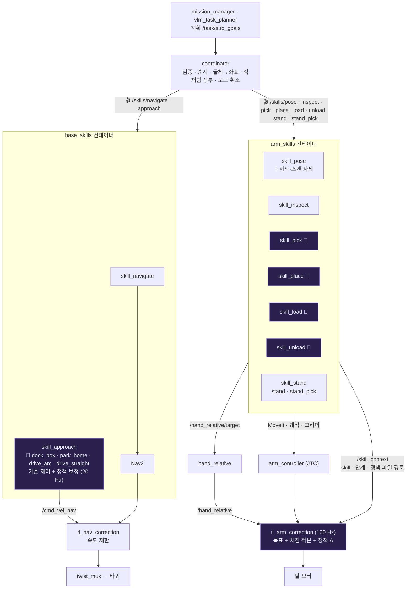
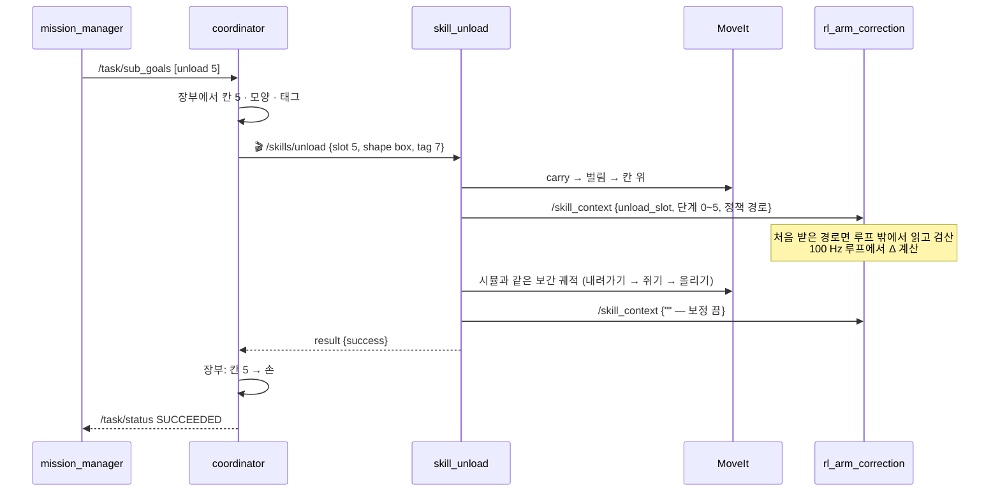

# skill 노드 구성 — skill마다 노드 하나

> 2026-11-04 · PR [#59](https://github.com/visualkhh/Lv2_bee_Assignment/pull/59) (`feature/skill-nodes` → `feature/skill-all`) · pa27 빌드·테스트 66개 통과 · 실기·전체 bringup 전
> 코드: `lv2_module6/ros2_ws/src/skills/` (새 패키지) · `plan/action/Skill.action` · `plan/src/coordinator.cpp` · 정책 `lv2_module6/ros2_ws/model/skills/`

---

## 1. 무엇이 바뀌었나

| | 예전 (11-03까지) | 지금 (11-04) |
|---|---|---|
| skill 실행 | coordinator 한 노드가 전부 (1645줄) | **skill 노드 9개** — skill마다 액션 서버 `/skills/<skill>` |
| coordinator | 계획 + 팔·주행 동작 + 장부 + 시작·스캔 자세 | 계획 검증 · 단계 순서 · 물체 → 좌표 · 적재함 장부 · 모드 취소만 (686줄) |
| 학습 정책 | `rl_arm_correction`이 4개를 미리 들고 이름으로 고름 · 주행은 `rl_nav_correction` 도킹 모드 | **skill 노드가 자기 정책 폴더를 갖고 관리** — 팔은 경로를 컨트롤러에 알려 줌 · 주행은 `skill_approach`가 직접 계산 |
| 정책 파일 | `model/arm_correction/*.policy` · `nav_correction/*.policy` | `model/skills/<skill>/` = `.policy` + `.onnx` + `meta.yaml` |

**왜 이렇게 나눴나**
- skill 하나 = 노드 하나 = 정책 폴더 하나 → 고치기·바꾸기·되돌리기·시험을 skill 단위로
- 팔 정책 **계산은 제어 루프 안에 그대로** (학습 때와 같은 50 Hz · 지연 0) — 노드에서 계산해 토픽으로 보내면 수 ms 지연·흔들림이 생겨 시뮬과 달라짐
- 주행 정책은 원래 20 Hz 노드에서 돌아 노드로 옮겨도 조건이 같음 → `skill_approach`가 직접
- 프로세스는 둘로 묶음 (팔 `arm_skills` · 주행 `base_skills` 컨테이너) — Jetson 부담 적게, 팔은 한 번에 하나

---

## 2. 전체 그림


<b style="color:#a78bfa">🧠 보라 = 학습 정책이 쓰이는 곳</b>

---

## 3. skill 노드 9개

| 액션 | 노드 | 하는 일 | goal에 쓰는 칸 | 정책 (`model/skills/`) | 실패 이유 |
|---|---|---|---|---|---|
| `/skills/navigate` | `skill_navigate` | Nav2로 먼 이동 | `pose` | — | `nav_failed` · `nav_unavailable` |
| `/skills/approach` | `skill_approach` | 마지막 몇 cm 정밀 주행 (시뮬 기준 제어 + 보정) | `pose` (x, y, yaw) · `target` = 정책 이름 | `dock_box`(기본) · `park_home` · `drive_arc` · `drive_straight` | `approach_blocked` · `approach_no_tf` |
| `/skills/pose` | `skill_pose` | 이름 자세 (stow · carry · scan) · **시작 자세 · 지도 만들 때 스캔 자세** | `target` | — | `pose_unknown` · `pose_failed` |
| `/skills/inspect` | `skill_inspect` | 점 위에서 내려다보기 (태그 읽기) | `pose` · `values[0]` 손 방향 | — | `inspect_failed` |
| `/skills/pick` | `skill_pick` | 서 있는 퍽 집기: 후보 → 퍽 위 5 cm (MoveIt, pregrasp) → 닿는 구간 | `target` 물체 id · `tag` | `pick_standing_puck` | `no_grasp` · `arm_contact` · `grasp_empty` · `grasp_failed_all` |
| `/skills/place` | `skill_place` | 칸에 놓기 (`cell`, 닿는 구간) · 물체 위 (`over`) | `target` · `pose` (놓을 면) | `place_cell` | `place_failed` · `arm_contact` |
| `/skills/load` | `skill_load` | 적재함 칸에 싣기 | `slot` · `shape` | `load_slot` | `load_failed` · `basket_table_missing` |
| `/skills/unload` | `skill_unload` | 적재함 칸에서 꺼내기 | `slot` · `shape` · `tag` | `unload_slot` | `grasp_empty` · `unload_failed` |
| `/skills/stand` · `/skills/stand_pick` | `skill_stand` | 누운 퍽 세우기 · 그 자리 다시 쥐기 | `pose` (누운 퍽) · `shape` · `tag` | `regrasp_after_stand` (**안 씀**) | `stand_failed` · `stand_pick_no_stand` · `grasp_empty` |

- 액션 타입 `plan/action/Skill`: goal `target · pose · shape · tag · slot · values` → result `success · reason` (→ `/task/status` reason 그대로) · feedback `stage`
- 한 노드에 한 번에 goal 하나 · 취소하면 그 노드가 MoveIt·그리퍼·Nav2 goal을 멈추고 보정을 끔 · 서버(MoveIt·Nav2)가 없으면 30 s 기다림
- 진단: 노드마다 `skill_<이름>: 상태` (실행 중 단계 · 실행·실패 수 · 마지막 결과 · 정책 상태) → `/diagnostics_agg` "skill" 묶음

---

## 4. 정책 폴더 — skill이 갖고 관리

```
lv2_module6/ros2_ws/model/skills/<skill>/
  <skill>.policy   로봇이 읽는 MLP (C++ 직접 계산 · 파일 안 'test' 줄로 검산)
  <skill>.onnx     Isaac Lab 학습 원본
  meta.yaml        kind · layout · use · sim_baseline · sim_policy · 출처 · (주행) tol_m · tol_deg · hold_s · limit_s
```

| 폴더 | 노드 | 시뮬 (기준선 → 학습) | use |
|---|---|---|---|
| `dock_box` | skill_approach | 30.2 → 98.6 % | ✅ |
| `drive_straight` | skill_approach | 61.4 → 100 % | ✅ |
| `park_home` (송정혁) | skill_approach | 81.1 → 96.5 % | ✅ 출발 구역 보정 |
| `drive_arc` (송정혁) | skill_approach | 91.8 → 100 % | ✅ |
| `pick_standing_puck` (팀원) | skill_pick | 99.1 → 100 % | ✅ |
| `place_cell` (팀원) | skill_place | 96.3 → 99.0 % | ✅ |
| `load_slot` | skill_load | 94.8 → 99.0 % | ✅ |
| `unload_slot` | skill_unload | 93.7 → 98.1 % | ✅ |
| `regrasp_after_stand` (송정혁) | skill_stand | 74.6 → 78.2 % | ❌ 로봇 입력 모양(stand 49) 없음 · 합격 기준 못 넘음 |
| `pregrasp` | (skill_pick) | 99.5 % = 99.6 % | ❌ 기준선(MoveIt)으로 충분 |

**정책 바꾸기**: 새 `.pt` → `export_policy.py` → 그 폴더의 `.policy` · `.onnx` 교체 + `meta.yaml` 성공률 → 빌드. 끄기는 `use: false` (기준 동작만). 테스트 `test_skills`가 폴더마다 meta · 입력 크기를 검사.

---

## 5. 한 단계가 도는 길 — 예: 적재함 칸 5에서 꺼내기



---

## 6. 확인한 것 · 남은 것

| | 상태 |
|---|---|
| 빌드 · 테스트 (pa27, ROS Lyrical) | ✅ ml · plan · skills 66개 — coordinator → skill 액션 → 장부 (새) · 정책 폴더 검사 · 잡기 판정 · 세우기 경유점 |
| skill 노드 9개 기동 · 정책 8개 읽기 | ✅ `ros2 launch skills skills.launch.py` |
| approach 정책 계산 | ✅ goal → 기준 0.12 m/s + 보정 +0.005~0.012 m/s 명령 |
| 전체 bringup CI (testbed) | ⏳ PR #59 |
| MoveIt 붙인 팔 닿는 구간 | ⏳ Isaac Sim 또는 실기 |
| `regrasp_after_stand` 로봇 입력 | 🔴 stand 입력 모양 · 동작 순서를 시뮬과 맞춰야 (재학습 뒤) |
| Isaac Sim 실행 파일 (`isaac_system.launch.py`) | 🔴 예전 coordinator 파라미터를 고침 → skill 노드 이름으로 바꿔야 |
