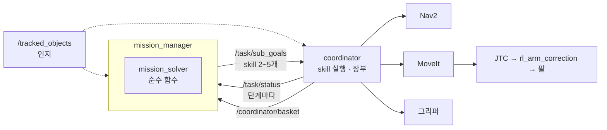
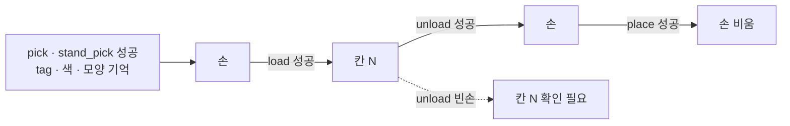
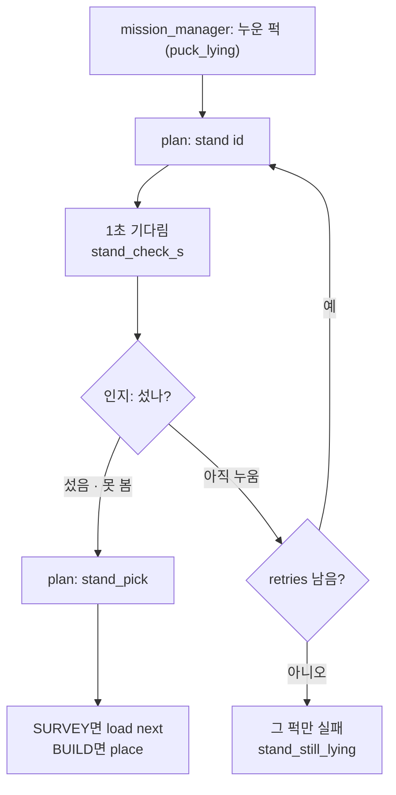

# beebot 스킬·플랜 한 장

> 주사위 기억 미션 · PR #48 skill · PR #49 미션 흐름 · 2026-11-03 기준
>
> 11-09 갱신: 11-04(#59)부터 skill 실행은 **skill 노드**(액션 `/skills/<skill>`, `skills` 패키지)가 합니다. coordinator는 계획 검증 · 단계 순서 · 물체 → 좌표 · 적재함 장부만 맡습니다. 학습 정책은 skill 노드가 `models/skills/<skill>/`에서 고르고, 팔 보정 Δ는 `rl_arm_correction`, 도킹 보정은 `skill_approach`가 계산합니다 → [skill 노드](skill-nodes.html) · [ONNX 실행 구조](onnx-runtime.html) · [지금 구조](system-now.html). 아래 1·5·6장의 "coordinator가 MoveIt으로 …"는 11-03 기록입니다.

**미션은 순서를 정하고, coordinator는 skill 하나를 움직임으로 바꿉니다.**

mission_manager는 "무엇을, 어디서, 어떤 순서로" 할지 정해서 skill 2~5개짜리 작은 계획을 보냅니다. coordinator는 그 계획의 skill을 하나씩 Nav2나 MoveIt 동작으로 바꿔 실행하고, 단계마다 결과를 돌려줍니다. mission_manager는 그 결과를 보고 다음 작은 계획을 정합니다.

---

## 1. 세 층과 각자의 질문

| 층 | 질문 | 하는 일 |
|---|---|---|
| **mission_manager** | 무엇을 · 어디서 · 어떤 순서로? | <ul><li>미션 단계를 진행합니다: GO_OBSERVE → BARCODE → READ → SURVEY → BUILD → VERIFY → RETURN.</li><li>판단은 순수 함수 `mission_solver`가 합니다(신호 판정, 바코드, 배정, 할당, 주사위 칸, 칸 판정).</li><li>skill이 실패하면 다시 할지, 그 퍽만 건너뛸지, 미션을 멈출지 정합니다.</li><li>단계마다 기록을 `~/.ros/mission/<시각>/`에 남깁니다.</li></ul> |
| **coordinator** | 이 skill 하나를 어떻게 움직이나? | <ul><li>모터로 가는 **유일한 길**입니다. 비상정지와 수동 모드도 여기서 막습니다.</li><li>실행 직전에 `/tracked_objects`를 다시 읽어 목표를 정합니다. 계획을 세울 때의 값은 쓰지 않습니다.</li><li>단계 순서는 바꾸지 않습니다. 예외는 `load`·`unload` 안의 carry 경유 하나입니다.</li><li>적재함 장부를 혼자 씁니다.</li><li>실패하면 이유를 붙여 바로 끝냅니다.</li></ul> |
| **실행 계층** | 실제로 움직임 | <ul><li>주행: Nav2(NavFn A* + RlNavController). 상자 앞 마지막 도킹은 `approach`가 시뮬과 같은 돌기-직진-돌기 제어로 하고, `skill_approach`가 학습 보정을 더합니다. 경로 따라가기 속도는 Nav2 컨트롤러 `RlNavController`(동료 RL, 끄면 DWB).</li><li>팔: 빈 공간 이동은 MoveIt move_group → ExecuteTrajectory → `arm_controller`(JTC), 퍽에 닿는 구간은 시뮬과 같은 IK 궤적 → JTC. 둘 다 → `rl_arm_correction`(학습 보정 Δ) → 하드웨어.</li><li>그리퍼: `gripper_controller`. 쥐는 힘은 goal의 `effort`로 보내고, 펌웨어 Goal Current가 됩니다.</li></ul> |



---

## 2. 주고받는 메시지

```text
SubGoalArray   /task/sub_goals        mission_manager → coordinator
  plan_id      계획 번호 (보낼 때마다 새 번호)
  goals[]      SubGoal { step, skill, target, relation, offset_m }

TaskStatus     /task/status           coordinator → mission_manager
  plan_id, step
  state        RUNNING | SUCCEEDED | FAILED
  reason       실패 이유 (예: grasp_empty, stand_still_lying …)
```

- **target은 문자열입니다.** 물체 id, `"x,y,z"` 좌표, 자세 이름, 칸 `0`~`11`, `next`, `last` 중 하나가 들어갑니다.
- **새 계획이 오면 옛 계획은 취소됩니다.** 진행 중이던 goal을 전부 끊고 새 계획을 시작합니다.
- **정지**하려면 `plan_id 0`에 빈 목록을 보냅니다. coordinator는 `cancelled`로 답합니다.
- mission_manager는 한 번에 한 계획만 기다립니다. 계획이 끝나면 콜백이 다음 계획을 정합니다.

**예: 시작 박스의 퍽 하나를 조사하고 싣기** (좌표와 id는 설명용 예시)

```text
plan 101  [pose stow, navigate 0.62,1.10,1.57]   ← 박스 앞 0.25m
plan 102  [approach 0.62,1.27,1.57]               ← 0.085m까지 직선
plan 103  [inspect x,y,z, inspect x,y,z]          ← 퍽 두 자리 내려다봄
plan 104  [pick 17]                               ← (누웠으면 stand → stand_pick)
plan 105  [load next]                             ← 장부에 칸 기록
```

---

## 3. 왜 작은 계획을 여러 번 보내나

**다음 행동이 앞 결과에 달려 있기 때문입니다.**
- 퍽이 섰는지 누웠는지는 `inspect` 뒤에야 압니다.
- 어느 칸에 실렸는지는 `load` 뒤 장부에서야 압니다.
- 12개를 어느 그룹에 넣을지는 조사가 다 끝나야 정할 수 있습니다.

그래서 이렇게 합니다.
- 미션 전체를 한 번에 보내지 않습니다. 지금 아는 것만으로 다음 2~5단계를 보냅니다.
- 실패도 작은 단위로 처리합니다. 퍽 하나가 안 집히면 그 계획만 다시 보내거나 그 퍽만 건너뜁니다.
- coordinator는 미션을 모릅니다. 그래서 같은 skill을 vlm_task_planner와 ai-service도 그대로 씁니다.

### 실패를 누가 처리하나

| 상황 | coordinator | mission_manager |
|---|---|---|
| 집기·놓기·보기 실패 | FAILED와 실패 이유를 냄 | 같은 계획을 `retries`(2)번 더 보냄. 그래도 안 되면 그 퍽·장소만 실패로 기록하고 다음으로 감 |
| 비상정지 · 수동·탐사 모드 전환 · 다른 계획이 끼어듦 | `estop*` `manual*` `explore*` `cancelled` | 다시 시도하지 않음. ERROR `interrupted: …`로 미션을 멈춤 |
| 바코드·신호·복귀 실패 | — | ERROR로 멈추고 coordinator도 정지시킴 |
| 할당 불가 | — | BUILD를 건너뛰고 RETURN |

---

## 4. 미션 단계와 보내는 skill

| 단계 | 하는 일 | 보내는 skill | 실패하면 |
|---|---|---|---|
| GO_OBSERVE | 팔을 scan 자세로 접고(기둥 카메라 시야 확보), 바코드가 보이는 자리로 감 | `pose scan` `navigate` | ERROR |
| BARCODE | 이 단계가 시작된 뒤 본 바코드만 씀. 읽으면 관측 자리(−X)로 감 | `navigate` | ERROR |
| READ | 12회 점멸이 확정되기를 기다림. 두 사이클이 같은 답이면 확정. 오류가 2번 이어지거나 150초가 넘으면 정지(추정 금지) | — | ERROR |
| SURVEY | 시작 박스 6곳마다 다가가 퍽 두 자리를 보고, 집어서 적재함 칸에 실음. 끝나면 12개를 R·Y·G에 한 번에 할당 | `pose stow` `navigate` `approach` `inspect` `pick`(또는 `stand`→`stand_pick`) `load next` | 그 박스·퍽만 기록하고 계속 |
| BUILD | 퍽마다: 장소 상자 앞으로 → `location_box`로 칸 위치 보정 → 적재함에서 꺼냄 → 주사위 칸에 놓기 → 내려다보고 10mm 밖이거나 누웠으면 다시 | `approach` `unload <칸>` `place x,y,z` `inspect` `pick` `stand` | 그 퍽만 기록하고 다음 퍽 |
| VERIFY | 장소마다 이번에 새로 본 퍽만으로 칸을 판정. 12개 중복·누락 확인 | `approach` `inspect` | 결과에만 남김 |
| RETURN | 출발 구역으로 감. 차체 외곽이 구역 안인지 보고 밖이면 한 번 보정. 3초 정지 | `pose stow` `navigate` `approach` | ERROR |

- **시작 조건**: 적재함 장부가 비어 있어야 시작합니다. 남아 있으면 시작을 거부하고, `/mission/state` note에 `/coordinator/basket_clear`를 부르라고 띄웁니다.
- **주행 전에는 팔을 접습니다.** 다가가기·물러나기·복귀 계획 맨 앞에 `pose stow`를 넣습니다. 놓기나 보기 뒤에는 팔이 상자 위에 나가 있기 때문입니다.
- **주사위 칸 순서**: 3과 5는 가운데 칸(4)부터 놓습니다. 이웃 칸이 먼저 놓여 있으면 가운데 칸 성공률이 81~83%로 떨어졌습니다(isaac-pick 시험).

---

## 5. skill 목록 (coordinator)

| skill | target | 하는 일 | 움직이는 길 | 끝 자세 |
|---|---|---|---|---|
| `navigate` | 물체 id · `x,y[,yaw]` | Nav2로 이동 | Nav2 | — |
| `approach` | `x,y,yaw` | 상자 앞 마지막 몇 cm를 저속 직선으로 붙음(Nav2는 로봇을 반지름 0.18m 원으로 봐서 더 못 붙음). 4초 동안 진행이 없으면 `approach_blocked` | `/cmd_vel_nav` | — |
| `inspect` | 퍽 id · `x,y,z` | 손끝을 0.15m 위로 옮겨 손 카메라로 내려다봄. 집지 않음 | MoveIt | 그 자리 |
| `say` | 문장 | 말하기 | `/robot/say` | — |
| `pose` | `stow` `carry_left` `carry_right` `scan` | 이름 있는 관절 자세로 이동 | MoveIt (관절 목표) | 그 자세 |
| `pick` | 퍽 id | 위에서 집고 잡기 판정 후 들어올림. 파지 후보는 grasp_scorer가 냄 | MoveIt (손끝 목표) | 들어올린 자리 |
| `load` | `0`~`11` · `next` | 손의 퍽을 적재함 칸에 실음: carry → q_over → q_low → 벌림 → q_lift → stow | MoveIt (관절 목표, basket.yaml) | `stow` |
| `unload` | `0`~`11` · `last` | 칸의 퍽을 꺼냄: carry → 벌림 → q_over → q_grasp → 닫기 → 잡기 판정 → q_over → carry | MoveIt (관절 목표) | `carry_<방향>` |
| `place` | `location_box` id · `x,y,z` | 손 안 퍽 바닥이 z가 되게 놓음: 0.08m 위 → 0.02m 위에서 벌림 → 다시 위로 | MoveIt (손끝 목표) | 그 점 위 |
| `stand` | 누운 퍽 id | 먼 끝을 0.4N으로 가볍게 쥐고, 가까운 아래 모서리를 축으로 돌려 세움. 벌리고 위로 | MoveIt 계획 1번 + 샘플 궤적 ExecuteTrajectory | 선 퍽 위 |
| `stand_pick` | (직전 stand의 퍽) | 같은 손목 자세로 바로 내려가 제 힘으로 쥠. 잡기 판정 후 들어올림 | 샘플 궤적 ExecuteTrajectory | 들어올린 자리 |

옛 형식도 그대로 돕니다. `pick tray`는 `unload last`, `place tray`는 `load next`와 같습니다.

---

## 6. 팔 skill 공통 규칙

- **빈 공간 이동은 MoveIt을 거칩니다.** (2026-11-03 결정으로 고침 — 이전: "팔 동작은 전부 MoveIt")
  - 정해진 자세(stow, carry, 적재함 칸 위)는 관절 목표로 계획합니다.
  - 물체 위까지(집기 전 퍽 위 5 cm, 놓기 전 칸 위 5 cm, 보기)는 손끝 목표로 계획합니다(손이 위에서 아래로).
- **퍽에 닿는 짧은 구간은 시뮬과 같은 방식으로 움직입니다.** 내려가기 → 쥐기·놓기 → 올리기(세우기는 원호 경유점)는 오프라인 IK + 관절 보간 궤적을 JTC에 보내고, 그 위에 `rl_arm_correction`이 학습 보정 Δ를 더합니다.
  - 이유: 학습한 보정은 시뮬에서 쓴 기준 동작 위에서만 맞습니다. 이 구간을 MoveIt으로 하면 매번 경로가 조금씩 달라 보정이 맞지 않고, 다시 학습해야 합니다. 이 구간은 몇 cm짜리 상하 동작이라 MoveIt의 충돌 회피가 거의 필요 없습니다.
  - 자세한 배포 조건: [skill별 학습 조건 9장](skill-training.html)
- JTC에 바로 보내는 경우: 위의 닿는 구간, 기동할 때의 `initial_pose`, 사람이 조작하는 `manual_control`.
- **처짐 보정 초기화**: 팔 skill을 시작할 때 `/rl_arm_correction/reset_sag`를 한 번 부릅니다. `stand_pick`만 부르지 않습니다. 세운 직후 보정을 0으로 되돌리면 처진 만큼 손이 떨어지기 때문입니다.
- **잡기 판정**(`pick`, `unload`, `stand_pick`): 닫은 뒤 두 가지를 봅니다. 전류 값이 안 오면 위치만 봅니다.
  - 손가락 위치가 3mm 이상: 퍽이 끼어서 끝까지 닫히지 않았다는 뜻입니다.
  - 전류가 0.25A 이상: 원기둥 실측값은 0.33~0.42A였습니다.
- **쥐는 힘**: 보통은 0.35A(약 22~29N)로 쥡니다. 세울 때는 0.0055A(약 0.4N)입니다. PR #50 이후 최소 2.69mA까지 보낼 수 있습니다.

---

## 7. 적재함 장부 (12칸)

장부는 **coordinator 하나만 씁니다.** 실제로 싣고 꺼내는 쪽이 가장 정확히 알기 때문입니다. mission_manager와 화면은 읽기만 합니다.



- 장부는 `/coordinator/basket`(latched)으로 내보냅니다. 파일 `~/.ros/beebot_basket.txt`에도 저장하므로 노드가 다시 떠도 이어 갑니다.
- BUILD 때 mission_manager는 장부에서 그 tag가 실린 칸을 찾아 `unload <칸>`을 보냅니다.
- 칸마다 carry 방향이 정해져 있습니다. 칸 0·1·4·5·8·9는 오른쪽, 나머지는 왼쪽입니다.

---

## 8. 누운 퍽 세우기: stand → 확인 → stand_pick



### 왜 두 skill로 나눴나
- **끝 상태가 다릅니다.** `stand`는 손을 놓고 끝납니다. 그래서 다시 잡기 전에 인지로 섰는지 확인할 수 있습니다.
- **쥐는 방식이 다릅니다.** 세울 때는 0.4N으로 쥐어서 퍽이 손가락 사이에서 경첩처럼 돌게 합니다. 다시 잡을 때는 제 힘으로 쥐고 잡기 판정을 합니다.
- **다시 시도하는 범위가 좁아집니다.** 집기만 실패했을 때 이미 선 퍽을 다시 세우지 않습니다.

### 동작 (팀원 `right_env` tilt 방식 그대로)
1. 그리퍼를 40mm 벌리고, MoveIt 계획으로 먼 끝 0.04m 위까지 갑니다(충돌 확인).
2. 내려가서 먼 끝을 0.4N으로 쥡니다. 쥐는 높이는 사각 퍽 30mm, 원기둥 15mm입니다.
3. 가까운 아래 모서리를 축으로 0°에서 120°까지 호를 그립니다. 경유점은 7.5°마다 있고, 도는 동안 10mm 더 올립니다.
4. 0.5초 멈춘 뒤 90°로 되돌려 10mm 눌러 놓습니다. 벌리고 0.08m 위로 올라갑니다.
5. `stand_pick`: 선 퍽의 중심선 위로 바로 내려가 쥡니다. 잡기 판정 후 0.05m 들어올립니다.

경유점은 다시 잡기 2개를 포함해 27개입니다. 손은 내내 아래를 향하고, 손가락이 닫히는 축은 퍽 축과 직각입니다.

### 경유점 두 방식 (`stand_waypoints` — 11-09: `skill_stand` 파라미터, `skills/config/skills.yaml`)

| | `ik` (기본) | `table` |
|---|---|---|
| 방법 | 퍽마다 손끝 경유점을 계산하고, 5축 해석 IK로 관절값을 구함 | 팀원 표(모양 × 방향 5° × 옆 위치 3곳)에서 가까운 칸을 고르고 선형 보정 `q = q_nom + P·Δp` |
| 손끝 오차 | 0 (팀원 수치 IK와 관절값 차이 0.0025 rad 이내) | 격자점 0.2mm, 격자 사이 평균 2.1mm, 최대 6.5mm |
| 장점 | 어떤 위치·방향에도 대응 | 학습 때와 같은 궤적 |
| 파일 | `skills/src/stand_plan.cpp` (11-03엔 `plan/src/`) | `skills/params/stand_table.yaml` (`skills/scripts/stand_table_export.py`로 생성 · 11-03엔 `plan/`) |

MoveIt IK(pick_ik)는 위치만 맞추고 손 방향은 보장하지 않습니다. 그래서 세우기에는 해석 IK를 씁니다. 실행은 두 방식 모두 ExecuteTrajectory입니다.

---

## 9. 예상 질문

**강화학습 정책이 팔을 움직이나요?**
아닙니다. 경로는 coordinator(11-04부터 skill 노드)가 만들고, 정책은 `rl_arm_correction`에서 관절마다 작은 보정 Δ만 더합니다. 11-03 당시 develop은 Δ = 0이었습니다. → 11-09: 정책이 있는 skill(`meta.yaml` `use: true`)의 닿는 구간에서 `rl_arm_correction`이 50 Hz로 Δ를 계산합니다(`ml/src/rl_arm_correction.cpp`). 어느 정책을 쓸지는 skill 노드가 `/skill_context`로 알려 줍니다.

**왜 coordinator가 순서를 정하지 않나요?**
순서는 미션마다 다르고, 앞 결과에 따라 바뀝니다. coordinator가 skill 하나만 책임지면 VLM과 ai-service도 같은 skill을 그대로 쓸 수 있습니다.

**퍽이 섰는지는 누가 확인하나요?**
mission_manager가 확인합니다. `stand`가 끝나고 1초 뒤 인지 결과(`puck` / `puck_lying`)를 봅니다. coordinator의 `stand_pick`은 인지를 기다리지 않고, 세운 직후의 관절값에서 이어 갑니다.

**skill이 실패하면 어떻게 되나요?**
coordinator는 이유를 붙여 바로 실패를 알립니다. mission_manager는 2번 더 시도하고, 그래도 안 되면 그 퍽만 실패로 남기고 다음으로 갑니다. 그때까지의 점수는 유효하므로 복귀까지 진행합니다.

**사람이 비상정지를 누르면요?**
coordinator가 `estop`으로 실패를 알리고, mission_manager는 다시 시도하지 않고 미션을 멈춥니다. 이어서 하려면 상태를 확인한 뒤 다시 start 합니다.

---

## 10. 지금 상태

| 항목 | 상태 |
|---|---|
| skill 정의·구현 (#48) | ✅ CI 통과 `f2a1998` |
| 미션 흐름 (#49, #48 위에 쌓임) | ✅ CI 통과 `0f86fc5` |
| 세우기 경유점 계산 | ✅ 로컬 대조: FK는 pinocchio와 5e-10m 이내, 팀원 계획과 관절 0.0025 rad 이내 |
| 세우기 실제 성공률 (ik vs table) | ⚠️ 미확인 (Isaac·실기) |
| 0.4N 쥐기 전류 | ⚠️ 미확인 (mA ↔ N 실측 필요) |
| 경기장 좌표·다가가기 거리·칸 보정 | ⚠️ 미확인 (실물로 맞춰야 함) |
| 사각 퍽을 집을 때 손 방향 맞춤 | ⏳ 예정 |

병합 순서는 #48 → #49입니다. 자세한 내용은 `documents/project/ros/03-plan.md`(미션), `05-arm.md`(skill), `API.md`(메시지)에 있습니다.
