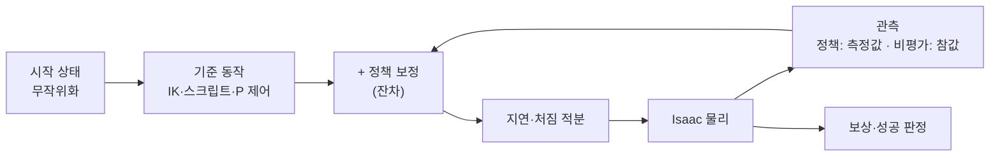
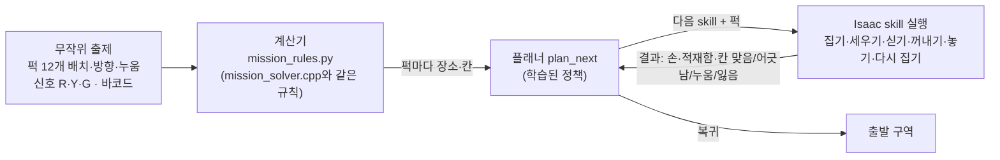
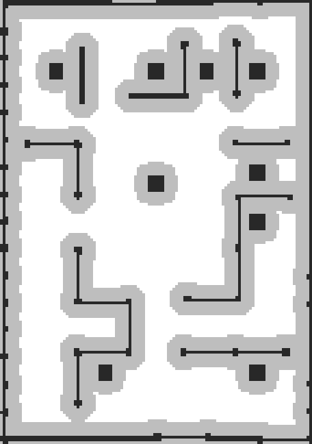
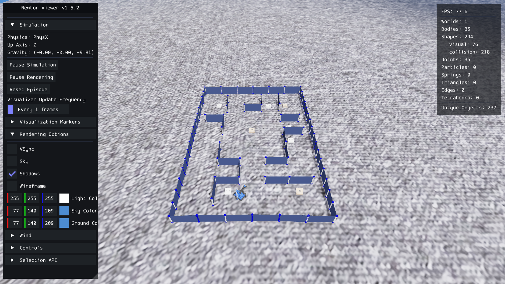
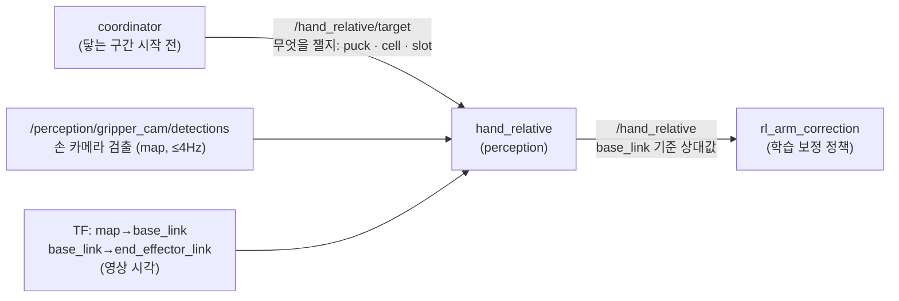

# skill별 학습 조건

움직이는 skill마다 **Isaac Lab 학습 환경 하나**를 두고, 같은 방식으로 학습합니다. 이 페이지는 skill마다 **무엇에서 시작해서, 무엇을 배우고, 어떻게 점수를 받는지**를 정리합니다.

- 코드: 브랜치 `feature/skill-envs` · `lv2_module6/isaac/lab/` (팀원 `feature/isaac-lab` 위에 추가)
- skill 목록·나눈 이유: [학습용 skill 구성](skill-learning.html)
- 기준선 결과는 2026-11-03 pa27(RTX 5060 8 GB)에서 잔차 0으로 128~256판씩 돌린 값입니다.
- **재학습 끝 (11-03 20:43, pa27)**: `load_slot` 99.0 % · 놓침 0.49 % ✅ (정책 파일 바꿈) · `pregrasp` 기준선 99.5 % = 학습 99.6 % → **기준선으로 충분** → 7장
- `park_home` · `drive_arc` · `regrasp_after_stand`는 동료가 학습
- **Isaac에서 미션 전체를 푸는 실행기**: 무작위 문제를 끝까지 풂 → 8장
- **실제 로봇에 올리는 조건 (11-03 결정)** → 9장


> **이름 바꿈 (11-03 19:50)** — `upright` · `right` · `stand`가 섞여 헷갈려서, 퍽이 **서 있는지 / 누웠는지**가 이름에 드러나게 했습니다.
>
> | 새 이름 | 예전 이름 | 하는 일 | `--task` (예전) | 환경 파일 (팀원) |
> |---|---|---|---|---|
> | `pick_standing_puck` | `pick_upright` | **서 있는** 퍽 집기 | `pick_standing` (`pick`) | `pick_env.py` |
> | `stand_lying_puck` | `stand_up` | **누운** 퍽 세우기 | `stand_lying` (`stand` · `right`) | `right_env.py` |
> | `regrasp_after_stand` | `regrasp_stood` | 세운 그 자리에서 다시 쥐기 | `stand_lying` + `regrasp=1` | `right_env.py` |
> | `stand_puck_in_cell` | `stand_in_place` | 칸 안에서 누운 퍽 세우기 | 환경 없음 | — |
>
> 예전 `--task` 이름과 `train_queue.sh regrasp_stood`도 그대로 됩니다.

---

## 1. 모든 skill에 공통인 것

| 항목 | 내용 |
|---|---|
| **방식** | **잔차 강화학습**: 지금 쓰는 동작(기준선) + 정책이 더하는 작은 보정. 학습이 잘 안 돼도 기준선만큼은 동작 |
| **알고리즘** | rsl_rl PPO · 정책·비평가 신경망 256-128-64 (ELU) · 관측 정규화 |
| **PPO 설정** | 학습률 3e-4 (KL 0.01에 맞춰 자동 조절) · γ 0.99 · λ 0.95 · clip 0.2 · 엔트로피 0.002 · env당 32걸음 모아 5번 학습 |
| **물리·제어 주기** | 물리 200 Hz · 정책 팔 50 Hz / 주행 25 Hz |
| **실제 로봇과 맞춘 것** | 관절마다 실측 명령 지연(45~62 ms) · 처짐 보정 적분(실제 `rl_arm_correction`과 같은 식) · 팀 관절 한계 × 0.3 속도 |
| **비대칭 학습** | 정책은 **실제 로봇이 볼 수 있는 값**만(카메라 측정에 잡음·편향), 비평가는 **시뮬 참값**까지 봄 |
| **보상 틀** | 걸음마다: 목표 추종 + · 급한 동작 − · 보정 크기 − / 끝: 성공 +10 · 최종 오차 + / 떨굼·넘어짐·충돌 −5 |
| **결과물** | `policies/<skill>.pt` (TorchScript) · `.onnx` (실제 로봇 C++ `rl_arm_correction`이 읽음) |
| **명령** | `train_place.py --task <task> [--cfg k=v] --mode zero / train / eval` |
| **주의** | 8 GB GPU에는 학습 하나만 (둘이면 GPU 메모리 부족). 창으로 볼 땐 `--viz newton` (가벼움) |



---

## 2. 전체 현황

| skill | 영역 | 환경 (`--task`, `--cfg`) | 기준선 성공 | 상태 |
|---|---|---|---|---|
| `place_cell` | 팔 | `pip` (팀원) | 96.3 % (place, 10-31) | 학습됨 99.0 % (팀원) |
| `pick_standing_puck` | 팔 | `pick` (팀원) | — | 팀원 정책 있음 |
| `stand_lying_puck` | 팔 | `right` (팀원) | — | 팀원 정책 있음 |
| `regrasp_after_stand` | 팔 | `right`, `regrasp=1` (팀원) | — | 본 학습 대기열 8번째 (기준선도 그때 잼) |
| `load_slot` | 팔 | `load` (**새로**) | **94.8 %** (고친 뒤) | ✅ **재학습 99.0 %, 놓침 0.49 %** (1차 98.3 %·1.0 % → 놓침 벌점 5 → 20) |
| `unload_slot` | 팔 | `unload` (**새로**) | 90.6 % | ✅ **학습 완료 98.1 %** (놓침 0.1 %) |
| `move_pose` | 팔 | `reach`, `target=pose` (**새로**) | 100 % | 시뮬에선 기준선으로 충분 |
| `camera_clear_view` | 팔 | `reach`, `target=clear` (**새로**) | 100 % | 시뮬에선 기준선으로 충분 |
| `pregrasp` | 팔 | `reach`, `target=above` (**새로**) | 89.8 % → 고친 뒤 **99.5 %** | ✅ 기준선으로 충분 (재학습 99.6 % — 차이 없음) |
| `camera_look_down` | 팔 | `reach`, `target=look` (**새로**) | 100 % | 높이 확인 필요 (아래) |
| `drive_straight` | 주행 | `drive`, `task=straight` (**새로**) | 61.4 % | ✅ **학습 완료 100 %** (2048 env × 500회) |
| `drive_turn` | 주행 | `drive`, `task=turn` (**새로**) | 100 % | 시뮬에선 기준선으로 충분 |
| `drive_arc` | 주행 | `drive`, `task=arc` (**새로**) | 94.5 % | 동료 학습 |
| `dock_box` | 주행 | `drive`, `task=dock` (**새로**) | **30.2 %** | ✅ **학습 완료 98.6 %** (512 env × 1500회) |
| `park_home` | 주행 | `drive`, `task=park` (**새로**) | 87.5 % | 동료 학습 |
| `nudge_cell` · `stand_puck_in_cell` | 팔 | 없음 | — | 기준 동작부터 설계 필요 |
| `navigate` | 주행 | 없음 | — | Nav2·장애물 장면 필요 |
| `plan_next` | 플랜 | 가상 미션 (CPU) | 계산기 38.11점 | **skill 완성 후** (마지막) |

---

## 3. 팔 — 놓기·집기 계열 (팀원 환경 + 새 환경)

<details>
<summary>▶ <code>place_cell</code> — 주사위 칸 중심에 놓기 (팀원 <code>place_env.py</code> · <code>pip_env.py</code>)</summary>

| 항목 | 내용 |
|---|---|
| 시작 | 퍽을 쥔 손이 칸 위 50 mm. 칸은 가까운·가운데 줄 6칸 (먼 줄은 차체가 넘어져 제외) |
| 기준 동작 | 오프라인 IK로 칸 위 → 내려가기 → 안정 0.3 s → 36 mm로 열기 → 올리기 → 대기 |
| 정책 행동 | 관절 5개 보정 ±0.05 rad, 손 열기 전까지 |
| 관측 (정책) | 관절 추종 오차 · 남은 이동 · 관절 속도 · 이전 행동 · 단계 · 진행 · **손 카메라로 본 칸−퍽 (편향 2 mm, 잡음 1 mm)** · 처짐 적분 |
| 무작위화 | 칸 인식 ±5 mm · 손 안 퍽 ±2 mm(측정) · 퍽 질량 ×0.7~1.3 · 마찰 · (pip) 이웃 퍽 주사위 배치·놓인 오차 ±4 mm |
| 보상 | 칸 중심 추종 0.1·exp(−(e/4 mm)²) · 기울기 −0.2 · 급한 동작 −0.05 · 보정 크기 −0.002 · 성공 +10 · 최종 오차 +5 · 떨굼/넘어짐 −5 · (pip) 이웃 움직임 −50/m |
| 성공 | 중심 10 mm 안 · 기울기 5° 이하 · 손에서 빠짐 · 상자 위 · 2 mm 이상 안 움직임 · (pip) 이웃 3 mm/5° 안 |
| 결과 | 잔차 0 96.3 % → 정책 **99.0 %** (p90 8.4 → 4.1 mm) |

</details>

<details>
<summary>▶ <code>pick_standing_puck</code> — 서 있는 퍽 집기 (팀원 <code>pick_env.py</code>)</summary>

| 항목 | 내용 |
|---|---|
| 시작 | stow 자세, 손 40 mm 열림. 시작 박스 위 퍽 2개(±40 mm), 그중 하나가 목표 (30 %는 이웃 없음 = 두 번째 집기) |
| 기준 동작 | stow → 퍽 위 50 mm → 잡는 높이 → 안정 → 닫기 → 들기 → 대기. 손가락은 두 퍽을 잇는 선에 직각, 사각 퍽은 가까운 면 |
| 정책 행동 | 관절 보정 ±0.05 rad, 손 닫기 전까지 |
| 관측 (정책) | 관절 상태 · 단계 · **손 카메라로 본 퍽−손 (편향 2 mm, 잡음 1 mm)** · 면 방향 오차 (잡음 2°) · 퍽 종류 · 처짐 적분 |
| 무작위화 | 인식 ±5 mm, ±10° · 정차 오차 ±10 mm · 퍽 방향 · 질량 · 마찰 |
| 보상 | 손−퍽 추종 0.1 · 퍽 기울기 −0.5 · **이웃 움직임 −50/m** · 급한 동작 −0.05 · 성공 +10 · 조준 오차 +5 · 넘어뜨림/넘어짐 −5 |
| 성공 | 30 mm 이상 들림 · 손 안 · 이웃 그대로 (3 mm, 5°) |
| 실패 종료 | 퍽 30° 넘게 기욺 (위에서 잡는 방식으로는 누운 퍽을 못 집음) |

</details>

<details>
<summary>▶ <code>stand_lying_puck</code> · <code>regrasp_after_stand</code> — 누운 퍽 세우기, 세운 퍽 다시 집기 (팀원 <code>right_env.py</code>)</summary>

| 항목 | 내용 |
|---|---|
| 시작 | stow. 시작 박스 위 누운 퍽(방향 ±90°), 70 %는 옆에 서 있는 이웃 |
| 기준 동작 (tilt) | 먼 쪽 끝을 **0.4 N으로 살짝 집고** 가까운 쪽 아래 모서리를 축으로 원호를 그리며 120°까지 넘김 → 멈춤 → 세워 내려놓기 → 열기 → 위로 비키기 (5축 팔은 손을 수평으로 못 눕혀서 퍽을 손 안에서 돌림) |
| 정책 행동 | 관절 보정 ±0.1 rad (세울 때 위쪽을 16 mm쯤 밀어 넘겨야 해서 더 큼) |
| 무작위화 | 인식 ±5 mm, ±10° · 쥐는 힘 ×0.85~1.15 · 지연 ×0.8~1.2 · 질량 · 마찰 · 가로 위치 ±45 mm |
| 보상 | 집은 동안 퍽이 서는 쪽 +0.01 · 연 뒤 서 있음 +0.1 · 손 흔들림 −0.1 · 성공 +10 · 실패 −5 |
| 성공 (stand_lying_puck) | 기울기 5° 미만으로 섬 · 박스 위 · 손에서 빠짐 · 박스 3 mm 이상 안 밀림 · 이웃 안 넘어짐 |
| 성공 (`regrasp=1`) | 세운 뒤 그 자리에서 다시 잡아 30 mm 이상 들고 손 안 |
| 실패 종료 | 박스에서 떨어짐 · 박스 밀림 · 이웃 넘어짐 · 연 뒤 다시 누움 |

</details>

<details>
<summary>▶ <code>load_slot</code> — 적재함 칸에 싣기 (새 <code>slot_env.py</code> · LoadEnv)</summary>

| 항목 | 내용 |
|---|---|
| 시작 | 퍽을 쥔 손이 **적재함 칸 위**(slot_table `q_over`). 칸 12개 × 퍽 종류 2 |
| 기준 동작 | slot_table 관절 자세: 칸 위 → 칸 바닥 3 mm 위(`q_low`) → 안정 → 열기 → 칸 위로 → 대기. 손 안 퍽 오차만큼 `q = q_nom + P·(−R·e)`로 보정 |
| 정책 행동 | 관절 보정 ±0.05 rad, 손 열기 전까지 |
| 관측 | `place_cell`과 같음 (칸 대신 적재함 칸) |
| 무작위화 | 칸 위치 ±1 mm (적재함은 로봇에 고정, 보정 오차만) · 손 안 퍽 ±2 mm · 퍽 질량·마찰 |
| 보상 | `place_cell`과 같은 항·가중치, 목표만 적재함 칸 중심 |
| 성공 | 칸 중심 10 mm 안 · 칸 바닥 높이 ±5 mm · 기울기 5° 이하 · 손에서 빠짐 · 정지 |
| 기준선 | **93.8 %** (192판, 놓침 0). 처음 71.1 %는 환경 오류: 뒤쪽 칸(0~3번) 위 자세는 손이 20° 기울어 있는데 퍽을 똑바로 세워 넣어서, 시작 0.02초에 퍽이 손가락과 겹쳐 튕겨 나갔음 → 퍽을 손 방향대로 쥐게 고침 |

</details>

<details>
<summary>▶ <code>unload_slot</code> — 적재함에서 꺼내기 (새 <code>slot_env.py</code> · UnloadEnv)</summary>

| 항목 | 내용 |
|---|---|
| 시작 | carry 자세(칸 쪽), 손 열림. 퍽이 칸 안에 (사각 퍽은 칸 벽에 맞춤 ±3°, 원기둥은 아무 방향) |
| 기준 동작 | carry → 칸 위(`q_over`) → 잡는 자세(`q_grasp`, 기둥 쪽 칸은 기둥에서 8 mm 비켜 잡음) → 안정 → 닫기 → 칸 위로 → 대기 |
| 정책 행동 | 관절 보정 ±0.05 rad, 손 닫기 전까지 |
| 관측 | `pick_standing_puck`와 같음 (이웃 없음) |
| 무작위화 | 칸 안 퍽 위치 ±3 mm · 질량·마찰 · 처짐 |
| 보상 | `pick_standing_puck`와 같은 항·가중치 (이웃 항은 0) |
| 성공 | 칸 바닥보다 30 mm 이상 들림 · 손 안 |
| 기준선 | **90.6 %** |

</details>

---

## 4. 팔 — 자세 계열 (새 <code>reach_env.py</code>)

하나의 환경에 목표만 바꿔서 4개 skill을 학습합니다. 정해진 자세나 퍽 위로 **손을 정확히 가져가는 것**이 목표이고, 정책은 이동이 끝난 뒤 **처짐 때문에 생기는 끝 위치 오차**를 줄입니다.

| 항목 | 공통 내용 |
|---|---|
| 시작 | stow · carry 왼쪽 · carry 오른쪽 중 하나 (±0.05 rad 흔들기), 손 열림 |
| 기준 동작 | 관절 공간 이동(팀 한계 × 0.3) → 유지 0.3 s → 안정 0.6 s → 판정 0.4 s |
| 정책 행동 | 관절 보정 ±0.05 rad, 이동이 끝난 뒤부터 |
| 관측 | 관절 추종 오차 · 목표까지 남은 관절 · 관절 속도 · 이전 행동 · 단계 · 진행 · **목표−손끝 위치 (cm)** · 처짐 적분 |
| 보상 | 손끝 추종 0.1·exp(−(e/4 mm)²) (이동 뒤) · 급한 동작 −0.05 · 보정 크기 −0.002 · 성공 +10 · 최종 오차 +5 · 넘어짐 −5 |
| 성공 | 손끝 오차 5 mm 안 · 관절 정지 (0.05 rad/s 미만) |

| skill | `--cfg` | 목표 | 기준선 |
|---|---|---|---|
| `move_pose` | `target=pose` | stow · carry 왼쪽 · carry 오른쪽 | 100 % (≤ 0.3 mm) |
| `camera_clear_view` | `target=clear` | stow (scan 자세가 정해질 때까지 대신) | 100 % |
| `pregrasp` | `target=above` | 시작 박스 위 3×3 위치 × 손목 3방향 중 IK 되는 27개, 손끝 아래로 퍽 윗면 50 mm 위 | **88~91 %** |
| `camera_look_down` | `target=look` | 퍽 윗면 **0.08 m** 위, 카메라 기울기 25°까지 허용 (18개) | 100 % |

- **`pregrasp` 실패 원인**: ① 먼 줄 목표(18·20·22·25번)는 위치는 0.2~1.2 mm로 맞는데 **팔을 길게 뻗어 판정 시간 안에 흔들림이 안 멈춤** → 학습으로 줄일 대상. ② 목표 5번(손목 −2.35 rad)만 18 mm 어긋남 → 확인 필요.
- `move_pose`·`camera_clear_view`·`camera_look_down`은 시뮬에서 기준선이 이미 100 %라 **학습으로 얻을 게 없습니다.** 실제 처짐을 잰 뒤 시뮬 처짐을 맞추고 다시 봅니다.
- ❓ **확인 필요**: coordinator `plan.yaml`의 `inspect_height_m = 0.15`는 시작 박스(70 mm) 위 퍽에서 손끝을 아래로 향한 채로는 **팔이 닿지 않습니다** (IK 계산: 박스 가운데 ≤ 0.10 m, 박스 전체 0.08 m).

---

## 5. 주행 (새 <code>drive_env.py</code>)

하나의 환경에 과제만 바꿔서 5개 skill을 학습합니다. 정책은 **속도 명령(v, w)에 보정**을 더합니다.

| 항목 | 공통 내용 |
|---|---|
| 시작 | 로봇 정지, 팔 stow, 시작 자세 = 원점 |
| 기준 동작 | `demo_cycle.py drive_to`와 같은 P 제어: 목표 쪽으로 돌기(10° 넘으면) → 방향 보정하며 직진(최대 0.12 m/s) → 마지막 방향으로 돌기 |
| 정책 행동 | v ± 0.05 m/s · w ± 0.3 rad/s 보정 (한계 0.26 m/s, 2 rad/s) |
| 관측 (정책) | 로봇 기준 목표 (x, y, cos·sin 방향) · 차체 속도 · 회전 속도 · 기준 명령 · 이전 행동 · 시간 · 기울기. 목표는 **SLAM 같은 잡음** (±5 mm, ±0.5°) |
| 관측 (비평가) | + 참 목표 · 바퀴 속도 오차 · 지연 |
| 무작위화 | 바퀴마다 속도 오차 ×0.97~1.03 (반지름·보정) · 명령 지연 20~60 ms · 바퀴 마찰 0.6~1.1 |
| 보상 | 목표에 가까워진 만큼 +2.0/m · 방향 오차 줄어든 만큼 +0.5/rad · 급한 동작 −0.02 · 보정 크기 −0.005 · 차체 기울기 −1.0 · 성공 +10 · 넘어짐/충돌 −5 |
| 성공 | 위치·방향 허용 안 + 정지(0.01 m/s, 0.03 rad/s)를 정해진 시간 동안 유지 |

| skill | `--cfg` | 목표 | 허용 (위치, 방향) | 유지 | 제한 시간 |
|---|---|---|---|---|---|
| `drive_straight` | `task=straight` | 앞 0.2~1.5 m | 10 mm, 1.0° | 0.5 s | 20 s |
| `drive_turn` | `task=turn` | 제자리 ±180° | 10 mm, 0.7° | 0.5 s | 10 s |
| `drive_arc` | `task=arc` | 앞 0.3~1.2 m, 옆 ±0.6 m, 방향 ±90° | 20 mm, 2.0° | 0.5 s | 25 s |
| `dock_box` | `task=dock` | 0.6~1.2 m 떨어진 시작 박스 앞 도킹 자세 (박스 중심이 0.18 m 앞) | 10 mm, 1.5° | 0.5 s | 25 s |
| `park_home` | `task=park` | 0.3~1.5 m 떨어진 구역 | 50 mm, 10° | **3 s** | 25 s |

- `dock_box`는 박스에 닿으면(도킹 거리보다 2 cm 넘게 가까워짐) 실패로 끝납니다.
- 기준선 (잔차 0, 128판): straight **68.0 %** · turn **100 %** · arc **94.5 %** · dock **31.4 %** (p90 51 mm) · park **87.5 %**
- `dock_box`가 가장 낮아 먼저 학습합니다. straight는 기준 제어가 1 cm 안에 들어오면 멈춰서, 허용 10 mm 경계에 걸립니다.
- **첫 학습에서 고친 것**: 처음 `dock_box` 학습은 보정 폭(v ±0.05, w ±0.3)이 기준 제어를 흔들어 보상이 20 → 12로 떨어지고, 행동 표준편차가 **0.00으로 무너져** 더 배우지 못했습니다. → 보정 폭을 **v ±0.02 m/s, w ±0.1 rad/s**로 줄이고, 새 환경은 표준편차를 **로그 공간**으로 학습(0이 될 수 없음), 엔트로피 0.002 → 0.005.

---

## 6. 아직 없는 것과 다음 순서

| 순서 | 할 일 | 이유 |
|---|---|---|
| 1 | 대기열 본 학습: dock → straight → load → unload → pregrasp → park → arc → regrasp (`train_queue.sh`) | 기준선 낮은 순 · pa27 한 대 약 5~6시간, 4대로 나누면 1~2시간 |
| 2 | `pregrasp` 목표 5번 18 mm 확인 | 손목 한계 근처인지 |
| 3 | skill별 본 학습 (env 512, 1500회 ≈ 35분/skill) | 한 번에 하나 (8 GB GPU) |
| 4 | `nudge_cell`·`stand_puck_in_cell` 기준 동작 설계 | 지금 스크립트가 없음 |
| 5 | `navigate` 환경 (Nav2 + 장애물) | 가장 무거움 |
| 6 | 실측 2개 (`compensate_sag`·`grip_force`) 절차·맞추기 | 시뮬 처짐·힘을 실기에 맞춤 |
| 마지막 | `plan_next` | skill 성공률이 나온 뒤 |

---

## 7. 산출물 현황

학습이 끝난 skill의 정책 파일과 평가 결과입니다. 정책은 **기준선보다 좋을 때만** 씁니다.

| skill | 정책 파일 | 기준선 | 학습 뒤 | 쓸 수 있나 |
|---|---|---|---|---|
| `place_cell` | `place_residual*.pt/.onnx` (팀원) | 96.3 % | **99.0 %** | ✅ |
| `pick_standing_puck` | `pick_residual*.pt/.onnx` (팀원) | — | 기록 없음 | 평가 필요 |
| `stand_lying_puck` | `right_residual*.pt/.onnx` (팀원, 여러 버전) | — | 기록 없음 | 평가 필요 |
| `dock_box` | `policies/dock_box.pt/.onnx` | 30.2 % | **98.6 %** (1024판) | ✅ |
| `drive_straight` | `policies/drive_straight.pt/.onnx` | 61.4 % | **100 %** | ✅ |
| `load_slot` | `policies/load_slot.pt` (재학습 · 1차는 `load_slot_v1.pt`) | 94.8 % | **99.0 % · 놓침 5/1024 = 0.49 %** (1차 98.3 % · 10/1024) | ✅ 로봇 정책 파일 바꿈 (mission-flow e8c290f) |
| `unload_slot` | `policies/unload_slot.pt/.onnx` | 93.7 % | **98.1 %** | ✅ 로봇 정책 파일 넣음 (mission-flow 73bf41a) |
| `pregrasp` | `policies/pregrasp.pt` (1차는 `pregrasp_v1.pt`) | 89.3 % → 고친 뒤 **99.5 %** | 1차 95.4 % → 재학습 99.6 % | ✅ **기준선으로 충분** — 정책 안 씀 (MoveIt만) |
| `park_home` · `drive_arc` · `regrasp_after_stand` | 동료 | — | — | — |

### 재학습 (11-03 19:36 시작, pa27 `bee-retrain`) — 무엇을 왜 고쳤나

| skill | 1차 결과 | 원인 (측정) | 고친 것 (`feature/skill-envs` 700a86f) | 고친 뒤 기준선 |
|---|---|---|---|---|
| `load_slot` | 성공 98.3 %, **놓침 10/1024 = 1.0 %** (기준선 4/1024) | 정책이 가운데 맞추기(+10)를 얻으려고 놓침(−5)을 감수함 — 놓친 퍽은 미션에서 되돌릴 수 없음 | `LoadEnvCfg.w_fail` **5 → 20** | 94.8 % (보상만 바뀜) |
| `pregrasp` | **95.4 %** (기준 97 %) | 기준선 2049판 실패 210판: **목표 5번 65판** (가까운 줄 · 가운데 · +45°, 17.8 mm 못 감 — 손이 못 가는 자세라 보정으로 못 고침) · **먼 줄 목표 20·22·25번 144판** (오차 0.2 mm로 맞았는데 판정 때 아직 흔들림) | 목표 5번 **뺌** (`skip_above`) · 멈춤 시간 `settle_s` **0.6 → 1.2 s** | **99.5 %** (1024판) |

- 끝나면 1차와 같은 1024판 평가 → 기준 넘으면 `.policy`로 바꿔 로봇에 넣고, 못 넘으면 1차(`_v1`) 그대로 둠
- `pregrasp`는 기준선만으로도 이제 97 %를 넘음 → 학습이 기준선보다 나을 때만 정책 사용

- 로봇 배포: 위 ✅ 정책은 `.policy`로 바꿔 PR #55 `ros2_ws/model/`에 넣었습니다 (`place_cell`·`pick_standing_puck`는 팀원 정책). 전체 지도: [system-map](system-map.html)

- 오늘 앞서 나온 `pregrasp_residual.pt`(300회 시험)·`load_viz.pt`(화면 시연)는 **환경이 학습까지 도는지 확인한 시험 결과**라 쓰지 않습니다 (기준선보다 나아지지 않았고, `load`는 그 뒤 환경을 고침).
- 기준선이 이미 100 %라 학습이 필요 없는 것 (시뮬 기준): `move_pose` · `camera_clear_view` · `camera_look_down` · `drive_turn`
- 환경이 아직 없는 것: `nudge_cell` · `stand_puck_in_cell` · `navigate`

---

## 8. Isaac에서 미션 전체 풀기 (진행 중)

무작위로 출제된 문제를 **계산기 → 학습된 플래너 → skill** 순서로 Isaac 미션 장면(`scene_lab.usda`: 미로 벽, 시작 박스 6, 퍽 12, 장소 상자 3)에서 끝까지 풉니다. 코드: `isaac/lab/mission_run.py` · `mission_rules.py`.



| 항목 | 내용 |
|---|---|
| 출제 (매 판 무작위) | 퍽 12개(색·모양·번호)를 시작 박스 12자리에 섞어 배치, 방향 무작위, 15 %는 누운 퍽 · 신호 횟수 R·Y·G (이 퍽 구성으로 풀 수 있는 조합) · 바코드 4종 중 하나 |
| 계산기 | `mission_solver.cpp`를 Python으로 옮김: 그룹 배정(Y = 남는 퍽, 한 모양) · 횟수 순 장소 배정(동률 R→Y→G) · 주사위 칸 |
| 플래너 | `plan_next` (가상 미션에서 계산기 따라 하기 → 강화학습) · 비교용 `--planner solver`(최단 순서 계산기) / `rule`(지금 규칙) |
| skill | 팀원 시연 코드의 동작 + 학습된 보정 정책 (놓기·집기·세우기). 대기열 학습이 끝나면 기준선보다 좋은 정책으로 바꿈 |
| 주행 | 미로 벽·상자 지도(4 cm 격자, 로봇 크기만큼 부풀림)에서 A* 경로 → P 제어. 상자 면 앞 0.15 m에서 정렬 후 도킹 |
| 도킹 면 | 시작 박스: 두 퍽이 손가락 사이로 나란히 오는 면 (벽에 막히면 퍽이 앞뒤로 선 면) · 장소 상자: 놓을 칸이 가까운·가운데 줄이 되는 면 (먼 줄은 반대 면) |
| 판정 | 매 skill 뒤 시뮬 상태로 퍽 상태 판정 → 플래너 입력 · 끝에 장소별 모든 퍽이 칸 10 mm 안이면 +10, 복귀 +10 |
| 대신 쓰는 것 | 인식 = 참값 + 학습 때 잡음 · 신호·바코드는 출제값을 입력 · Nav2·SLAM 없음 (cuVSLAM·nvblox 연결은 다음 단계) |
| 아직 없는 skill | 밀어 맞추기 · 놓인 퍽 세우기 → 플래너가 못 고르게 막음 (어긋나면 다시 집기) |

<details>
<summary>▶ 주행에 쓰는 지도 (미로 벽·상자, 로봇 크기만큼 부풀림)</summary>

검정 = 벽·상자, 회색 = 로봇 중심이 들어가면 닿는 영역, 흰색 = 다닐 수 있는 곳. 위쪽이 북쪽(+y).



</details>

**진행 기록**

| 시각 | 내용 |
|---|---|
| 15:30 | 계산기 규칙 Python 이식 + 자체 확인 통과 · 학습된 `plan_next`를 TorchScript로 내보냄 (같은 상태에서 원래 모델과 같은 행동 확인) |
| 15:40 | 미로 지도 생성 확인 (위 그림: 벽 9개, 상자 9개) · 첫 실행: `start_5` 도킹 방향 오류로 정지 → 상자 면 방향으로 고침 |
| 15:45 | 문제 #1 (신호 R4 Y3 G5, 바코드 P2-01 오름차순 → L1 Y · L2 R · L3 G, 누운 퍽 1개): 플래너가 **집기 → 놓기**를 2번, 둘 다 성공 (중심 오차 3.7 · 1.8 mm) · `start_6`은 양옆이 벽이라 막힘 → 퍽이 앞뒤로 선 면으로 도킹하게 고침 |
| 15:58 | 문제 #1 첫 완주 시도 **0점**: 퍽 4개는 칸에 잘 놓았지만 ① 어긋난 퍽을 다시 집다 실패하는 행동을 플래너가 **190번 반복** ② **로봇이 장소 상자를 밀어**(L2 137 mm·38°, L3 80 mm) 먼저 놓은 퍽이 칸에서 벗어남 |
| 16:10 | 고침: 같은 행동이 3번 연속 바뀐 게 없으면 막음 · 상자 위치를 매번 실제 값으로 읽어 놓을 칸·판정에 씀 · 주행 전에 팔 접기 (쥐고 있으면 옆 carry 자세) |
| 16:25 | 원인 확인: 로봇 **뒤 모서리가 제자리 회전 때 반경 0.29 m**를 쓸고 지나가는데, 상자 앞 정렬 위치가 면에서 0.23 m뿐이라 돌아 나갈 때 상자를 침 → 정렬 위치 0.31 m, 지도 여유 0.26 m로 |
| 16:35 | 다시 실행: **상자 이동 0 mm**, 놓은 퍽 4개 모두 칸 안 (0.7~3.9 mm), 누운 퍽 세우기 성공 · L3 남서 칸이 벽 여유 경계(0.265 m)에 걸려 정지 → 정렬 위치는 벽 쪽만 0.22 m 허용 |
| 16:45 | 학습 대기열: dock_box 끝나면 나머지 7개를 **2048 env × 500회**로 (같은 경험 양, 더 빠르게) |
| 17:20 | **문제 #1 첫 완주 — 20 / 40점** (아래 표) |
| 16:30 | 학습: **dock_box 30.2 % → 98.6 %** (첫 본 학습 결과물) · 나머지 7개 2048 env × 500회로 전환, GPU 4.7 GB · skill당 약 28분 |
| 17:00 무렵 | 문제 #7 (화면 실행) 완주 — **10 / 40점**: L1 4/5 · L2 4/5 · L3 1/2, 복귀 +10. 실패: 세우기 1번(7.8° 덜 섬), 놓다가 누움 1번, 집다가 떨어뜨림 1번 → 이번에도 **skill 실패**가 점수를 깎음 |
| 17:10 무렵 | **배포 방식 결정** (9장): 빈 공간 = MoveIt·Nav2, 닿는 구간·도킹 = 시뮬 기준 동작 + 보정 |
| 17:25 | pa27 화면에 **문제 #7** (신호 R5 Y5 G2, 바코드 P2-04 내림차순 → L1 R · L2 Y · L3 G, 누운 퍽 3개)을 Newton 뷰어로 띄움 — 플래너가 누운 퍽 세우기부터 시작 |

**문제 #1 완주 결과** (학습된 플래너 `plan_next`, skill은 팀원 정책 + 기준 동작, 시뮬 시간 1968초 ≈ 33분, 27걸음)

| 장소 | 결과 | 점수 |
|---|---|---|
| L1 (Y 3개) | 2/3 — 1개는 집다가 상자 밖으로 떨어뜨림 (잃음) | 0 |
| L2 (R 4개) | **4/4** (칸 오차 1.4~6.8 mm) | **+10** |
| L3 (G 5개) | 4/5 — 1개는 놓다가 누움. 칸 위 누운 퍽 세우기(`stand_puck_in_cell`)가 아직 없어 못 고침 | 0 |
| 복귀 | 출발 구역 도착 | **+10** |
| **합계** | | **20 / 40** |

- 플래너가 한 일: 집기 → 바로 놓기를 반복 (적재함은 안 씀), 누운 퍽 1개 세우기, 칸에서 16 mm 어긋난 퍽 1개 다시 집어 놓기(4.0 mm), 마지막에 복귀.
- 점수를 놓친 두 곳은 **skill 실패**입니다: 집기에서 퍽을 떨어뜨림, 놓기에서 퍽이 누움. 플래너보다 skill 성공률이 점수를 정한다는 가상 미션 결과와 같습니다.



---

## 9. 실제 로봇에 올리는 조건 (2026-11-03 결정)

> **11-04 바뀜**: 아래의 "coordinator 닿는 구간 · approach · rl_nav_correction 도킹 모드"는 이제 **skill 노드**가 합니다 (`skill_pick` · `skill_place` · `skill_load` · `skill_unload` · `skill_approach`). 정책 파일은 `model/skills/<skill>/` — [skill 노드 구성](skill-nodes.html)

### 왜 정해야 했나
잔차 정책은 **"기준 동작 + 작은 보정"**이라, 보정은 **학습할 때 쓴 기준 동작 위에서만 맞습니다.** 시뮬은 팀원 환경대로 오프라인 IK + 관절 보간으로 학습했는데, 로봇은 11-02에 "팔 동작은 전부 MoveIt"으로 정해져 있었습니다. 이대로면 학습한 보정이 로봇에서 맞지 않습니다. 학습 계획에 **배포 조건**(기준 동작이 로봇과 같은지, 입력을 로봇에서 얻을 수 있는지, 어느 노드에서 돌리는지)이 빠져 있어서 생긴 일이라, `skills.yaml`에 `deploy` 항목을 추가하고 테스트로 강제합니다.

### 결정
```
집기 예)   [1] stow → 퍽 위 5 cm            → MoveIt (그대로)
           [2] 내려가기 → 쥐기 → 들어 올리기  → 시뮬과 같은 IK + 관절 보간 → JTC  +  학습 보정 (rl_arm_correction)
도킹 예)   [1] 상자 면 앞 정렬 위치까지      → Nav2 (그대로)
           [2] 정렬 위치 → 도킹              → 시뮬과 같은 돌기-직진-돌기 제어 (approach)  +  학습 보정 (rl_nav_correction)
```
- 11-02 "팔은 전부 MoveIt"에 **[2] 구간만 예외**를 둡니다. [2]는 몇 cm짜리 상하 동작이라 MoveIt의 충돌 회피가 거의 필요 없고, mm 정밀도가 필요한 곳이라 학습 보정이 가장 효과를 냅니다. (Plan-Seq-Learn · ManipGen과 같은 구조)
- 시뮬 학습 환경은 이미 "[1]이 끝난 상태에서 [2]만" 학습하므로 **지금 학습 중인 정책을 그대로 씁니다.**

### skill별 배포 조건 (`skills.yaml` `deploy`)

| skill | [1] 빈 공간 이동 | [2] 학습 보정 구간 (기준 동작) | 로봇에서 정책 위치 | 로봇에 아직 없는 입력 |
|---|---|---|---|---|
| `place_cell` | MoveIt: carry → 칸 위 50 mm | 내려가기 → 놓기 → 올리기 (IK + 보간) | `rl_arm_correction` | `/hand_relative` cell로 해결 · 손 안 퍽 오차는 0으로 |
| `pick_standing_puck` | MoveIt: stow → 퍽 위 50 mm | 내려가기 → 쥐기 → 들기 | `rl_arm_correction` | `/hand_relative` puck으로 해결 |
| `stand_lying_puck` | MoveIt: 누운 퍽 먼 끝 위 | 살짝 집기 → 원호로 세우기 → 놓기 → 비키기 | `rl_arm_correction` | `/hand_relative` puck (축·옆 퍽)으로 해결 |
| `regrasp_after_stand` | (stand_lying_puck에 이어서) | 그 자리에서 쥐기 → 들기 | `rl_arm_correction` | `/hand_relative` puck으로 해결 |
| `load_slot` | MoveIt: → carry 자세 | 칸 위 → 칸 바닥 → 놓기 → 올리기 (slot_table) | `rl_arm_correction` | `/hand_relative` slot으로 해결 · 손 안 퍽 오차는 0으로 |
| `unload_slot` | MoveIt: → carry 자세 | 칸 위 → 쥐기 → 칸 위 (slot_table) | `rl_arm_correction` | `/hand_relative` puck으로 해결 |
| `pregrasp` · `camera_look_down` | MoveIt 경로 | 도착 뒤 끝 자세 유지 (처짐 보정) | `rl_arm_correction` | 없음 |
| `dock_box` · `park_home` · `drive_straight` · `drive_arc` | Nav2 | 정렬 위치 → 도킹·정지·짧은 이동 (P 제어) | `skill_approach` (11-04~) | 없음 |
| `move_pose` · `camera_clear_view` · `drive_turn` | MoveIt · — | 없음 (시뮬 기준선 100 %) | — | — |
| `plan_next` | — | 다음 skill 고르기 | `mission_manager` (PR #49 병합 뒤, 마지막) | 없음 |

### 정책 입력 대조 결과 → 손 카메라 상대값 노드 만듦 (11-03)
- **로봇에서 바로 얻는 값**: 관절 위치·속도, 목표 관절(coordinator가 앎), skill 단계, 처짐 보정값, 로봇 위치(cuVSLAM + 상자 태그), 차체 속도(odom).
- **없던 값 = 손 카메라 상대 측정** → 인식에 **`hand_relative` 노드를 새로 만들었습니다** (브랜치 `feature/hand-relative`, 커밋 `1859f63`). 정책은 그대로 씁니다.



| skill | 재는 것 (`kind`) | 내보내는 값 (base_link, m) — 시뮬 정책 입력과 같은 정의 |
|---|---|---|
| 집기 · 꺼내기 · 다시 집기 | `puck` (퍽 번호, 없으면 손에 가장 가까운 퍽) | 퍽 가운데 − 손끝 · 사각 퍽 면 − 손 방향 (±45°) |
| 세우기 | `puck` | 퍽 가운데 − 손끝 · 퍽 축 (가까운 끝 → 먼 끝) · 옆 퍽 위치 |
| 놓기 | `cell` (상자 태그, 계획 칸) | 칸 가운데 − 손 안 퍽 바닥 · 상자가 밀렸으면(≤ 5 cm) 지금 본 상자만큼 칸을 옮김 |
| 싣기 | `slot` (적재함 칸) | 칸 가운데 − 손 안 퍽 바닥 (카메라 없이 TF만 — 적재함은 로봇에 고정) |

- **확인한 것**: 계산식 테스트 5개 + ROS 빌드·테스트(pa27, Lyrical) 통과 · 노드를 띄워 가짜 TF·검출을 넣고 손으로 계산한 값과 같음 (퍽: (0.01, 0.01, −0.10) m · 면 10.0° / 적재함 칸 5: (−0.285, −0.033, −0.048) m)
- **남은 차이** (정책 입력과 완전히 같지 않은 곳):
  1. 손 안 퍽 위치: 손 카메라가 퍽 밑면을 못 봐서 **정상 파지 위치로 둠** — 시뮬은 ±2~3 mm 손 안 오차까지 보며 학습 (놓기·싣기에서 그만큼은 못 고침)
  2. 주기: 손 카메라 추론이 ≤ 4Hz → 정책(50Hz)은 새 값 올 때까지 마지막 값 사용 (시뮬은 매 걸음 새 측정)
  3. 못 찾으면 `valid = false` → 그때는 보정을 끄는 것을 권장 (시뮬 정책은 "못 봄"을 배운 적 없음)
- 주행 정책은 빠진 입력이 없습니다.

### 할 일 (누가)

| 할 일 | 누가 | 상태 |
|---|---|---|
| `rl_arm_correction`·`rl_nav_correction` ONNX 추론 구현 (지금 `TODO`, Δ = 0) | 송정혁 | 미착수 |
| coordinator → 보정 컨트롤러로 skill 정보(단계, 목표 관절, 측정값) 보내는 토픽 | 송정혁 + coordinator | 미착수 |
| coordinator의 닿는 구간을 시뮬과 같은 IK + 보간 궤적으로 (pick·place·load·unload·stand) | coordinator (사용자 트랙 ②) | 미착수 |
| approach(도킹)를 시뮬과 같은 돌기-직진-돌기 제어로 | coordinator | 미착수 |
| 손 카메라 상대 측정 토픽 `hand_relative` | 나 | ✅ 만듦 (`feature/hand-relative`, PR 전) |
| coordinator가 닿는 구간 시작 전에 `/hand_relative/target` 보내기 | coordinator (사용자 트랙 ②) | 미착수 |
| `rl_arm_correction`이 `/hand_relative`를 정책 입력으로 받기 | 송정혁 | 미착수 |
| 실제 로봇 처짐 보정 적분이 시뮬과 같은지 확인 + 처짐 실측 | 송정혁 / 실기 | 확인 필요 |
| PR #49 (mission_manager, mission_solver) 병합 | 사용자 | 열림 |
| `plan_next`를 mission_manager에 | 나 | 마지막 단계 |

---

## 10. 보상 함수 자세히 — skill마다 항 · 식 · 가중치 · 켜지는 단계

> 값은 코드 그대로입니다 (브랜치 `feature/skill-envs` · `isaac/lab/*_env.py` 의 `*EnvCfg` · `_get_rewards`). 가중치 이름(`w_*`)은 학습 때 `--cfg w_track=0.2,…`로 바꿀 수 있습니다. 지금 값은 **1차** — 결과를 보며 조정합니다.

### 10-0. 공통 — 읽는 법

| 기호 | 뜻 |
|---|---|
| 걸음마다 보상 | 정책 한 걸음(팔 50 Hz · 주행 25 Hz)마다 더함 |
| 끝 보상 | 에피소드가 정상으로 끝나는 걸음에 한 번 (`done`) |
| 실패 벌점 | 실패로 바로 끝나는 걸음에 한 번 |
| `e` | 목표까지 오차 [m] (skill마다 무엇의 오차인지 아래 표) |
| `exp(−(e/4 mm)²)` | 오차 0에서 1, 4 mm에서 0.37, 8 mm에서 0.02 — **"4 mm 안으로 들어오라"**는 모양 |
| `w(단계)` | 단계별 비중 — 그 단계에서만 그 항을 셈 |
| 급한 동작 `rate` | Σ(이번 행동 − 이전 행동)² — 보정이 흔들리지 않게 (보정이 켜진 단계만) |
| 보정 크기 `mag` | Σ(행동)² — 기준 동작에서 너무 벗어나지 않게 (보정이 켜진 단계만) |
| 행동 → 보정 | 팔: Δ관절 = `residual_rad` × 행동 (행동 −1~1) · 주행: Δv = 0.02 × 행동₀ [m/s], Δw = 0.1 × 행동₁ [rad/s] |
| 할인 γ | 0.99 (PPO, rsl_rl) — 플래너는 0.995 |

---

### 10-1. `place_cell` · `load_slot` — 놓기 (`place_env.py` `PlaceEnv`, 적재함은 `slot_env.py` `LoadEnv`가 같은 보상)

**단계**: 0 위에서 정지 → 1 내려가기 → 2 안정 → 3 벌리기 → 4 올리기 → 5 대기 → 끝 · 보정은 0~2단계만 (`residual_rad` 0.05 rad)

| 항 | 식 | 가중치 (설정) | 언제 | 뜻 |
|---|---|---|---|---|
| 칸 추종 | `+ w_track · w(단계) · exp(−(e/4mm)²)` | **0.1** (`w_track`) | 단계 비중 `w` = [0.2, 0.5, 1.0, 1.0, 0, 0] | 퍽 바닥이 칸 중심에 가까울수록 — 내려갈수록 비중 커짐. `e` = 퍽 바닥 ↔ 칸 중심 (수평) |
| 퍽 기울기 | `− w_tilt · w(단계) · tilt` | **0.2** (`w_tilt`) | 같은 비중 | 손 안 퍽이 기울수록 [rad] |
| 급한 동작 | `− w_rate · rate` | **0.05** (`w_rate`) | 보정 켜진 동안 | |
| 보정 크기 | `− w_act · mag` | **0.002** (`w_act`) | 보정 켜진 동안 | |
| **성공** | `+ w_success` | **10** (`w_success`) | 끝 | 손에서 빠짐 · 칸 높이 ±5 mm · 기울기 < 5° · 올린 뒤 2 mm 이상 안 움직임 · **중심 10 mm 안** |
| 최종 오차 | `+ w_final · exp(−(e/4mm)²)` | **5** (`w_final`) | 끝 | 성공 못 해도 가까울수록 |
| **실패** | `− w_fail` | **5** (`w_fail`) | 바로 끝 | 벌리기 전에 손에서 빠짐 · 차체 10° 넘게 기욺 |

**`place_cell` 이웃 퍽 (`pip_env.py` `PipEnv`, 실제 주사위 배치)** — 위에 더해:

| 항 | 식 | 가중치 | 언제 | 뜻 |
|---|---|---|---|---|
| 이웃 움직임 | `− w_nb · Σ 이웃 이동 거리 [m]` | **50** (`w_nb`) | 걸음마다 | 이미 놓인 퍽(최대 5개)이 밀린 만큼 — 1 mm 밀면 −0.05 |
| 이웃 건드린 성공 취소 | `− w_success` | 10 | 끝 | 잘 놓았어도 이웃이 3 mm · 5° 넘게 움직였으면 성공이 아님 |

---

### 10-2. `pick_standing_puck` · `unload_slot` — 집기 (`pick_env.py` `PickEnv`, 적재함은 `slot_env.py` `UnloadEnv`)

**단계**: 0 (stow·carry에서 이동 후) 위에서 정지 → 1 내려가기 → 2 안정 → 3 닫기 → 4 들기 → 5 대기 → 끝 · 보정은 이동이 끝난 뒤 0~2단계만 (0.05 rad)

| 항 | 식 | 가중치 (설정) | 언제 | 뜻 |
|---|---|---|---|---|
| 손 추종 | `+ w_track · w(단계) · exp(−(e/4mm)²)` | **0.1** | `w` = [0.2, 0.5, 1.0, 0, 0, 0] | `e` = 퍽 가운데 ↔ 손끝 (수평) — 닫기 직전까지 |
| 퍽 기울기 | `− w_tilt · tilt` | **0.5** | 들기 전(0~3단계) | 손가락이 퍽을 밀어 기울게 하면 |
| 이웃 움직임 | `− w_nb · 이웃 이동 거리 [m]` | **50** | 걸음마다 | 옆 퍽 (70 %는 있음) — `unload_slot`은 이웃 없음 |
| 급한 동작 · 보정 크기 | `− 0.05 · rate − 0.002 · mag` | `w_rate` · `w_act` | 보정 켜진 동안 | |
| **성공** | `+ w_success` | **10** | 끝 | **30 mm 이상 들림** (적재함은 칸 바닥 기준) · 손 안 · 이웃 그대로 (3 mm · 5°) |
| 조준 오차 | `+ w_final · exp(−(e_닫기 직전/4mm)²)` | **5** | 끝 | 닫기 시작할 때 손이 퍽 가운데에 가까웠는지 |
| **실패** | `− w_fail` | **5** | 바로 끝 | 퍽이 30° 넘게 넘어짐 (위에서 잡는 방식으론 못 집음) · 차체 10° 기욺 |

---

### 10-3. `stand_lying_puck` · `regrasp_after_stand` — 누운 퍽 세우기 (`right_env.py` `RightEnv`, 팀원)

**단계**: 0 이동·정지 → 1 내려가기 → 2 0.4 N으로 살짝 집기 → 3 원호로 120°까지 넘김 → 4 안정 → 5 벌리기 → 6 비키기 → 7 대기 → 끝 (`regrasp=1`: 6~7단계가 그 자리에서 다시 쥐고 들기) · 보정 1~4단계 (`residual_rad` **0.1 rad**)

| 항 | 식 | 가중치 (설정) | 언제 | 뜻 |
|---|---|---|---|---|
| 서는 쪽 | `+ w_up · up_z` | **0.01** (`w_up`) | 집은 동안 (2~4단계) | `up_z` = 퍽 축의 위쪽 성분 (누움 0 → 섬 1) |
| 벌린 뒤 서 있음 | `+ w_open_up · up_z` | **0.1** (`w_open_up`) | 벌린 뒤 (5~7단계) | 놓은 뒤에도 서 있어야 함 |
| 미끄러짐 | `− w_slide · 가까운 끝 이동 [m]` | **0** (`w_slide`, arc 모드만) | 2~4단계 | 축이 되는 끝이 제자리에 있어야 |
| 손 흔들림 | `− w_jerk · max(0, Δ손 속도 [cm/s] − 2)` | **0.1** (`w_jerk`, `jerk_deadband` 2.0) | 2~4단계 | 부드러운 기준 동작보다 손이 급하게 움직이면 |
| 급한 동작 · 보정 크기 | `− 0.05 · rate − 0.002 · mag` | | 보정 켜진 동안 | |
| **성공** | `+ w_success` | **10** | 끝 | 기울기 < 5°로 섬 · 박스 위 ±5 mm · 손에서 빠짐 · 박스 3 mm 이상 안 밀림 · 이웃 안 넘어짐 (`regrasp=1`: 30 mm 이상 들고 손 안) |
| **실패** | `− w_fail` | **5** | 바로 끝 | 박스에서 떨어짐 · 박스 3 mm 넘게 밀림 · 이웃 30° 넘게 넘어짐 · 벌린 뒤 다시 누움 |

---

### 10-4. `move_pose` · `camera_clear_view` · `pregrasp` · `camera_look_down` — 팔 자세 (`reach_env.py` `ReachEnv`)

**단계**: 0 이동 + 정지 0.3 s → (내려가기 없음) → 2 안정 0.6 s → 5 판정 0.4 s → 끝 · 보정은 이동이 끝난 뒤 (0.05 rad) — 처짐으로 생기는 끝 자세 오차를 고침

| 항 | 식 | 가중치 (설정) | 언제 | 뜻 |
|---|---|---|---|---|
| 손끝 추종 | `+ w_track · exp(−(e/4mm)²)` | **0.1** | 이동이 끝난 뒤 | `e` = 목표 손끝 ↔ 실제 손끝 (3차원) |
| 급한 동작 · 보정 크기 | `− 0.05 · rate − 0.002 · mag` | | 보정 켜진 동안 | |
| **성공** | `+ w_success` | **10** | 끝 | 손끝 오차 < **5 mm** (`tol_m`) · 관절 정지 (< 0.05 rad/s) |
| 최종 오차 | `+ w_final · exp(−(e/4mm)²)` | **5** | 끝 | |
| **실패** | `− w_fail` | **5** | 바로 끝 | 차체 10° 기욺 |

목표 (`target`): `pose` stow · carry 좌우 / `clear` stow / `above` 퍽 윗면 50 mm 위 27자세 / `look` 퍽 윗면 0.08 m 위 18자세 (카메라 25°까지 기울기 허용)

---

### 10-5. `dock_box` · `drive_straight` · `drive_turn` · `drive_arc` · `park_home` — 주행 (`drive_env.py` `DriveEnv`)

**기준 동작**: 목표 쪽으로 돌기(10° 넘으면) → 옆 어긋남 고치며 직진(≤ 0.12 m/s) → 마지막 방향 · 보정 Δv ±0.02 m/s · Δw ±0.1 rad/s (`res_v` · `res_w`) · 주기 25 Hz

| 항 | 식 | 가중치 (설정) | 언제 | 뜻 |
|---|---|---|---|---|
| 다가감 | `+ w_prog · (이전 거리 − 지금 거리) [m]` | **2.0** (`w_prog`) | 걸음마다 | 목표에 1 m 다가가면 +2 (도착하면 합이 처음 거리 × 2) |
| 방향 맞춤 | `+ w_yaw · (이전 방향 오차 − 지금) [rad]` | **0.5** (`w_yaw`) | 걸음마다 | |
| 급한 동작 | `− w_rate · Σ(행동 변화)²` | **0.02** (`w_rate`) | 걸음마다 | |
| 보정 크기 | `− w_act · Σ 행동²` | **0.005** (`w_act`) | 걸음마다 | |
| 차체 기울기 | `− w_tilt · tilt [rad]` | **1.0** (`w_tilt`) | 걸음마다 | |
| **성공** | `+ w_success` | **10** | 끝 | 허용 안에서 정지(0.01 m/s · 0.03 rad/s)를 **유지 시간** 동안 |
| **실패** | `− w_fail` | **5** | 바로 끝 | 차체 10° 기욺 · (`dock`) 상자에 닿음 (도킹 거리보다 2 cm 넘게 가까움) |

| 과제 (`task`) | 허용 (위치 · 방향) | 유지 | 제한 시간 | 목표 |
|---|---|---|---|---|
| `straight` | 10 mm · 1.0° | 0.5 s | 20 s | 앞 0.2~1.5 m |
| `turn` | 10 mm · 0.7° | 0.5 s | 10 s | 제자리 ±180° |
| `arc` | 20 mm · 2.0° | 0.5 s | 25 s | 앞 0.3~1.2 m · 옆 ±0.6 m · ±90° |
| `dock` | 10 mm · 1.5° | 0.5 s | 25 s | 0.6~1.2 m 떨어진 상자 앞 도킹 자세 |
| `park` | 50 mm · 10° | **3 s** | 25 s | 0.3~1.5 m 떨어진 구역 |

무작위화 (보상 아님, 같이 봐야 하는 것): 바퀴 속도 오차 ×0.97~1.03 · 명령 지연 20~60 ms · 바퀴 마찰 0.6~1.1 · 목표 측정 잡음 ±5 mm · ±0.5°

---

### 10-6. `plan_next` — 다음 skill 고르기 (`learning/plan/mission_sim.py` `MissionSim`)

| 항 | 식 | 값 | 언제 | 뜻 |
|---|---|---|---|---|
| 시간 | `− TIME_COST · 걸린 초` | **0.001**/s | 행동마다 | 시간 제한은 없지만 짧을수록 조금 낫게 (1000초 = −1) |
| 진척 | `+ Φ(다음 상태) − Φ(지금 상태)` | 퍽 상태별 Φ: 박스 0 · 손 0.5 · 적재함 1 · **칸 맞음 2.5** · 칸 어긋남 1.5 · 칸에 누움 1 · 잃음 **−1** | 행동마다 | 점수가 끝에만 나와서 "바로 복귀"에 갇히는 것을 막음 |
| **채점 (끝)** | `+ 점수` | 장소마다 그 장소 퍽이 **전부** 칸 맞음이면 **+10** · 제한 시간(3600 s) 안 복귀 **+10** | 복귀 · 시간 끝 | 미션 채점표와 같음 (최대 40) |
| 막은 행동 | 고를 수 없음 | — | — | 시작 조건이 안 맞는 행동 (손이 찼는데 집기 등) — 가려서 확률 0 |

학습: MaskablePPO · γ 0.995 · 따라 하기(계산기 또는 지금 규칙) 뒤 강화학습 · skill 성공 확률은 임시값 (`PROBS`) → skill 학습 결과로 바꿀 예정

---

### 10-7. 보상이 아직 없는 것

| skill | 이유 |
|---|---|
| `nudge_cell` · `stand_puck_in_cell` | 학습 환경이 없음 (기준 동작부터 설계) |
| `navigate` | Nav2 그대로 (환경 없음) |
| `compensate_sag` · `grip_force` | 실측값에 맞추는 방식 — 보상 대신 손실(예측 − 실측). 맞추는 스크립트 아직 없음 |
| 인식 · 상태 · 비상 · 맵 | 새로 학습 안 함 (YOLO 학습됨 · 규칙 · 유지) |
