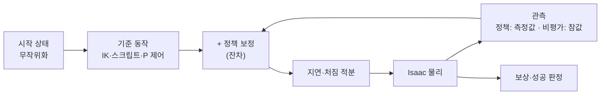

# skill별 학습 조건

움직이는 skill마다 **Isaac Lab 학습 환경 하나**를 두고, 같은 방식으로 학습합니다. 이 페이지는 skill마다 **무엇에서 시작해서, 무엇을 배우고, 어떻게 점수를 받는지**를 정리합니다.

- 코드: 브랜치 `feature/skill-envs` · `lv2_module6/isaac/lab/` (팀원 `feature/isaac-lab` 위에 추가)
- skill 목록·나눈 이유: [학습용 skill 구성](skill-learning.html)
- 기준선 결과는 2026-11-03 pa27(RTX 5060 8 GB)에서 잔차 0으로 128판씩 돌린 값입니다.

---

## 1. 모든 skill에 공통인 것

| 항목 | 내용 |
|---|---|
| **방식** | **잔차 강화학습**: 지금 쓰는 동작(기준선) + 정책이 더하는 작은 보정. 학습이 잘 안 돼도 기준선만큼은 동작 |
| **알고리즘** | rsl_rl PPO · 정책·비평가 신경망 256-128-64 (ELU) · 관측 정규화 |
| **PPO 설정** | 학습률 3e-4 (KL 0.01에 맞춰 자동 조절) · γ 0.99 · λ 0.95 · clip 0.2 · 엔트로피 0.002 · env당 32걸음 모아 5번 학습 |
| **물리·제어 주기** | 물리 200 Hz · 정책 팔 50 Hz / 주행 25 Hz |
| **실제 로봇과 맞춘 것** | 관절마다 실측 명령 지연(45~62 ms) · 처짐 보정 적분(실제 `rl_arm_correction`과 같은 식) · 팀 관절 한계 × 0.3 속도 |
| **비대칭 학습** | 정책은 **실제 로봇이 볼 수 있는 값**만(카메라 측정에 잡음·편향), 비평가는 **시뮬 참값**까지 봄 |
| **보상 틀** | 걸음마다: 목표 추종 + · 급한 동작 − · 보정 크기 − / 끝: 성공 +10 · 최종 오차 + / 떨굼·넘어짐·충돌 −5 |
| **결과물** | `policies/<skill>.pt` (TorchScript) · `.onnx` (실제 로봇 C++ `rl_arm_correction`이 읽음) |
| **명령** | `train_place.py --task <task> [--cfg k=v] --mode zero / train / eval` |
| **주의** | 8 GB GPU에는 학습 하나만 (둘이면 GPU 메모리 부족). 창으로 볼 땐 `--viz newton` (가벼움) |

---

## 2. 전체 현황

| skill | 영역 | 환경 (`--task`, `--cfg`) | 기준선 성공 | 상태 |
|---|---|---|---|---|
| `place_cell` | 팔 | `pip` (팀원) | 96.3 % (place, 10-31) | 학습됨 99.0 % (팀원) |
| `pick_upright` | 팔 | `pick` (팀원) | — | 팀원 정책 있음 |
| `stand_up` | 팔 | `right` (팀원) | — | 팀원 정책 있음 |
| `regrasp_stood` | 팔 | `right`, `regrasp=1` (팀원) | — | 연결만, 미시험 |
| `load_slot` | 팔 | `load` (**새로**) | 71.1 % | 450회 시연 학습 69.3 % — **놓침 약 20 %는 학습으로 안 줄어듦, 원인 확인 중** (사각·원기둥 비슷) |
| `unload_slot` | 팔 | `unload` (**새로**) | 90.6 % | 학습 대기 |
| `move_pose` | 팔 | `reach`, `target=pose` (**새로**) | 100 % | 시뮬에선 기준선으로 충분 |
| `camera_clear_view` | 팔 | `reach`, `target=clear` (**새로**) | 100 % | 시뮬에선 기준선으로 충분 |
| `pregrasp` | 팔 | `reach`, `target=above` (**새로**) | 88.3 % | 300회 학습 89.1 % — 실패는 특정 목표 자세(약 20 mm), 확인 필요 |
| `camera_look_down` | 팔 | `reach`, `target=look` (**새로**) | 100 % | 높이 확인 필요 (아래) |
| `drive_straight` | 주행 | `drive`, `task=straight` (**새로**) | 68.0 % | 학습 대상 (멈춘 자리 오차 중앙값 8.3 mm, 허용 10 mm) |
| `drive_turn` | 주행 | `drive`, `task=turn` (**새로**) | 100 % | 시뮬에선 기준선으로 충분 |
| `drive_arc` | 주행 | `drive`, `task=arc` (**새로**) | 94.5 % | 학습 대기 |
| `dock_box` | 주행 | `drive`, `task=dock` (**새로**) | **31.4 %** | **학습 중** (512 env, 1000회) |
| `park_home` | 주행 | `drive`, `task=park` (**새로**) | 87.5 % | 학습 대기 |
| `nudge_cell` · `stand_in_place` | 팔 | 없음 | — | 기준 동작부터 설계 필요 |
| `navigate` | 주행 | 없음 | — | Nav2·장애물 장면 필요 |
| `plan_next` | 플랜 | 가상 미션 (CPU) | 계산기 38.11점 | **skill 완성 후** (마지막) |

---

## 3. 팔 — 놓기·집기 계열 (팀원 환경 + 새 환경)

▶ <code>place_cell</code> — 주사위 칸 중심에 놓기 (팀원 <code>place_env.py</code> · <code>pip_env.py</code>)

| 항목 | 내용 |
|---|---|
| 시작 | 퍽을 쥔 손이 칸 위 50 mm. 칸은 가까운·가운데 줄 6칸 (먼 줄은 차체가 넘어져 제외) |
| 기준 동작 | 오프라인 IK로 칸 위 → 내려가기 → 안정 0.3 s → 36 mm로 열기 → 올리기 → 대기 |
| 정책 행동 | 관절 5개 보정 ±0.05 rad, 손 열기 전까지 |
| 관측 (정책) | 관절 추종 오차 · 남은 이동 · 관절 속도 · 이전 행동 · 단계 · 진행 · **손 카메라로 본 칸−퍽 (편향 2 mm, 잡음 1 mm)** · 처짐 적분 |
| 무작위화 | 칸 인식 ±5 mm · 손 안 퍽 ±2 mm(측정) · 퍽 질량 ×0.7~1.3 · 마찰 · (pip) 이웃 퍽 주사위 배치·놓인 오차 ±4 mm |
| 보상 | 칸 중심 추종 0.1·exp(−(e/4 mm)²) · 기울기 −0.2 · 급한 동작 −0.05 · 보정 크기 −0.002 · 성공 +10 · 최종 오차 +5 · 떨굼/넘어짐 −5 · (pip) 이웃 움직임 −50/m |
| 성공 | 중심 10 mm 안 · 기울기 5° 이하 · 손에서 빠짐 · 상자 위 · 2 mm 이상 안 움직임 · (pip) 이웃 3 mm/5° 안 |
| 결과 | 잔차 0 96.3 % → 정책 **99.0 %** (p90 8.4 → 4.1 mm) |

▶ <code>pick_upright</code> — 서 있는 퍽 집기 (팀원 <code>pick_env.py</code>)

| 항목 | 내용 |
|---|---|
| 시작 | stow 자세, 손 40 mm 열림. 시작 박스 위 퍽 2개(±40 mm), 그중 하나가 목표 (30 %는 이웃 없음 = 두 번째 집기) |
| 기준 동작 | stow → 퍽 위 50 mm → 잡는 높이 → 안정 → 닫기 → 들기 → 대기. 손가락은 두 퍽을 잇는 선에 직각, 사각 퍽은 가까운 면 |
| 정책 행동 | 관절 보정 ±0.05 rad, 손 닫기 전까지 |
| 관측 (정책) | 관절 상태 · 단계 · **손 카메라로 본 퍽−손 (편향 2 mm, 잡음 1 mm)** · 면 방향 오차 (잡음 2°) · 퍽 종류 · 처짐 적분 |
| 무작위화 | 인식 ±5 mm, ±10° · 정차 오차 ±10 mm · 퍽 방향 · 질량 · 마찰 |
| 보상 | 손−퍽 추종 0.1 · 퍽 기울기 −0.5 · **이웃 움직임 −50/m** · 급한 동작 −0.05 · 성공 +10 · 조준 오차 +5 · 넘어뜨림/넘어짐 −5 |
| 성공 | 30 mm 이상 들림 · 손 안 · 이웃 그대로 (3 mm, 5°) |
| 실패 종료 | 퍽 30° 넘게 기욺 (위에서 잡는 방식으로는 누운 퍽을 못 집음) |

▶ <code>stand_up</code> · <code>regrasp_stood</code> — 누운 퍽 세우기, 세운 퍽 다시 집기 (팀원 <code>right_env.py</code>)

| 항목 | 내용 |
|---|---|
| 시작 | stow. 시작 박스 위 누운 퍽(방향 ±90°), 70 %는 옆에 서 있는 이웃 |
| 기준 동작 (tilt) | 먼 쪽 끝을 **0.4 N으로 살짝 집고** 가까운 쪽 아래 모서리를 축으로 원호를 그리며 120°까지 넘김 → 멈춤 → 세워 내려놓기 → 열기 → 위로 비키기 (5축 팔은 손을 수평으로 못 눕혀서 퍽을 손 안에서 돌림) |
| 정책 행동 | 관절 보정 ±0.1 rad (세울 때 위쪽을 16 mm쯤 밀어 넘겨야 해서 더 큼) |
| 무작위화 | 인식 ±5 mm, ±10° · 쥐는 힘 ×0.85~1.15 · 지연 ×0.8~1.2 · 질량 · 마찰 · 가로 위치 ±45 mm |
| 보상 | 집은 동안 퍽이 서는 쪽 +0.01 · 연 뒤 서 있음 +0.1 · 손 흔들림 −0.1 · 성공 +10 · 실패 −5 |
| 성공 (stand_up) | 기울기 5° 미만으로 섬 · 박스 위 · 손에서 빠짐 · 박스 3 mm 이상 안 밀림 · 이웃 안 넘어짐 |
| 성공 (`regrasp=1`) | 세운 뒤 그 자리에서 다시 잡아 30 mm 이상 들고 손 안 |
| 실패 종료 | 박스에서 떨어짐 · 박스 밀림 · 이웃 넘어짐 · 연 뒤 다시 누움 |

▶ <code>load_slot</code> — 적재함 칸에 싣기 (새 <code>slot_env.py</code> · LoadEnv)

| 항목 | 내용 |
|---|---|
| 시작 | 퍽을 쥔 손이 **적재함 칸 위**(slot_table `q_over`). 칸 12개 × 퍽 종류 2 |
| 기준 동작 | slot_table 관절 자세: 칸 위 → 칸 바닥 3 mm 위(`q_low`) → 안정 → 열기 → 칸 위로 → 대기. 손 안 퍽 오차만큼 `q = q_nom + P·(−R·e)`로 보정 |
| 정책 행동 | 관절 보정 ±0.05 rad, 손 열기 전까지 |
| 관측 | `place_cell`과 같음 (칸 대신 적재함 칸) |
| 무작위화 | 칸 위치 ±1 mm (적재함은 로봇에 고정, 보정 오차만) · 손 안 퍽 ±2 mm · 퍽 질량·마찰 |
| 보상 | `place_cell`과 같은 항·가중치, 목표만 적재함 칸 중심 |
| 성공 | 칸 중심 10 mm 안 · 칸 바닥 높이 ±5 mm · 기울기 5° 이하 · 손에서 빠짐 · 정지 |
| 기준선 | **71.1 %** — 128판 중 28판은 내려가는 중 퍽이 손에서 빠짐 (링 모서리에 걸리는 것으로 보임, 확인 필요) |

▶ <code>unload_slot</code> — 적재함에서 꺼내기 (새 <code>slot_env.py</code> · UnloadEnv)

| 항목 | 내용 |
|---|---|
| 시작 | carry 자세(칸 쪽), 손 열림. 퍽이 칸 안에 (사각 퍽은 칸 벽에 맞춤 ±3°, 원기둥은 아무 방향) |
| 기준 동작 | carry → 칸 위(`q_over`) → 잡는 자세(`q_grasp`, 기둥 쪽 칸은 기둥에서 8 mm 비켜 잡음) → 안정 → 닫기 → 칸 위로 → 대기 |
| 정책 행동 | 관절 보정 ±0.05 rad, 손 닫기 전까지 |
| 관측 | `pick_upright`와 같음 (이웃 없음) |
| 무작위화 | 칸 안 퍽 위치 ±3 mm · 질량·마찰 · 처짐 |
| 보상 | `pick_upright`와 같은 항·가중치 (이웃 항은 0) |
| 성공 | 칸 바닥보다 30 mm 이상 들림 · 손 안 |
| 기준선 | **90.6 %** |

---

## 4. 팔 — 자세 계열 (새 <code>reach_env.py</code>)

하나의 환경에 목표만 바꿔서 4개 skill을 학습합니다. 정해진 자세나 퍽 위로 **손을 정확히 가져가는 것**이 목표이고, 정책은 이동이 끝난 뒤 **처짐 때문에 생기는 끝 위치 오차**를 줄입니다.

| 항목 | 공통 내용 |
|---|---|
| 시작 | stow · carry 왼쪽 · carry 오른쪽 중 하나 (±0.05 rad 흔들기), 손 열림 |
| 기준 동작 | 관절 공간 이동(팀 한계 × 0.3) → 유지 0.3 s → 안정 0.6 s → 판정 0.4 s |
| 정책 행동 | 관절 보정 ±0.05 rad, 이동이 끝난 뒤부터 |
| 관측 | 관절 추종 오차 · 목표까지 남은 관절 · 관절 속도 · 이전 행동 · 단계 · 진행 · **목표−손끝 위치 (cm)** · 처짐 적분 |
| 보상 | 손끝 추종 0.1·exp(−(e/4 mm)²) (이동 뒤) · 급한 동작 −0.05 · 보정 크기 −0.002 · 성공 +10 · 최종 오차 +5 · 넘어짐 −5 |
| 성공 | 손끝 오차 5 mm 안 · 관절 정지 (0.05 rad/s 미만) |

| skill | `--cfg` | 목표 | 기준선 |
|---|---|---|---|
| `move_pose` | `target=pose` | stow · carry 왼쪽 · carry 오른쪽 | 100 % (≤ 0.3 mm) |
| `camera_clear_view` | `target=clear` | stow (scan 자세가 정해질 때까지 대신) | 100 % |
| `pregrasp` | `target=above` | 시작 박스 위 3×3 위치 × 손목 3방향 중 IK 되는 27개, 손끝 아래로 퍽 윗면 50 mm 위 | **88.3 %** (최대 18.8 mm) → 학습 뒤 89.1 % |
| `camera_look_down` | `target=look` | 퍽 윗면 **0.08 m** 위, 카메라 기울기 25°까지 허용 (18개) | 100 % |

- `move_pose`·`camera_clear_view`·`camera_look_down`은 시뮬에서 기준선이 이미 100 %라 **학습으로 얻을 게 없습니다.** 실제 처짐을 잰 뒤 시뮬 처짐을 맞추고 다시 봅니다.
- ❓ **확인 필요**: coordinator `plan.yaml`의 `inspect_height_m = 0.15`는 시작 박스(70 mm) 위 퍽에서 손끝을 아래로 향한 채로는 **팔이 닿지 않습니다** (IK 계산: 박스 가운데 ≤ 0.10 m, 박스 전체 0.08 m).

---

## 5. 주행 (새 <code>drive_env.py</code>)

하나의 환경에 과제만 바꿔서 5개 skill을 학습합니다. 정책은 **속도 명령(v, w)에 보정**을 더합니다.

| 항목 | 공통 내용 |
|---|---|
| 시작 | 로봇 정지, 팔 stow, 시작 자세 = 원점 |
| 기준 동작 | `demo_cycle.py drive_to`와 같은 P 제어: 목표 쪽으로 돌기(10° 넘으면) → 방향 보정하며 직진(최대 0.12 m/s) → 마지막 방향으로 돌기 |
| 정책 행동 | v ± 0.05 m/s · w ± 0.3 rad/s 보정 (한계 0.26 m/s, 2 rad/s) |
| 관측 (정책) | 로봇 기준 목표 (x, y, cos·sin 방향) · 차체 속도 · 회전 속도 · 기준 명령 · 이전 행동 · 시간 · 기울기. 목표는 **SLAM 같은 잡음** (±5 mm, ±0.5°) |
| 관측 (비평가) | + 참 목표 · 바퀴 속도 오차 · 지연 |
| 무작위화 | 바퀴마다 속도 오차 ×0.97~1.03 (반지름·보정) · 명령 지연 20~60 ms · 바퀴 마찰 0.6~1.1 |
| 보상 | 목표에 가까워진 만큼 +2.0/m · 방향 오차 줄어든 만큼 +0.5/rad · 급한 동작 −0.02 · 보정 크기 −0.005 · 차체 기울기 −1.0 · 성공 +10 · 넘어짐/충돌 −5 |
| 성공 | 위치·방향 허용 안 + 정지(0.01 m/s, 0.03 rad/s)를 정해진 시간 동안 유지 |

| skill | `--cfg` | 목표 | 허용 (위치, 방향) | 유지 | 제한 시간 |
|---|---|---|---|---|---|
| `drive_straight` | `task=straight` | 앞 0.2~1.5 m | 10 mm, 1.0° | 0.5 s | 20 s |
| `drive_turn` | `task=turn` | 제자리 ±180° | 10 mm, 0.7° | 0.5 s | 10 s |
| `drive_arc` | `task=arc` | 앞 0.3~1.2 m, 옆 ±0.6 m, 방향 ±90° | 20 mm, 2.0° | 0.5 s | 25 s |
| `dock_box` | `task=dock` | 0.6~1.2 m 떨어진 시작 박스 앞 도킹 자세 (박스 중심이 0.18 m 앞) | 10 mm, 1.5° | 0.5 s | 25 s |
| `park_home` | `task=park` | 0.3~1.5 m 떨어진 구역 | 50 mm, 10° | **3 s** | 25 s |

- `dock_box`는 박스에 닿으면(도킹 거리보다 2 cm 넘게 가까워짐) 실패로 끝납니다.
- 기준선 (잔차 0, 128판): straight **68.0 %** · turn **100 %** · arc **94.5 %** · dock **31.4 %** (p90 51 mm) · park **87.5 %**
- `dock_box`가 가장 낮아 먼저 학습 중입니다. straight는 기준 제어가 1 cm 안에 들어오면 멈춰서, 허용 10 mm 경계에 걸립니다.

---

## 6. 아직 없는 것과 다음 순서

| 순서 | 할 일 | 이유 |
|---|---|---|
| 1 | 주행 학습: dock → straight → park → arc | 기준선 낮은 순 |
| 2 | `load_slot` 놓침 원인 확인 | 기준선·학습 뒤 모두 약 20 %가 손에서 빠짐 |
| 3 | skill별 본 학습 (env 512, 1500회 ≈ 35분/skill) | 한 번에 하나 (8 GB GPU) |
| 4 | `nudge_cell`·`stand_in_place` 기준 동작 설계 | 지금 스크립트가 없음 |
| 5 | `navigate` 환경 (Nav2 + 장애물) | 가장 무거움 |
| 6 | 실측 2개 (`compensate_sag`·`grip_force`) 절차·맞추기 | 시뮬 처짐·힘을 실기에 맞춤 |
| 마지막 | `plan_next` | skill 성공률이 나온 뒤 |
