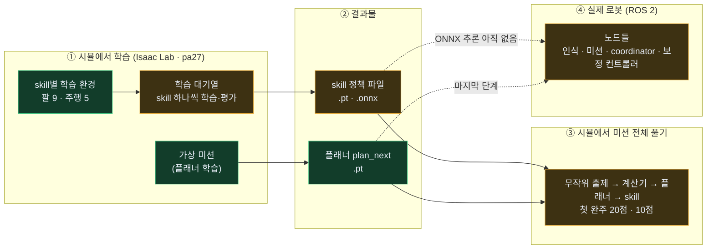
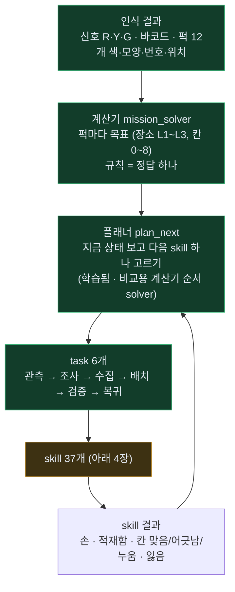
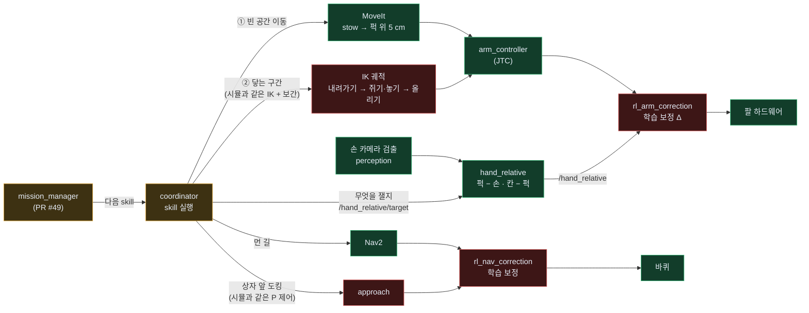
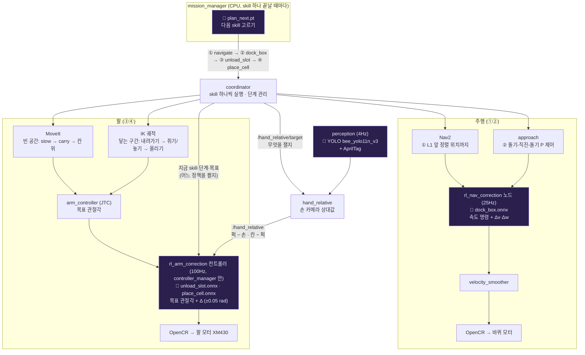
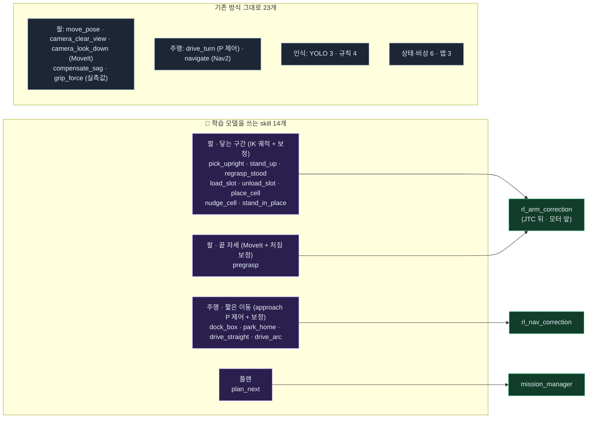
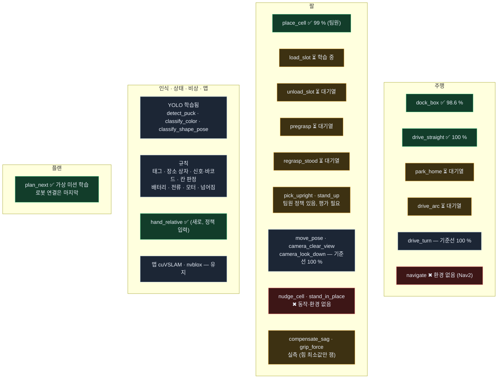
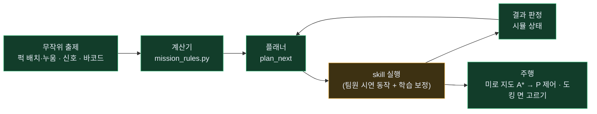
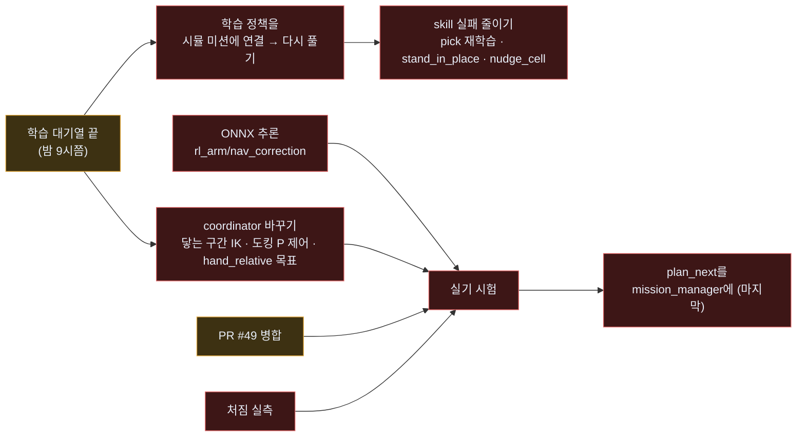

# BEE 전체 지도 — 학습부터 로봇까지

> 2026-11-03 20:00 기준. 지금까지 만든 것 전부를 한 장에 그렸습니다. 색: <b style="color:#3fbf7f">초록 = 완료</b> · <b style="color:#e2a83a">노랑 = 진행 중 · 일부</b> · <b style="color:#e06666">빨강 = 아직 없음</b> · <b style="color:#8aa0b8">회색 = 학습 안 함 (규칙·기존 그대로)</b>
> 자세한 내용: [학습용 skill 구성](skill-learning.html) · [skill별 학습 조건](skill-training.html) · [스킬·플랜 한 장](skill-plan.html)

---

## 1. 한눈에 — 세 덩어리

| 덩어리 | 지금 | 막힌 곳 |
|---|---|---|
| ① 시뮬 학습 | 환경 14개 완성, 대기열 8개 중 2개 끝 (`dock_box` 98.6 %, `drive_straight` 100 %) | — (밤 9시쯤 끝 예상) |
| ② 결과물 | 쓸 수 있는 정책 3개 (`place_cell` 99 % 팀원 · `dock_box` · `drive_straight`) · 플래너 1개 | 학습 대기 6개 |
| ③ 시뮬 미션 | 무작위 문제를 끝까지 풂 (문제 #1 20점, #7 10점) | 점수를 깎는 건 **skill 실패** (집다 떨어뜨림 · 놓다 누움) |
| ④ 로봇 | 노드 틀은 있음 | **보정 컨트롤러 ONNX 추론 없음** · coordinator 닿는 구간 방식 바꾸기 · PR #49 |

---

## 2. 미션은 어떻게 풀리나 — 계산기 · 플래너 · task · skill

| 부분 | 시뮬 (Isaac) | 로봇 (ROS) |
|---|---|---|
| 계산기 | ✅ `mission_rules.py` (C++와 같은 규칙) | 🟡 `mission_solver` — PR #49 열림 |
| 플래너 | ✅ `plan_next` 학습 · 미션 실행기에서 사용 | 🔴 mission_manager에 아직 없음 (마지막 단계, 그때까지 규칙 순서) |
| task 흐름 | ✅ 미션 실행기 | 🟡 `mission_manager` — PR #49 열림 |

---

## 3. 로봇에서 한 skill이 움직이는 길 (2026-11-03 배포 결정)

| 칸 | 상태 | 무엇이 남았나 | 누가 |
|---|---|---|---|
| MoveIt · JTC · Nav2 · 하드웨어 | ✅ 있음 | — | — |
| `hand_relative` (손 카메라 상대값) | ✅ 오늘 만듦 (`feature/hand-relative`) | PR | 나 |
| coordinator → `/hand_relative/target` | 🔴 | 닿는 구간 시작 전에 보내기 | coordinator (트랙 ②) |
| coordinator 닿는 구간 = 시뮬과 같은 IK 궤적 | 🔴 | 지금은 MoveIt — 그 구간만 바꾸기 | coordinator (트랙 ②) |
| approach 도킹 = 시뮬과 같은 P 제어 | 🔴 | 돌기-직진-돌기로 | coordinator (트랙 ②) |
| `rl_arm_correction` · `rl_nav_correction` | 🔴 틀만 (Δ = 0) | ONNX 추론 + `/hand_relative`·skill 단계 입력 | 송정혁 |
| mission_manager · mission_solver | 🟡 PR #49 | 병합 | 사용자 |

---

## 3-1. 예시: "배치" task 하나가 하드웨어까지 가는 길 — 학습된 모델은 어디서 도나

**상황**: 플래너가 "퍽 7번(적재함 칸 5에 있음)을 L1 상자의 가운데 칸(4번)에 놓기"를 골랐습니다. 이 task는 skill 4개로 풀립니다.

<b style="color:#a78bfa">🧠 보라 = 학습된 모델이 도는 곳</b>

| 순서 | skill | 누가 움직이나 | 🧠 학습된 모델 (어디서 · 무엇을) | 끝 판정 |
|---|---|---|---|---|
| 0 | (고르기) | mission_manager | **`plan_next.pt`** — mission_manager 안. skill이 하나 끝날 때마다 한 번 돌아 "다음 skill + 대상 퍽"을 냄 | — |
| ① | `navigate` | Nav2 | 없음 (Nav2 그대로) | L1 앞 정렬 위치 도착 |
| ② | `dock_box` | coordinator approach (돌기-직진-돌기) | **`dock_box.onnx`** — `rl_nav_correction` 노드. 매 주기 approach 속도 명령에 작은 Δv·Δw를 더해 바퀴로 | 상자 앞 1 cm · 1.5° 안 정지 |
| ③ | `unload_slot` | [1] MoveIt: stow → carry → 칸 5 위 · [2] IK 궤적: 내려가기 → 쥐기 → 칸 위 | **`unload_slot.onnx`** — `rl_arm_correction` 컨트롤러. [2] 구간 동안만 켜짐. 입력: 관절 상태 + 단계 + `/hand_relative`(퍽 − 손) → JTC 목표각에 Δ를 더해 모터로 | 퍽이 손 안 (전류 + 손가락 위치) |
| ④ | `place_cell` | [1] MoveIt: carry → 칸 4 위 5 cm · [2] IK 궤적: 내려가기 → 벌리기 → 올리기 | **`place_cell.onnx`** — 같은 `rl_arm_correction`. 입력에 `/hand_relative`(칸 − 손 안 퍽) | `judge_cell` (규칙): 칸 중심 10 mm 안 · 2초 정지 |
| → | (다음) | mission_manager | **`plan_next.pt`** 다시 — 결과(칸 맞음/어긋남/누움)를 보고 다음 skill | — |

**정리 — 모델은 4곳에서만 돕니다**

| 모델 | 도는 곳 | 얼마나 자주 | 하는 일 | 없으면 |
|---|---|---|---|---|
| `plan_next.pt` | mission_manager (노드) | skill 하나 끝날 때 1번 | 다음 skill 고르기 | 규칙 순서 / 계산기 순서 |
| `dock_box.onnx` 등 주행 정책 | rl_nav_correction (노드) | 25Hz | 속도 명령에 작은 보정 | 보정 0 — 기준 P 제어만 |
| `place_cell.onnx` 등 팔 정책 | rl_arm_correction (ros2_control 컨트롤러, JTC 바로 뒤) | 100Hz 루프, 정책은 50Hz | 목표 관절각에 작은 보정 (닿는 구간만) | 보정 0 — 기준 궤적만 |
| YOLO | perception (노드) | 카메라당 ≤ 4Hz | 퍽·신호등 찾기 | — |

- 학습된 skill 정책은 **로봇을 처음부터 움직이지 않습니다.** 늘 "기준 동작(Nav2 · MoveIt · IK 궤적 · P 제어)이 움직이고, 정책은 그 위에 몇 mm·몇 cm/s만 고칩니다." 그래서 정책을 끄면(Δ = 0) 지금 로봇과 똑같이 움직입니다.
- 팔 정책 파일은 skill마다 하나씩이고, **coordinator가 "지금 어떤 skill의 어느 단계인지"를 알려 주면 `rl_arm_correction`이 그 skill의 정책만 켭니다.** 빈 공간 이동 중이거나 skill이 없으면 꺼져 있습니다.
- 🔴 지금 로봇에 없는 것: `rl_arm_correction`·`rl_nav_correction`의 ONNX 추론 (틀만, Δ = 0) · coordinator → 보정 컨트롤러 "skill·단계" 전달 · coordinator 닿는 구간 IK 궤적 · approach P 제어 · mission_manager의 `plan_next` (3장 표).

---

## 3-2. 최종 목표 — skill별로 무엇이 움직이고, 학습 모델은 어디서 도나

> 학습 결과(지금은 1차)가 모두 기준선보다 좋아졌다고 볼 때의 최종 그림입니다. 결과가 기준선을 못 넘는 skill은 그 정책만 끄고 기준 동작으로 돌아갑니다 (Δ = 0).

**한 문장**: "퍽에 닿는 구간과 상자 앞 짧은 도킹·이동"에만 학습 보정이 붙고, 나머지는 지금 로봇 방식(MoveIt · Nav2 · YOLO · 규칙) 그대로 — 그 위에서 플래너 하나가 다음 skill을 고릅니다.

### 🧠 학습 모델(ONNX)을 쓰는 skill — 14개

| 영역 | skill | 기준 동작 (움직이는 것) | 학습 보정이 도는 곳 |
|---|---|---|---|
| 팔 · 닿는 구간 | `pick_upright` · `stand_up` · `regrasp_stood` · `load_slot` · `unload_slot` · `place_cell` · `nudge_cell`* · `stand_in_place`* | IK 궤적 (시뮬과 같음) | `rl_arm_correction` — JTC 뒤, 모터 앞 |
| 팔 · 끝 자세 | `pregrasp` | MoveIt 경로 | `rl_arm_correction` — 도착 뒤 처짐 보정 |
| 주행 · 짧은 이동 | `dock_box` · `park_home` · `drive_straight` · `drive_arc` | approach P 제어 (돌기-직진-돌기) | `rl_nav_correction` |
| 플랜 | `plan_next` | (규칙 순서 대신) | `mission_manager` |

\* 아직 학습 환경 없음 — 만들면 이 줄에 들어감

### 학습 모델 없이 기존 방식 그대로 — 23개

| 영역 | skill | 무엇으로 |
|---|---|---|
| 팔 | `move_pose` · `camera_clear_view` · `camera_look_down` | MoveIt (기준선이 이미 정확) |
| 팔 | `compensate_sag` · `grip_force` | 실측값 (보정표) |
| 주행 | `drive_turn` | P 제어 (기준선이 이미 정확) |
| 주행 | `navigate` | Nav2 |
| 인식 | `detect_puck` · `classify_color` · `classify_shape_pose` | YOLO (이미 학습된 `.pt`, perception 노드) |
| 인식 | `read_puck_tag` · `detect_location_box` · `read_signal_barcode` · `judge_cell` | 규칙 (AprilTag · 바코드 · 거리 계산) |
| 상태·비상 | `monitor_battery` · `monitor_current` · `monitor_motor` · `detect_tip_impact` · `basket_ledger` · `estop` | 문턱값 · 장부 · 버튼 |
| 맵 | `slam_localize` · `build_map` · `align_arena` | cuVSLAM · nvblox |

### 로봇에서 학습 모델이 도는 노드 — 결국 3개

| 노드 | 담는 모델 | 언제 켜지나 | 끄면 |
|---|---|---|---|
| `rl_arm_correction` | 팔 skill 9개 정책 (skill마다 1개) | coordinator가 "지금 이 skill의 닿는 구간"이라고 알려 줄 때만 | Δ = 0 → 기준 궤적만 |
| `rl_nav_correction` | 주행 skill 4개 정책 | approach로 도킹·짧은 이동할 때만 | Δ = 0 → 기준 P 제어만 |
| `mission_manager` | `plan_next` | skill 하나 끝날 때마다 | 규칙 순서 / 계산기 순서 |

(+ YOLO가 도는 perception 노드 — 이번에 새로 학습한 것이 아니라 원래 있던 모델)

---

## 4. skill 37개 지도 — 영역별 상태

▶ skill 37개 전체 표 (상태·결과물)

| 영역 | skill | 방식 | 시뮬 환경 | 기준선 → 학습 뒤 | 결과물 |
|---|---|---|---|---|---|
| 주행 | `dock_box` | 강화학습 | drive task=dock | 30.2 → **98.6 %** | ✅ `dock_box.pt/.onnx` |
| 주행 | `drive_straight` | 강화학습 | drive task=straight | 61.4 → **100 %** | ✅ `drive_straight.pt/.onnx` |
| 주행 | `park_home` | 강화학습 | drive task=park | 87.5 % → 대기열 | ⏳ |
| 주행 | `drive_arc` | 강화학습 | drive task=arc | 94.5 % → 대기열 | ⏳ |
| 주행 | `drive_turn` | 강화학습 | drive task=turn | 100 % | 기준선으로 충분 |
| 주행 | `navigate` | 강화학습 | 없음 | — | Nav2 그대로 |
| 팔 | `place_cell` | 강화학습 | pip (팀원) | 96.3 → **99.0 %** | ✅ `place_residual*.pt` (팀원) |
| 팔 | `pick_upright` | 강화학습 | pick (팀원) | — | 🟡 팀원 정책, 평가 필요 |
| 팔 | `stand_up` | 강화학습 | right (팀원) | — | 🟡 팀원 정책, 평가 필요 |
| 팔 | `regrasp_stood` | 강화학습 | right regrasp=1 | 대기열 | ⏳ |
| 팔 | `load_slot` | 강화학습 | load | 93.8 % → 학습 중 | ⏳ |
| 팔 | `unload_slot` | 강화학습 | unload | 90.6 % → 대기열 | ⏳ |
| 팔 | `pregrasp` | 강화학습 | reach target=above | 88~91 % → 대기열 | ⏳ |
| 팔 | `camera_look_down` | 강화학습 | reach target=look | 100 % | 기준선으로 충분 (높이 0.08 m — 확인 필요) |
| 팔 | `move_pose` · `camera_clear_view` | 강화학습 | reach pose · clear | 100 % | 기준선으로 충분 |
| 팔 | `nudge_cell` · `stand_in_place` | 강화학습 | 없음 | — | 🔴 동작부터 설계 |
| 팔 | `compensate_sag` · `grip_force` | 실측 | — | — | 🟡 쥐는 힘 최소값만 잼 · 처짐 실측 필요 |
| 인식 | `detect_puck` · `classify_color` · `classify_shape_pose` | YOLO (학습됨) | — | — | `bee_yolo11n_v3` |
| 인식 | `read_puck_tag` · `detect_location_box` · `read_signal_barcode` · `judge_cell` | 규칙 | — | — | 기존 |
| 상태·비상 | `monitor_battery` · `monitor_current` · `monitor_motor` · `detect_tip_impact` | 규칙 (문턱값) | — | — | 기존 |
| 상태·비상 | `basket_ledger` · `estop` | 없음 | — | — | 기존 |
| 맵 | `slam_localize` · `build_map` · `align_arena` | 유지 | — | — | cuVSLAM · nvblox |
| 플랜 | `plan_next` | 강화학습 | 가상 미션 | 계산기 38.1점 · 학습 37.6점 (가상) | ✅ `plan_next.pt` |

---

## 5. 시뮬에서 미션 전체 풀기 — 실행기 구조

| 문제 | 신호 · 바코드 | 결과 | 깎인 이유 |
|---|---|---|---|
| #1 | R4 Y3 G5 · P2-01 오름 | **20 / 40** (L2 +10, 복귀 +10) | 집다 떨어뜨림 1 · 놓다 누움 1 |
| #7 (화면) | R5 Y5 G2 · P2-04 내림 | **10 / 40** (복귀 +10) | 세우기 덜 섬 1 · 놓다 누움 1 · 집다 떨어뜨림 1 |

- 아직 미션 실행기에는 **팀원 정책만** 들어 있습니다. 대기열 정책(`dock_box` 등)은 끝나면 연결합니다.
- 칸 위 누운 퍽 세우기(`stand_in_place`)가 없어서, 놓다 누우면 그 장소 점수는 못 받습니다.

---

## 6. 남은 일 — 순서대로

| 할 일 | 누가 | 막히면 |
|---|---|---|
| 학습 정책 → 시뮬 미션 연결 · 다시 풀기 | 나 | — |
| skill 실패 줄이기 (`pick_upright` 평가·재학습, `stand_in_place`·`nudge_cell` 만들기) | 나 | — |
| coordinator: 닿는 구간 IK 궤적 · 도킹 P 제어 · `/hand_relative/target` | coordinator (사용자 트랙 ②) — 내가 해도 되는지 확인 필요 | 실기에서 정책을 못 씀 |
| `rl_arm_correction` · `rl_nav_correction` ONNX 추론 + 입력 | 송정혁 | 실기에서 정책을 못 씀 |
| PR #49 병합 | 사용자 | 로봇 미션 흐름 없음 |
| 처짐 실측 · 실제 처짐 보정 적분 확인 | 송정혁 / 실기 | 팔 정책이 실기에서 어긋날 수 있음 |
| PR 만들기: `feature/skill-learning` · `feature/skill-envs` · `feature/hand-relative` | 나 | — |
| `plan_next` → mission_manager | 나 | 마지막 단계 |

---

## 7. 브랜치 · 파일 위치

| 브랜치 | 들어 있는 것 |
|---|---|
| `feature/skill-learning` | `lv2_module6/learning/skills.yaml` (skill 37개 · 계약 · 배포 조건) · `learning/plan/` (가상 미션 · 플래너 학습 · 계산기 순서) |
| `feature/skill-envs` (팀원 `feature/isaac-lab` 위) | `isaac/lab/` 새 환경 `slot_env` · `reach_env` · `drive_env` · 학습 대기열 `train_queue.sh` · 미션 실행기 `mission_run.py` · 계산기 `mission_rules.py` |
| `feature/hand-relative` | 인식 `hand_relative` 노드 · `HandTarget`/`HandRelative` 메시지 · API.md |
| PR #49 `feature/mission-flow` | mission_manager · mission_solver · coordinator 좌표 skill |
| pa27 `~/bee_skill` | 학습 중인 복사본 · `logs/queue_summary.tsv` (학습 결과 한 줄씩) |
