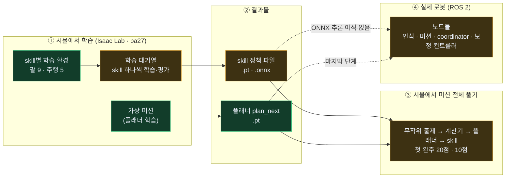
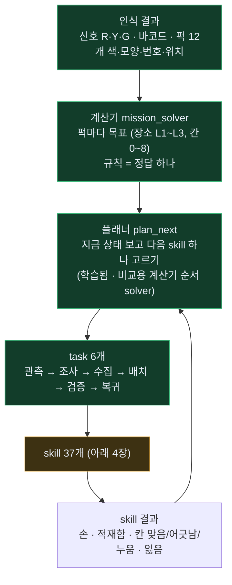
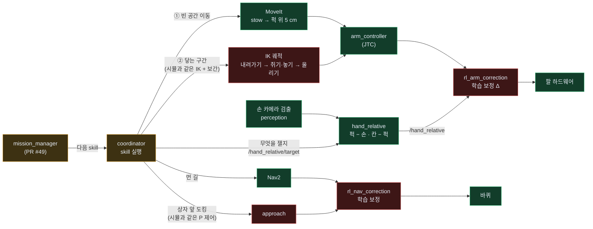
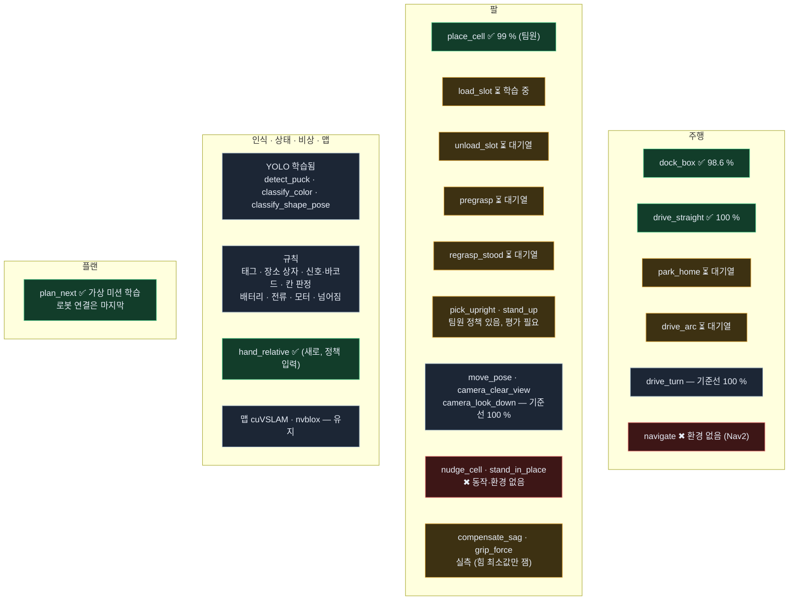
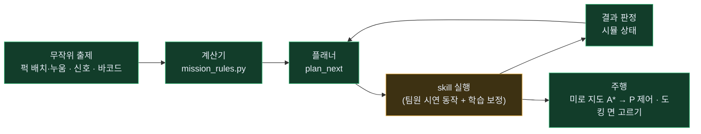
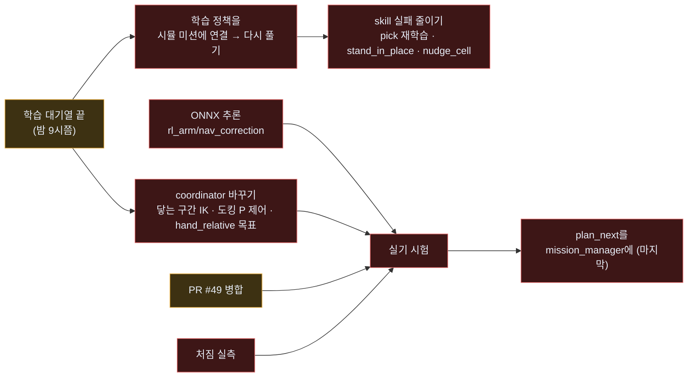

# BEE 전체 지도 — 학습부터 로봇까지

> 2026-11-03 19:30 기준. 지금까지 만든 것 전부를 한 장에 그렸습니다. 색: <b style="color:#3fbf7f">초록 = 완료</b> · <b style="color:#e2a83a">노랑 = 진행 중 · 일부</b> · <b style="color:#e06666">빨강 = 아직 없음</b> · <b style="color:#8aa0b8">회색 = 학습 안 함 (규칙·기존 그대로)</b>
> 자세한 내용: [학습용 skill 구성](skill-learning.html) · [skill별 학습 조건](skill-training.html) · [스킬·플랜 한 장](skill-plan.html)

---

## 1. 한눈에 — 세 덩어리

| 덩어리 | 지금 | 막힌 곳 |
|---|---|---|
| ① 시뮬 학습 | 환경 14개 완성, 대기열 8개 중 2개 끝 (`dock_box` 98.6 %, `drive_straight` 100 %) | — (밤 9시쯤 끝 예상) |
| ② 결과물 | 쓸 수 있는 정책 3개 (`place_cell` 99 % 팀원 · `dock_box` · `drive_straight`) · 플래너 1개 | 학습 대기 6개 |
| ③ 시뮬 미션 | 무작위 문제를 끝까지 풂 (문제 #1 20점, #7 10점) | 점수를 깎는 건 **skill 실패** (집다 떨어뜨림 · 놓다 누움) |
| ④ 로봇 | 노드 틀은 있음 | **보정 컨트롤러 ONNX 추론 없음** · coordinator 닿는 구간 방식 바꾸기 · PR #49 |

---

## 2. 미션은 어떻게 풀리나 — 계산기 · 플래너 · task · skill

| 부분 | 시뮬 (Isaac) | 로봇 (ROS) |
|---|---|---|
| 계산기 | ✅ `mission_rules.py` (C++와 같은 규칙) | 🟡 `mission_solver` — PR #49 열림 |
| 플래너 | ✅ `plan_next` 학습 · 미션 실행기에서 사용 | 🔴 mission_manager에 아직 없음 (마지막 단계, 그때까지 규칙 순서) |
| task 흐름 | ✅ 미션 실행기 | 🟡 `mission_manager` — PR #49 열림 |

---

## 3. 로봇에서 한 skill이 움직이는 길 (2026-11-03 배포 결정)

| 칸 | 상태 | 무엇이 남았나 | 누가 |
|---|---|---|---|
| MoveIt · JTC · Nav2 · 하드웨어 | ✅ 있음 | — | — |
| `hand_relative` (손 카메라 상대값) | ✅ 오늘 만듦 (`feature/hand-relative`) | PR | 나 |
| coordinator → `/hand_relative/target` | 🔴 | 닿는 구간 시작 전에 보내기 | coordinator (트랙 ②) |
| coordinator 닿는 구간 = 시뮬과 같은 IK 궤적 | 🔴 | 지금은 MoveIt — 그 구간만 바꾸기 | coordinator (트랙 ②) |
| approach 도킹 = 시뮬과 같은 P 제어 | 🔴 | 돌기-직진-돌기로 | coordinator (트랙 ②) |
| `rl_arm_correction` · `rl_nav_correction` | 🔴 틀만 (Δ = 0) | ONNX 추론 + `/hand_relative`·skill 단계 입력 | 송정혁 |
| mission_manager · mission_solver | 🟡 PR #49 | 병합 | 사용자 |

---

## 4. skill 37개 지도 — 영역별 상태

▶ skill 37개 전체 표 (상태·결과물)

| 영역 | skill | 방식 | 시뮬 환경 | 기준선 → 학습 뒤 | 결과물 |
|---|---|---|---|---|---|
| 주행 | `dock_box` | 강화학습 | drive task=dock | 30.2 → **98.6 %** | ✅ `dock_box.pt/.onnx` |
| 주행 | `drive_straight` | 강화학습 | drive task=straight | 61.4 → **100 %** | ✅ `drive_straight.pt/.onnx` |
| 주행 | `park_home` | 강화학습 | drive task=park | 87.5 % → 대기열 | ⏳ |
| 주행 | `drive_arc` | 강화학습 | drive task=arc | 94.5 % → 대기열 | ⏳ |
| 주행 | `drive_turn` | 강화학습 | drive task=turn | 100 % | 기준선으로 충분 |
| 주행 | `navigate` | 강화학습 | 없음 | — | Nav2 그대로 |
| 팔 | `place_cell` | 강화학습 | pip (팀원) | 96.3 → **99.0 %** | ✅ `place_residual*.pt` (팀원) |
| 팔 | `pick_upright` | 강화학습 | pick (팀원) | — | 🟡 팀원 정책, 평가 필요 |
| 팔 | `stand_up` | 강화학습 | right (팀원) | — | 🟡 팀원 정책, 평가 필요 |
| 팔 | `regrasp_stood` | 강화학습 | right regrasp=1 | 대기열 | ⏳ |
| 팔 | `load_slot` | 강화학습 | load | 93.8 % → 학습 중 | ⏳ |
| 팔 | `unload_slot` | 강화학습 | unload | 90.6 % → 대기열 | ⏳ |
| 팔 | `pregrasp` | 강화학습 | reach target=above | 88~91 % → 대기열 | ⏳ |
| 팔 | `camera_look_down` | 강화학습 | reach target=look | 100 % | 기준선으로 충분 (높이 0.08 m — 확인 필요) |
| 팔 | `move_pose` · `camera_clear_view` | 강화학습 | reach pose · clear | 100 % | 기준선으로 충분 |
| 팔 | `nudge_cell` · `stand_in_place` | 강화학습 | 없음 | — | 🔴 동작부터 설계 |
| 팔 | `compensate_sag` · `grip_force` | 실측 | — | — | 🟡 쥐는 힘 최소값만 잼 · 처짐 실측 필요 |
| 인식 | `detect_puck` · `classify_color` · `classify_shape_pose` | YOLO (학습됨) | — | — | `bee_yolo11n_v3` |
| 인식 | `read_puck_tag` · `detect_location_box` · `read_signal_barcode` · `judge_cell` | 규칙 | — | — | 기존 |
| 상태·비상 | `monitor_battery` · `monitor_current` · `monitor_motor` · `detect_tip_impact` | 규칙 (문턱값) | — | — | 기존 |
| 상태·비상 | `basket_ledger` · `estop` | 없음 | — | — | 기존 |
| 맵 | `slam_localize` · `build_map` · `align_arena` | 유지 | — | — | cuVSLAM · nvblox |
| 플랜 | `plan_next` | 강화학습 | 가상 미션 | 계산기 38.1점 · 학습 37.6점 (가상) | ✅ `plan_next.pt` |

---

## 5. 시뮬에서 미션 전체 풀기 — 실행기 구조

| 문제 | 신호 · 바코드 | 결과 | 깎인 이유 |
|---|---|---|---|
| #1 | R4 Y3 G5 · P2-01 오름 | **20 / 40** (L2 +10, 복귀 +10) | 집다 떨어뜨림 1 · 놓다 누움 1 |
| #7 (화면) | R5 Y5 G2 · P2-04 내림 | **10 / 40** (복귀 +10) | 세우기 덜 섬 1 · 놓다 누움 1 · 집다 떨어뜨림 1 |

- 아직 미션 실행기에는 **팀원 정책만** 들어 있습니다. 대기열 정책(`dock_box` 등)은 끝나면 연결합니다.
- 칸 위 누운 퍽 세우기(`stand_in_place`)가 없어서, 놓다 누우면 그 장소 점수는 못 받습니다.

---

## 6. 남은 일 — 순서대로

| 할 일 | 누가 | 막히면 |
|---|---|---|
| 학습 정책 → 시뮬 미션 연결 · 다시 풀기 | 나 | — |
| skill 실패 줄이기 (`pick_upright` 평가·재학습, `stand_in_place`·`nudge_cell` 만들기) | 나 | — |
| coordinator: 닿는 구간 IK 궤적 · 도킹 P 제어 · `/hand_relative/target` | coordinator (사용자 트랙 ②) — 내가 해도 되는지 확인 필요 | 실기에서 정책을 못 씀 |
| `rl_arm_correction` · `rl_nav_correction` ONNX 추론 + 입력 | 송정혁 | 실기에서 정책을 못 씀 |
| PR #49 병합 | 사용자 | 로봇 미션 흐름 없음 |
| 처짐 실측 · 실제 처짐 보정 적분 확인 | 송정혁 / 실기 | 팔 정책이 실기에서 어긋날 수 있음 |
| PR 만들기: `feature/skill-learning` · `feature/skill-envs` · `feature/hand-relative` | 나 | — |
| `plan_next` → mission_manager | 나 | 마지막 단계 |

---

## 7. 브랜치 · 파일 위치

| 브랜치 | 들어 있는 것 |
|---|---|
| `feature/skill-learning` | `lv2_module6/learning/skills.yaml` (skill 37개 · 계약 · 배포 조건) · `learning/plan/` (가상 미션 · 플래너 학습 · 계산기 순서) |
| `feature/skill-envs` (팀원 `feature/isaac-lab` 위) | `isaac/lab/` 새 환경 `slot_env` · `reach_env` · `drive_env` · 학습 대기열 `train_queue.sh` · 미션 실행기 `mission_run.py` · 계산기 `mission_rules.py` |
| `feature/hand-relative` | 인식 `hand_relative` 노드 · `HandTarget`/`HandRelative` 메시지 · API.md |
| PR #49 `feature/mission-flow` | mission_manager · mission_solver · coordinator 좌표 skill |
| pa27 `~/bee_skill` | 학습 중인 복사본 · `logs/queue_summary.tsv` (학습 결과 한 줄씩) |
