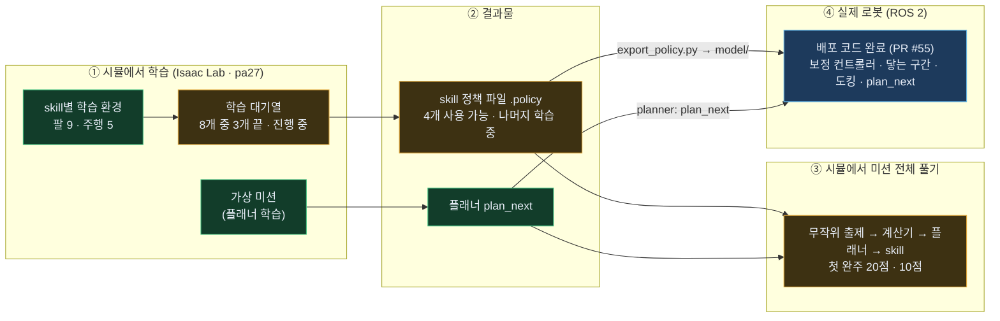
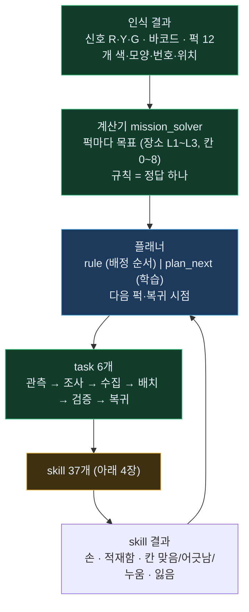
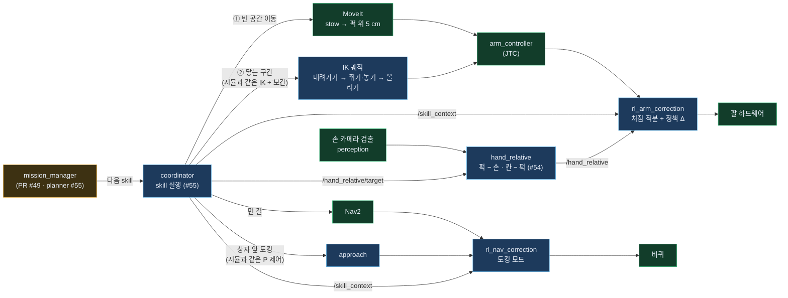
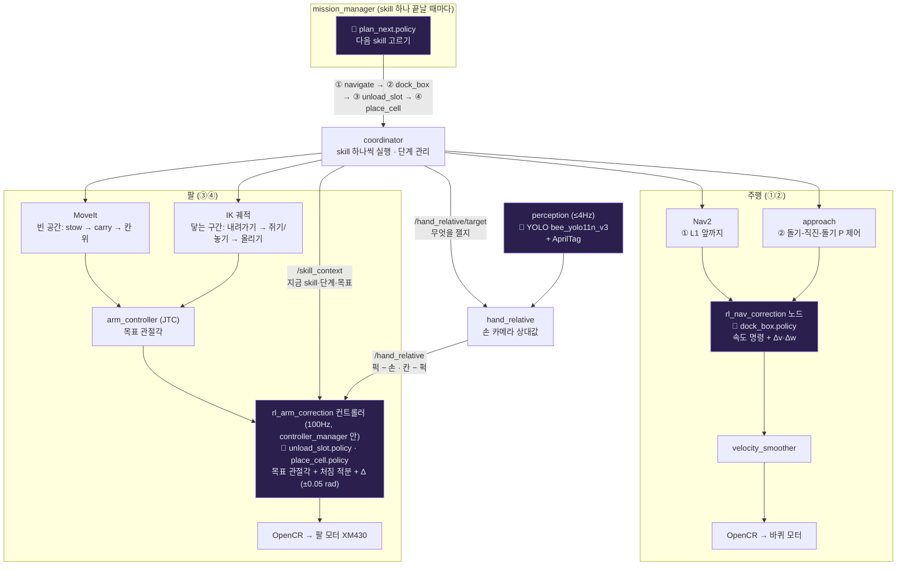
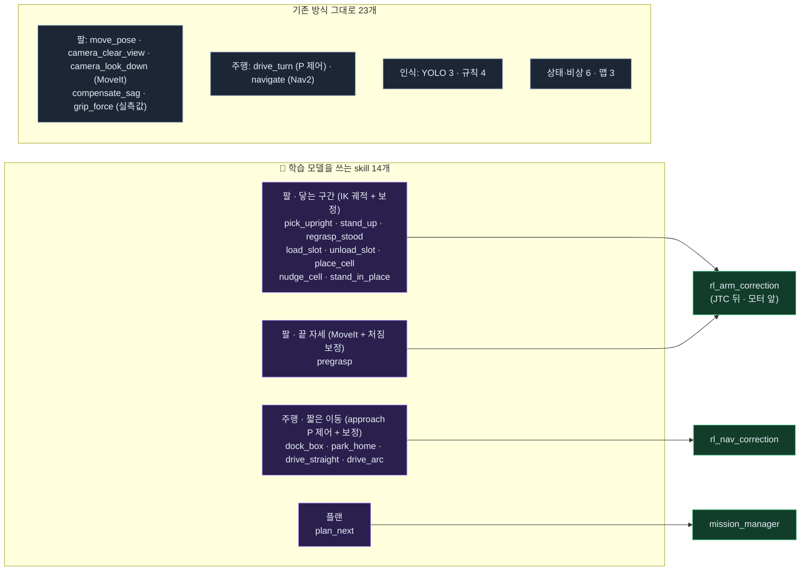
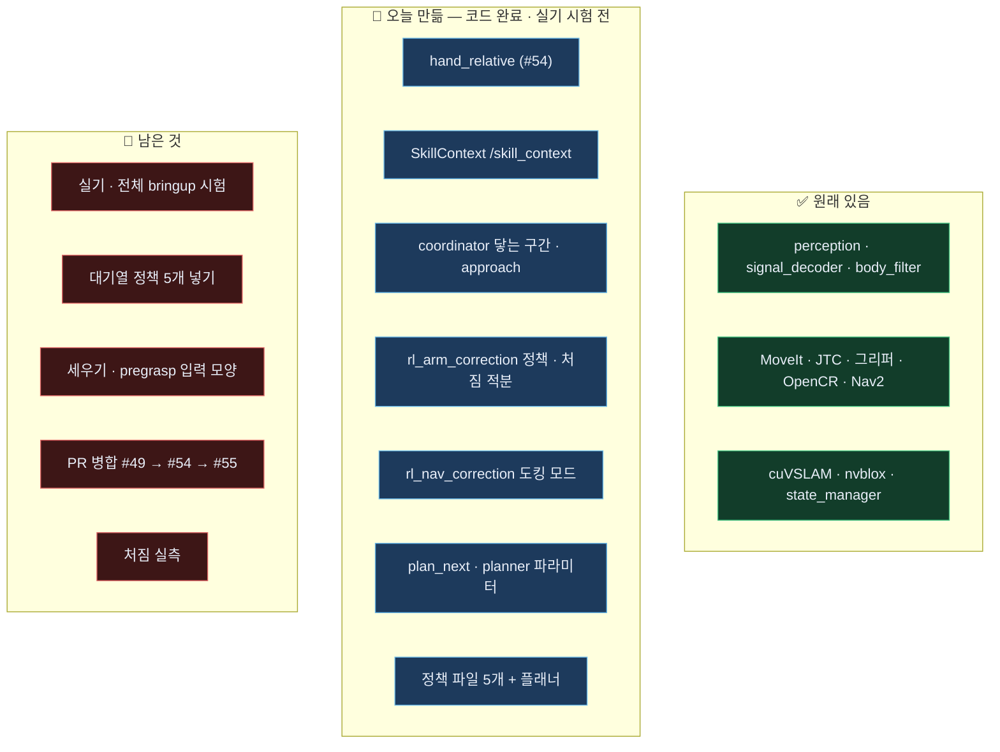
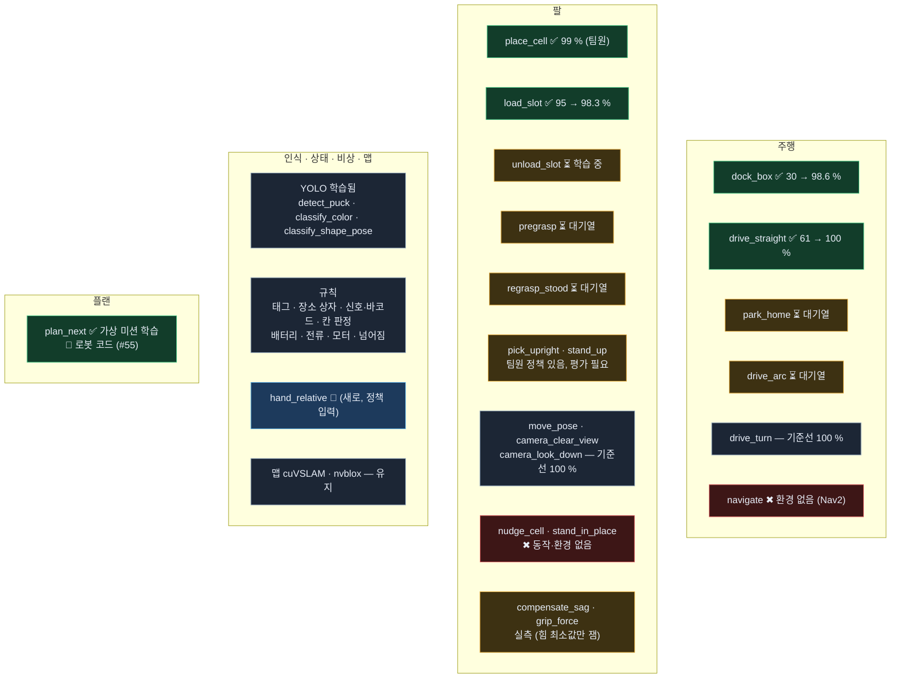
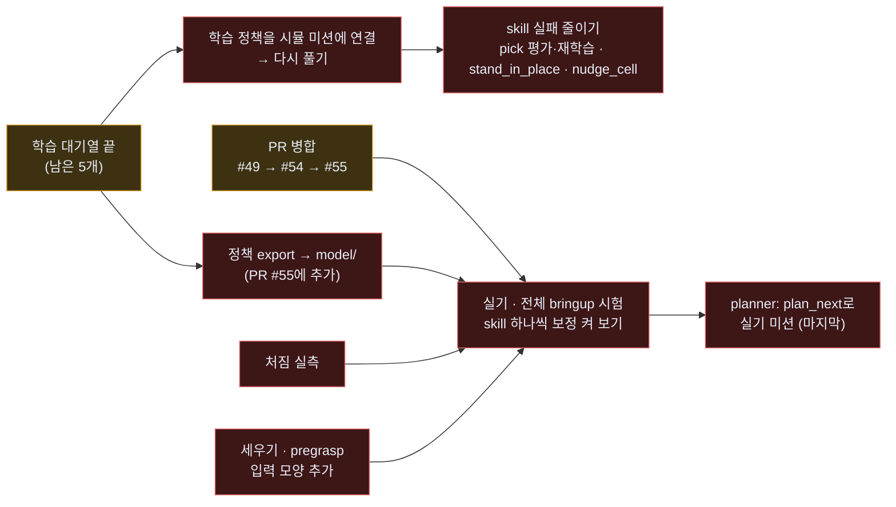

# BEE 전체 지도 — 학습부터 로봇까지

> **2026-11-03 17:50 기준** (pa27 시각). 지금까지 만든 것 전부를 한 장에 그렸습니다. 색: <b style="color:#3fbf7f">초록 = 완료</b> · <b style="color:#67b7e8">파랑 = 코드 완료, 실기 시험 전</b> · <b style="color:#e2a83a">노랑 = 진행 중 · 일부</b> · <b style="color:#e06666">빨강 = 아직 없음</b> · <b style="color:#8aa0b8">회색 = 학습 안 함 (규칙·기존 그대로)</b>
> 자세한 내용: [학습용 skill 구성](skill-learning.html) · [skill별 학습 조건](skill-training.html) · [스킬·플랜 한 장](skill-plan.html)
> PR: [#53 skill 목록·플래너 학습](https://github.com/visualkhh/Lv2_bee_Assignment/pull/53) · [#54 hand_relative](https://github.com/visualkhh/Lv2_bee_Assignment/pull/54) · [#55 로봇 배포](https://github.com/visualkhh/Lv2_bee_Assignment/pull/55) · [#56 Isaac 학습 환경](https://github.com/visualkhh/Lv2_bee_Assignment/pull/56) · (먼저) [#49 미션 흐름](https://github.com/visualkhh/Lv2_bee_Assignment/pull/49)

---

## 1. 한눈에 — 네 덩어리

| 덩어리 | 지금 | 막힌 곳 |
|---|---|---|
| ① 시뮬 학습 | 환경 14개 완성 · 대기열 8개 중 **3개 끝** (`dock_box` 98.6 %, `drive_straight` 100 %, `load_slot` 98.3 %) · 지금 `unload_slot` | 남은 5개 — skill당 약 30~45분 (2048 env × 500회) |
| ② 결과물 | 로봇에 넣은 정책 **5개** (`place_cell`·`pick_upright` 팀원 · `dock_box` · `drive_straight` · `load_slot`) + 플래너 1개 | 학습 중 5개는 끝나면 넣기 |
| ③ 시뮬 미션 | 무작위 문제를 끝까지 풂 (문제 #1 20점, #7 10점) | 점수를 깎는 건 **skill 실패** (집다 떨어뜨림 · 놓다 누움) |
| ④ 로봇 | **배포 코드 완료** — pa27 ROS에서 빌드 · 테스트 61개 통과 (PR #55) | **실기 · 전체 bringup 시험 전** · PR #49 → #54 → #55 병합 |

---

## 2. 미션은 어떻게 풀리나 — 계산기 · 플래너 · task · skill

| 부분 | 시뮬 (Isaac) | 로봇 (ROS) |
|---|---|---|
| 계산기 | ✅ `mission_rules.py` (C++와 같은 규칙) | 🟡 `mission_solver` — PR #49 열림 |
| 플래너 | ✅ `plan_next` 학습 · 미션 실행기에서 사용 | 🔵 C++ `plan_next` + mission_manager `planner` 파라미터 (기본 `rule`) — PR #55 · Python과 40개 상태 모두 같은 행동 |
| task 흐름 | ✅ 미션 실행기 | 🟡 `mission_manager` — PR #49 열림 |

---

## 3. 로봇에서 한 skill이 움직이는 길 (2026-11-03 배포 결정)

| 칸 | 상태 | 남은 것 |
|---|---|---|
| MoveIt · JTC · Nav2 · 하드웨어 | ✅ 있음 | — |
| `hand_relative` (손 카메라 상대값) | 🔵 PR #54 · 노드 시험 통과 | 실기 |
| coordinator → `/hand_relative/target` · `/skill_context` | 🔵 PR #55 | 실기 |
| coordinator 닿는 구간 = 시뮬과 같은 IK 궤적 (`contact_mode: sim`) | 🔵 PR #55 · 집기 · 놓기 · 싣기 · 꺼내기 | 실기 · 세우기는 아직 예전 방식 |
| approach 도킹 = 시뮬과 같은 P 제어 (`approach_mode: sim`) | 🔵 PR #55 | 실기 |
| `rl_arm_correction` (정책 계산 · 처짐 적분) | 🔵 PR #55 · C++ = TorchScript 검산 | 실기 (컨트롤러 체인에서 불러오기 · 주기) |
| `rl_nav_correction` 도킹 모드 | 🔵 PR #55 | 실기 |
| mission_manager · mission_solver | 🟡 PR #49 | 병합 |

---

## 3-1. 예시: "배치" task 하나가 하드웨어까지 가는 길 — 학습된 모델은 어디서 도나

**상황**: 플래너가 "퍽 7번(적재함 칸 5에 있음)을 L1 상자의 가운데 칸(4번)에 놓기"를 골랐습니다. 이 task는 skill 4개로 풀립니다.

<b style="color:#a78bfa">🧠 보라 = 학습된 모델이 도는 곳</b>

| 순서 | skill | 누가 움직이나 | 🧠 학습된 모델 (어디서 · 무엇을) | 끝 판정 |
|---|---|---|---|---|
| 0 | (고르기) | mission_manager | **`plan_next`** — mission_manager 안 (`planner: plan_next`일 때). skill이 하나 끝날 때마다 "다음 퍽 + 복귀할지" | — |
| ① | `navigate` | Nav2 | 없음 (Nav2 그대로) | L1 앞 도착 |
| ② | `dock_box` | coordinator approach (돌기-직진-돌기) | **`dock_box`** — `rl_nav_correction`. approach 속도 명령에 작은 Δv·Δw | 상자 앞 1 cm · 1.5° 안 0.5 s 정지 |
| ③ | `unload_slot` | [1] MoveIt: stow → carry → 칸 5 위 · [2] IK 궤적: 내려가기 → 쥐기 → 칸 위 | **`unload_slot`** — `rl_arm_correction`. [2] 구간만. 입력: 관절 상태 + 단계 + `/hand_relative`(퍽 − 손) | 퍽이 손 안 (전류 + 손가락 위치) |
| ④ | `place_cell` | [1] MoveIt: carry → 칸 4 위 5 cm · [2] IK 궤적: 내려가기 → 벌리기 → 올리기 | **`place_cell`** — 같은 `rl_arm_correction`. 입력에 `/hand_relative`(칸 − 손 안 퍽) | `judge_cell` (규칙): 칸 중심 10 mm 안 |
| → | (다음) | mission_manager | **`plan_next`** 다시 | — |

**정리 — 모델은 4곳에서만 돕니다**

| 모델 | 도는 곳 | 얼마나 자주 | 하는 일 | 없으면 |
|---|---|---|---|---|
| `plan_next` | mission_manager (노드) | skill 하나 끝날 때 1번 | 다음 퍽·복귀 시점 | 규칙 순서 |
| `dock_box` 등 주행 정책 | rl_nav_correction (노드) | approach 명령마다 (20Hz) | 속도 명령에 작은 보정 | 보정 0 — 기준 P 제어만 |
| `place_cell` 등 팔 정책 | rl_arm_correction (ros2_control 컨트롤러, JTC 바로 뒤) | 100Hz 루프, 정책은 50Hz | 목표 관절각에 작은 보정 (닿는 구간만) | 보정 0 — 기준 궤적만 |
| YOLO | perception (노드) | 카메라당 ≤ 4Hz | 퍽·신호등 찾기 | — |

- 학습된 skill 정책은 **로봇을 처음부터 움직이지 않습니다.** 늘 기준 동작(Nav2 · MoveIt · IK 궤적 · P 제어)이 움직이고, 정책은 그 위에 몇 mm·몇 cm/s만 고칩니다. 정책을 끄면(Δ = 0) 지금 로봇과 똑같이 움직입니다.
- 팔 정책 파일은 skill마다 하나씩이고, **coordinator가 `/skill_context`로 "지금 어떤 skill의 어느 단계인지" 알려 주면 `rl_arm_correction`이 그 skill의 정책만 켭니다.**
- 정책 계산은 ONNX 런타임 없이 C++로 직접 (`ml/mlp_policy.hpp`) — Jetson에 따로 설치할 것 없음. 정책 파일은 `.policy` (TorchScript에서 `export_policy.py`로 변환, 검산값 포함).

---

## 3-2. 최종 목표 — skill별로 무엇이 움직이고, 학습 모델은 어디서 도나

> 학습 결과(지금은 1차)가 모두 기준선보다 좋아졌다고 볼 때의 최종 그림입니다. 기준선을 못 넘는 skill은 그 정책 파일을 넣지 않으면 기준 동작으로 돕니다 (Δ = 0).

**한 문장**: "퍽에 닿는 구간과 상자 앞 짧은 도킹·이동"에만 학습 보정이 붙고, 나머지는 지금 로봇 방식(MoveIt · Nav2 · YOLO · 규칙) 그대로 — 그 위에서 플래너 하나가 다음 skill을 고릅니다.

| 영역 | skill (학습 모델 씀) | 기준 동작 | 학습 보정이 도는 곳 | 로봇 연결 |
|---|---|---|---|---|
| 팔 · 닿는 구간 | `place_cell` · `load_slot` · `pick_upright` · `unload_slot` | IK 궤적 (시뮬과 같음) | `rl_arm_correction` | 🔵 연결됨 (#55) |
| 팔 · 닿는 구간 | `stand_up` · `regrasp_stood` | 원호 경유점 | `rl_arm_correction` | 🔴 입력 모양 추가 필요 |
| 팔 · 닿는 구간 | `nudge_cell`* · `stand_in_place`* | — | — | 🔴 환경 없음 |
| 팔 · 끝 자세 | `pregrasp` | MoveIt 경로 | `rl_arm_correction` | 🔴 입력 모양 추가 필요 |
| 주행 · 짧은 이동 | `dock_box` · `park_home` · `drive_straight` · `drive_arc` | approach P 제어 | `rl_nav_correction` | 🔵 연결됨 (#55) |
| 플랜 | `plan_next` | (규칙 순서 대신) | `mission_manager` | 🔵 연결됨 (#55) |

\* 아직 학습 환경 없음

▶ 학습 모델 없이 기존 방식 그대로 — 23개

| 영역 | skill | 무엇으로 |
|---|---|---|
| 팔 | `move_pose` · `camera_clear_view` · `camera_look_down` | MoveIt (기준선이 이미 정확) |
| 팔 | `compensate_sag` · `grip_force` | 실측값 (보정표) |
| 주행 | `drive_turn` | P 제어 (기준선이 이미 정확) |
| 주행 | `navigate` | Nav2 |
| 인식 | `detect_puck` · `classify_color` · `classify_shape_pose` | YOLO (이미 학습된 `.pt`, perception 노드) |
| 인식 | `read_puck_tag` · `detect_location_box` · `read_signal_barcode` · `judge_cell` | 규칙 (AprilTag · 바코드 · 거리 계산) |
| 상태·비상 | `monitor_battery` · `monitor_current` · `monitor_motor` · `detect_tip_impact` · `basket_ledger` · `estop` | 문턱값 · 장부 · 버튼 |
| 맵 | `slam_localize` · `build_map` · `align_arena` | cuVSLAM · nvblox |

---

## 3-3. 노드 현황 — 무엇이 끝났고 무엇이 남았나

| 노드·부품 | 한 일 | 확인 |
|---|---|---|
| **정책 계산** `ml/mlp_policy.hpp` · `export_policy.py` | ONNX 런타임 없이 C++ MLP (실시간 루프 할당 없음) · `.pt` → `.policy` | 정책 6개 모두 **C++ 값 = TorchScript 값** |
| **`/skill_context`** (`ml/SkillContext`) | coordinator → 보정 노드: skill · 단계 · 처짐 적분 여부 · 보정 가능 여부 · 목표 관절 · 도킹 목표 | 빌드 |
| **coordinator 닿는 구간** `contact_mode: sim` | 퍽·칸 위 5 cm까지 MoveIt → 정지 0.3 s → 시뮬과 같은 보간(해석 IK)으로 내려가기 → 안정 → 쥐기/놓기 → 올리기 → 대기 · 집기·놓기·싣기·꺼내기 | 기존 테스트 통과 · `moveit`이면 예전 |
| **coordinator approach** `approach_mode: sim` | 시뮬 dock_box 기준 제어 (돌기 → 직진 ≤ 0.12 m/s → 마지막 방향) | `legacy`면 예전 |
| **`rl_arm_correction`** | 명령 = JTC + 처짐 적분 + 정책 Δ, 정책 있는 skill의 닿는 구간만 · 입력 = 시뮬과 같은 순서 | 입력·적분 테스트 |
| **`rl_nav_correction`** 도킹 모드 | 도킹 skill이면 시뮬 drive_env 입력 13개 → Δv·Δw | 입력 테스트 |
| **`plan_next`** | C++ 플래너 · `planner: plan_next`면 BUILD에서 다음 퍽·복귀 시점 | Python과 40개 상태 모두 같은 행동 |
| **`hand_relative`** | 손 카메라 → 퍽 − 손 · 칸 − 퍽 · 면 방향 | 노드 시험 (가짜 TF·검출) |
| 정책 파일 | `place_cell` · `pick_upright` (팀원) · `dock_box` · `drive_straight` · `load_slot` · `plan_next` | 설치·불러오기 |

전체: pa27 ROS Lyrical에서 빌드, **ml·plan 53개 + perception 8개 테스트 통과**. 실제 로봇·전체 bringup에서는 아직 안 돌려 봄.

---

## 4. skill 37개 지도 — 영역별 상태 (17:50)

▶ skill 37개 전체 표 (상태·결과물)

| 영역 | skill | 방식 | 시뮬 환경 | 기준선 → 학습 뒤 | 로봇 정책 파일 |
|---|---|---|---|---|---|
| 주행 | `dock_box` | 강화학습 | drive task=dock | 30.2 → **98.6 %** | ✅ `nav_correction/dock_box.policy` |
| 주행 | `drive_straight` | 강화학습 | drive task=straight | 61.4 → **100 %** | ✅ `nav_correction/drive_straight.policy` |
| 주행 | `park_home` | 강화학습 | drive task=park | 87.5 % → 대기열 | ⏳ |
| 주행 | `drive_arc` | 강화학습 | drive task=arc | 94.5 % → 대기열 | ⏳ |
| 주행 | `drive_turn` | 강화학습 | drive task=turn | 100 % | 기준선으로 충분 |
| 주행 | `navigate` | 강화학습 | 없음 | — | Nav2 그대로 |
| 팔 | `place_cell` | 강화학습 | pip (팀원) | 96.3 → **99.0 %** | ✅ `arm_correction/place_cell.policy` (팀원 정책) |
| 팔 | `load_slot` | 강화학습 | load | 94.8 → **98.3 %** | ✅ `arm_correction/load_slot.policy` |
| 팔 | `pick_upright` | 강화학습 | pick (팀원) | — (평가 필요) | ✅ `arm_correction/pick_upright.policy` (팀원 정책) |
| 팔 | `unload_slot` | 강화학습 | unload | 90.6 % → 학습 중 | ⏳ |
| 팔 | `stand_up` | 강화학습 | right (팀원) | — | 🟡 팀원 정책 · 로봇 입력 모양 필요 |
| 팔 | `regrasp_stood` | 강화학습 | right regrasp=1 | 대기열 | ⏳ |
| 팔 | `pregrasp` | 강화학습 | reach target=above | 88~91 % → 대기열 | ⏳ · 로봇 입력 모양 필요 |
| 팔 | `camera_look_down` | 강화학습 | reach target=look | 100 % | 기준선으로 충분 (높이 0.08 m — 확인 필요) |
| 팔 | `move_pose` · `camera_clear_view` | 강화학습 | reach pose · clear | 100 % | 기준선으로 충분 |
| 팔 | `nudge_cell` · `stand_in_place` | 강화학습 | 없음 | — | 🔴 동작부터 설계 |
| 팔 | `compensate_sag` · `grip_force` | 실측 | — | — | 🟡 쥐는 힘 최소값만 잼 · 처짐 실측 필요 |
| 인식 | `detect_puck` · `classify_color` · `classify_shape_pose` | YOLO (학습됨) | — | — | `bee_yolo11n_v3` |
| 인식 | `read_puck_tag` · `detect_location_box` · `read_signal_barcode` · `judge_cell` | 규칙 | — | — | 기존 |
| 상태·비상 | `monitor_battery` · `monitor_current` · `monitor_motor` · `detect_tip_impact` | 규칙 (문턱값) | — | — | 기존 |
| 상태·비상 | `basket_ledger` · `estop` | 없음 | — | — | 기존 |
| 맵 | `slam_localize` · `build_map` · `align_arena` | 유지 | — | — | cuVSLAM · nvblox |
| 플랜 | `plan_next` | 강화학습 | 가상 미션 | 계산기 38.1점 · 학습 37.6점 (가상) | ✅ `plan/plan_next.policy` |

---

## 5. 시뮬에서 미션 전체 풀기 — 실행기 구조

| 문제 | 신호 · 바코드 | 결과 | 깎인 이유 |
|---|---|---|---|
| #1 | R4 Y3 G5 · P2-01 오름 | **20 / 40** (L2 +10, 복귀 +10) | 집다 떨어뜨림 1 · 놓다 누움 1 |
| #7 (화면) | R5 Y5 G2 · P2-04 내림 | **10 / 40** (복귀 +10) | 세우기 덜 섬 1 · 놓다 누움 1 · 집다 떨어뜨림 1 |

- 미션 실행기에는 아직 **팀원 정책만** 들어 있습니다 (오늘 학습한 `dock_box` · `load_slot` 등은 대기열이 끝나면 연결).
- 칸 위 누운 퍽 세우기(`stand_in_place`)가 없어서, 놓다 누우면 그 장소 점수는 못 받습니다.

---

## 6. 남은 일 — 순서대로

| 할 일 | 막히면 |
|---|---|
| 학습 대기열 남은 5개 (`unload_slot` · `pregrasp` · `park_home` · `drive_arc` · `regrasp_stood`) → 기준선보다 좋으면 `export_policy.py`로 `model/`에 | 그 skill은 보정 0 (지금 동작 그대로) |
| 학습 정책을 시뮬 미션 실행기에 연결 → 다시 풀어 점수 비교 | — |
| skill 실패 줄이기: `pick_upright` 평가·재학습 · `stand_in_place`·`nudge_cell` 동작·환경 | 놓다 누우면 그 장소 0점 |
| PR 병합: #49 → #54 → #55 (+ #53 · #56) | 로봇에 배포 코드가 없음 |
| **실기 · 전체 bringup 시험**: 보정 끈 채로 먼저, 그다음 skill 하나씩 켜기 (`enabled` · 정책 파일) | 정책이 실기에서 맞는지 모름 |
| 처짐 실측 · 처짐 적분 이득 확인 | 팔 정책이 실기에서 어긋날 수 있음 |
| 세우기 · pregrasp 입력 모양 추가 | 그 skill은 보정 0 |
| 상자 밀림 보정 (`HandTarget.box_tag`) · `camera_look_down` 높이 (0.15 m → 0.08~0.10 m) | — |
| 마지막: `planner: plan_next`로 실기 미션 | 규칙 순서로 동작 |

---

## 7. 브랜치 · PR · 파일 위치

| PR | 브랜치 → base | 들어 있는 것 |
|---|---|---|
| [#49](https://github.com/visualkhh/Lv2_bee_Assignment/pull/49) | `feature/mission-flow` → develop | mission_manager · mission_solver · coordinator 좌표 skill (먼저 병합) |
| [#53](https://github.com/visualkhh/Lv2_bee_Assignment/pull/53) | `feature/skill-learning` → develop | `learning/skills.yaml` (skill 37개 · 계약 · 배포 조건) · `learning/plan/` (가상 미션 · 플래너 학습 · 계산기 순서) |
| [#54](https://github.com/visualkhh/Lv2_bee_Assignment/pull/54) | `feature/hand-relative` → develop | 인식 `hand_relative` · `HandTarget`/`HandRelative` · API.md |
| [#55](https://github.com/visualkhh/Lv2_bee_Assignment/pull/55) | `feature/policy-deploy` → `feature/mission-flow` | 로봇 배포: 보정 컨트롤러 · `SkillContext` · coordinator 닿는 구간·approach · `plan_next` · 정책 파일 (`ros2_ws/model/`) — #49·#54 포함, 최신 develop 포함 |
| [#56](https://github.com/visualkhh/Lv2_bee_Assignment/pull/56) | `feature/skill-envs` → 팀원 `feature/isaac-lab` | Isaac 학습 환경 `slot_env` · `reach_env` · `drive_env` · 학습 대기열 `train_queue.sh` · 미션 실행기 `mission_run.py` |
| — | pa27 `~/bee_skill` | 학습 중인 복사본 · `logs/queue_summary.tsv` (학습 결과 한 줄씩) |
