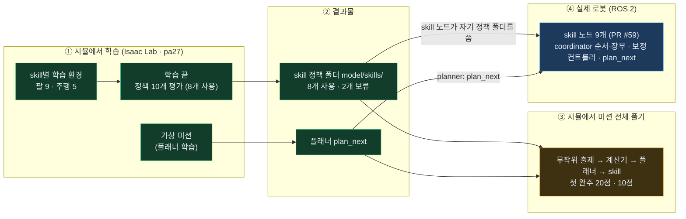
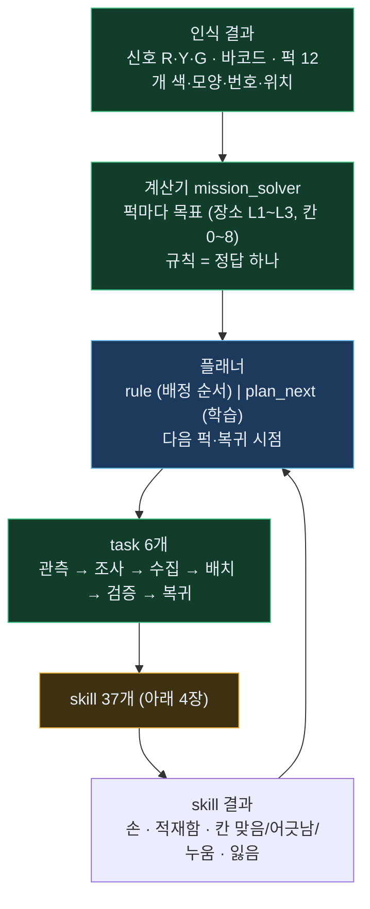
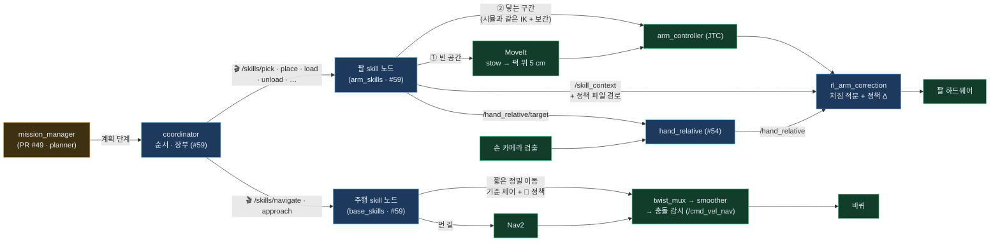
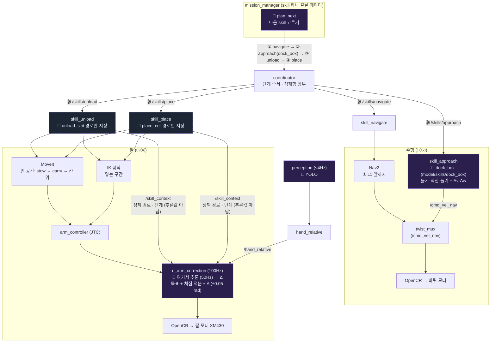
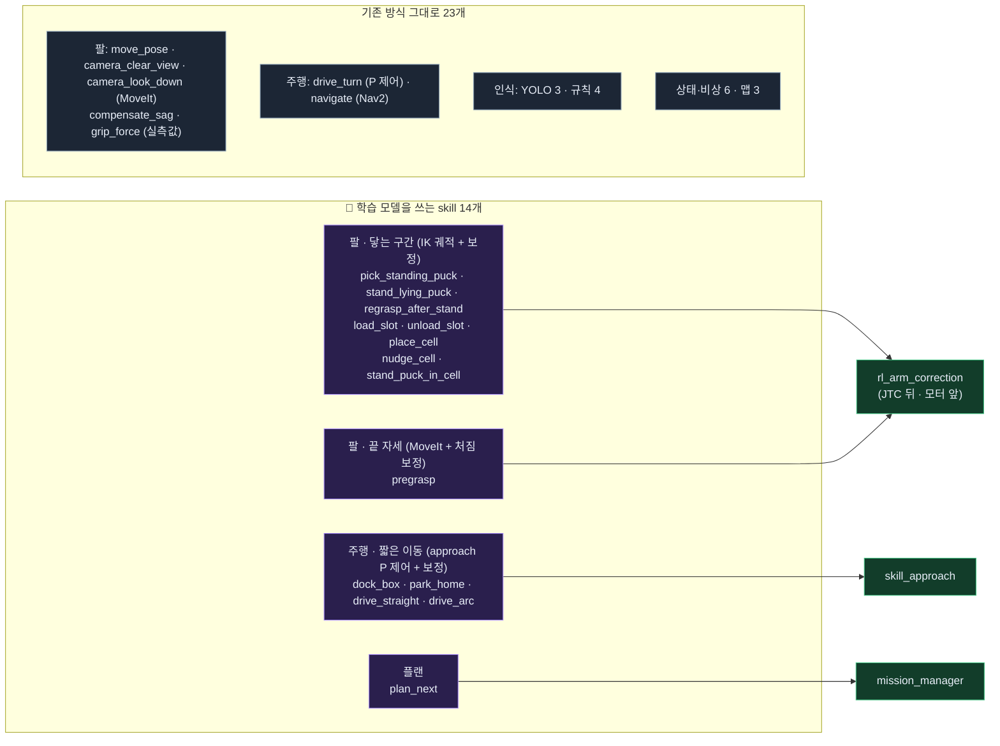
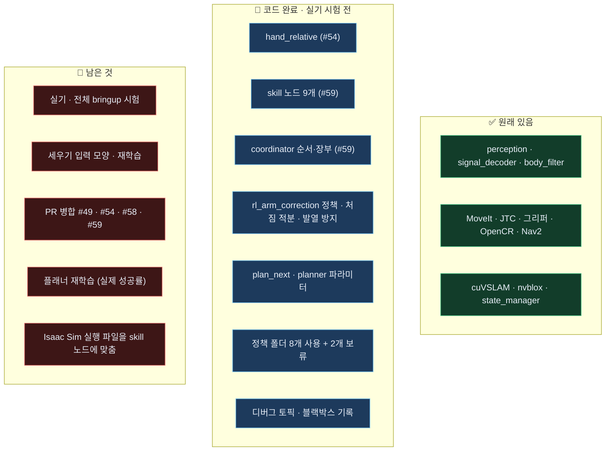
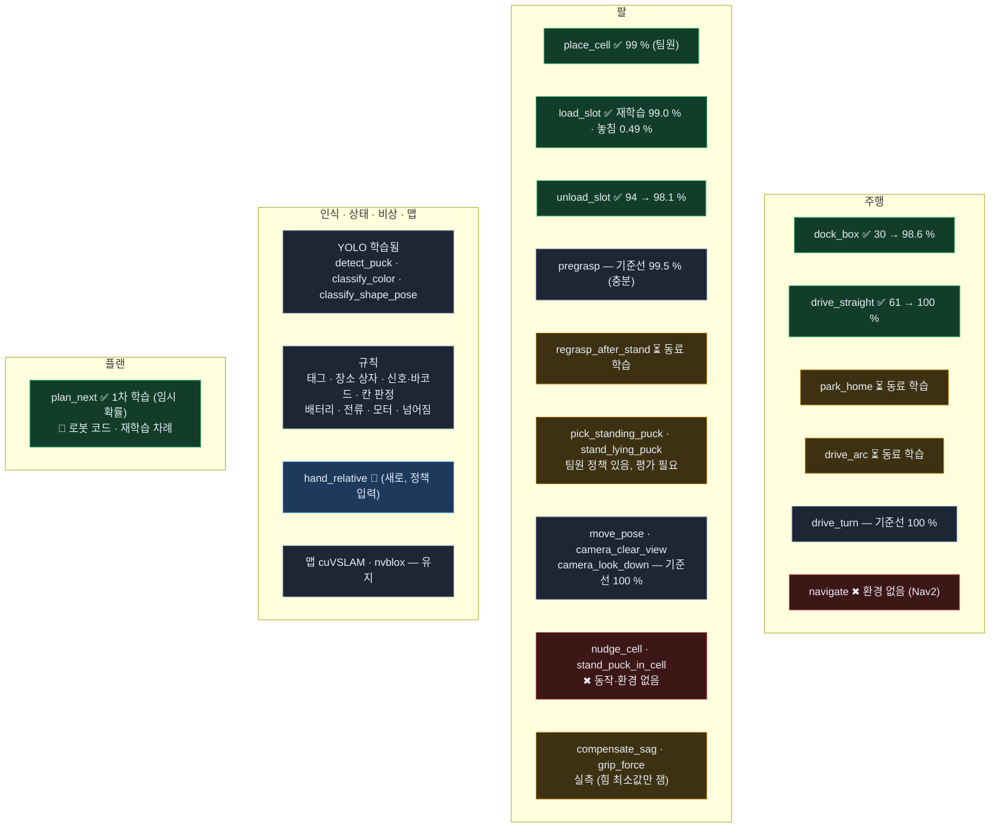
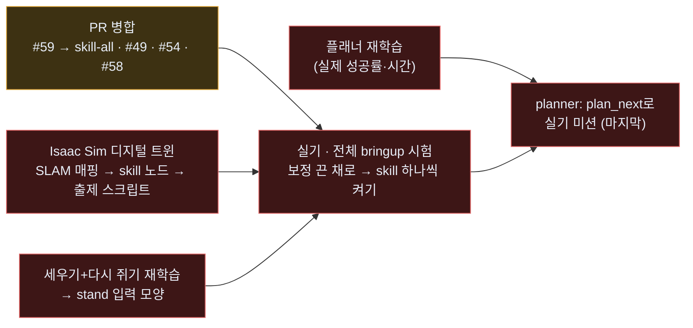

# BEE 전체 지도 — 학습부터 로봇까지

> **11-04 구조 변경 (PR #59, `feature/skill-nodes`)** — skill마다 노드 하나: coordinator는 계획 검증·순서·적재함 장부만, 팔·주행 동작은 **skill 노드 9개** (`/skills/<skill>` 액션 — navigate · approach · pose · inspect · pick · place · load · unload · stand). 학습 정책은 **skill 노드가 갖고 관리** (`models/skills/<skill>/` = `.onnx` · `.policy` · `meta.yaml`). 팔 정책 **추론은 `rl_arm_correction` 100 Hz 루프 안에서만** (skill 노드는 정책 경로만 알려 줌 — Δ를 미리 계산하지 않음) · 주행 정책은 `skill_approach`가 직접 추론. 11-09 PR #97: 기본 ONNX Runtime · 정책마다 `.policy`로 되돌림 ([ONNX 실행 구조](onnx-runtime.html)). 아래 그림의 "coordinator가 하는 팔·주행 동작"은 이제 skill 노드가 합니다. 스펙·성능표: [robot-spec](robot-spec.html)

> **2026-11-04 기준**. 색: <b style="color:#3fbf7f">초록 = 완료</b> · <b style="color:#67b7e8">파랑 = 코드 완료, 실기 시험 전</b> · <b style="color:#e2a83a">노랑 = 진행 중 · 일부</b> · <b style="color:#e06666">빨강 = 아직 없음</b> · <b style="color:#8aa0b8">회색 = 학습 안 함</b>
> 자세한 내용: [학습용 skill 구성](skill-learning.html) · [skill별 학습 조건](skill-training.html) · [스킬·플랜 한 장](skill-plan.html)
> PR: [#59 skill 노드](https://github.com/visualkhh/Lv2_bee_Assignment/pull/59) → [#57 통합 → isaac-setup](https://github.com/visualkhh/Lv2_bee_Assignment/pull/57) · [#49 미션 흐름 + 배포](https://github.com/visualkhh/Lv2_bee_Assignment/pull/49) (#55 병합됨) · [#53](https://github.com/visualkhh/Lv2_bee_Assignment/pull/53) · [#54](https://github.com/visualkhh/Lv2_bee_Assignment/pull/54) · [#56](https://github.com/visualkhh/Lv2_bee_Assignment/pull/56) · [#58 A*](https://github.com/visualkhh/Lv2_bee_Assignment/pull/58)

---

## 1. 한눈에 — 네 덩어리

| 덩어리 | 지금 | 막힌 곳 |
|---|---|---|
| ① 시뮬 학습 | 학습 정책 10개 평가 끝 (1024판): `dock_box` 98.6 · `drive_straight` 100 · `park_home` 96.5 · `drive_arc` 100 · `load_slot` 99.0 · `unload_slot` 98.1 · `place_cell` 99.0 · `pick_standing_puck` 100 · `regrasp_after_stand` 78.2 · `pregrasp` 기준선 99.5 % — [성능표](robot-spec.html) | 세우기+다시 쥐기 78 % (재학습 필요) · 플래너는 임시 확률로 학습 → 실제 성공률로 재학습 |
| ② 결과물 | 정책 폴더 `models/skills/<skill>/` (`.onnx` · `.policy` · `meta.yaml`) — **8개 사용** · `regrasp_after_stand` · `pregrasp` 보류 · 플래너 `plan_next` | — |
| ③ 시뮬 미션 | Isaac Lab 실행기로 무작위 문제 끝까지 (#1 20점, #7 10점) · Isaac Sim 디지털 트윈(전체 ROS · SLAM)은 10-30 기동 확인 | 점수를 깎는 건 skill 실패 · 디지털 트윈엔 출제 스크립트 · skill 노드 반영 필요 |
| ④ 로봇 | **skill 노드 구조** (PR #59): skill마다 노드 · 정책은 skill이 관리 · 테스트 66개 · 노드 9개 기동 | **실기 · 전체 bringup 시험 전** · PR 병합 · #57은 isaac-setup과 자산 충돌 정리 필요 |

> → 11-09: #59 develop 병합 · 디지털 트윈 #62는 develop에 없음 · 지금 구조는 [지금 구조](system-now.html)

---

## 2. 미션은 어떻게 풀리나 — 계산기 · 플래너 · task · skill

| 부분 | 시뮬 (Isaac) | 로봇 (ROS) |
|---|---|---|
| 계산기 | ✅ `mission_rules.py` (C++와 같은 규칙) | 🟡 `mission_solver` — PR #49 열림 |
| 플래너 | ✅ `plan_next` 학습 · 미션 실행기에서 사용 | 🔵 C++ `plan_next` + mission_manager `planner` 파라미터 (기본 `rule`) — PR #55 · Python과 40개 상태 모두 같은 행동 |
| task 흐름 | ✅ 미션 실행기 | 🟡 `mission_manager` — PR #49 열림 |

> → 11-09: #49 · #55 병합 — `mission_solver` · `mission_manager` · `plan_next` 모두 develop에 있음 (`planner` 기본 `rule`)

---

## 3. 로봇에서 한 skill이 움직이는 길 (11-04 skill 노드 구조)

> **지금 구조 (11-09 develop + PR #97, 노드 · 플러그인 구별): [지금 구조](system-now.html)** — 아래는 11-04 기준

> 자세히: [skill 노드 구성](skill-nodes.html) — skill마다 노드 하나 (`/skills/<skill>` 액션) · 정책은 skill 노드가 갖고 관리 (`models/skills/<skill>/`)

| 칸 | 상태 | 남은 것 |
|---|---|---|
| MoveIt · JTC · Nav2 · 하드웨어 | ✅ 있음 | — |
| **skill 노드 9개** (`skills` 패키지) | ✅ develop (#59) · #75에서 세우기·집기 실기 수정 | 실기 |
| coordinator (순서 · 장부 · 모드 취소) | ✅ develop (#59) | 실기 |
| `hand_relative` (손 카메라 상대값) | ✅ develop (#54) | 실기 |
| 닿는 구간 = 시뮬과 같은 IK 궤적 | 🔵 skill 노드 (pick · place · load · unload) | 실기 · 세우기는 기준 동작만 |
| `rl_arm_correction` (**플러그인** — 정책 계산 · 처짐 적분 · 앞먹임 · 발열 방지) | ✅ develop · 11-06 중력 앞먹임 기본 켬 · 상태는 하드웨어 플러그인이 실제 각으로(`twist_state`) | 실기 |
| 주행 정책 (dock_box · park_home · drive_arc · drive_straight) | 🔵 `skill_approach`가 직접 계산 | 실기 |
| mission_manager · mission_solver | ✅ develop (#49) · 물체 기억(tag) #79 (11-06) | 실기 |

---

## 3-1. 예시: "배치" task 하나가 하드웨어까지 가는 길 — 학습된 모델은 어디서 도나

**상황**: 플래너가 "퍽 7번(적재함 칸 5에 있음)을 L1 상자의 가운데 칸(4번)에 놓기"를 골랐습니다. 이 task는 skill 4개로 풀립니다.

<b style="color:#a78bfa">🧠 보라 = 학습된 모델이 실제로 추론하는 곳</b> · 📄 점선 = 정책 파일을 **고르고 경로만 알려 줌** (추론 안 함 — 팔 skill은 Δ를 미리 계산하지 않음, 11-09 수정)

| 순서 | 단계 | 맡는 skill 노드 | 🧠 학습된 모델 (어디서 · 무엇을) | 끝 판정 |
|---|---|---|---|---|
| 0 | (고르기) | mission_manager | **`plan_next`** — mission_manager 안 (`planner: plan_next`일 때) | — |
| ① | `navigate` | `skill_navigate` → Nav2 | **`rl_nav_controller`** — Nav2 `controller_server` 안 `RlNavController` 플러그인 (ONNX, 없으면 DWB) | L1 앞 도착 |
| ② | `approach` (dock_box) | `skill_approach` | **`dock_box`** — skill_approach가 직접 (20 Hz). 기준 속도 명령에 Δv·Δw | 1 cm · 1.5° 안 0.5 s 정지 (정책 meta) |
| ③ | `unload` 칸 5 | `skill_unload` (칸·모양은 coordinator 장부) | **`unload_slot`** — rl_arm_correction (skill_unload가 경로를 알려 줌). 닿는 구간만 | 퍽이 손 안 (전류 + 손가락 위치) |
| ④ | `place` 칸 4 | `skill_place` | **`place_cell`** — 같은 방식 | `judge_cell` (규칙): 칸 중심 10 mm 안 |

**정리 — 모델이 도는 곳**

| 모델 | 도는 곳 | 얼마나 자주 | 없으면 |
|---|---|---|---|
| `plan_next` | mission_manager | skill 하나 끝날 때 | 규칙 순서 |
| 주행 정책 4개 | **skill_approach** (노드) | 20 Hz | 기준 제어만 |
| `rl_nav_controller` (Nav2 경로 따라가기) | Nav2 `controller_server` 안 `RlNavController` 플러그인 | 20 Hz | 안쪽 DWB |
| 팔 정책 4개 | rl_arm_correction (컨트롤러) — **정책 파일은 skill 노드가 관리·지정** | 100 Hz 루프, 정책 50 Hz | 기준 궤적만 |
| YOLO | perception | 카메라당 ≤ 4 Hz | — |

- 학습된 정책은 늘 기준 동작(Nav2 · MoveIt · IK 궤적 · P 제어) 위에 몇 mm·몇 cm/s만 고칩니다. 정책을 끄면(`meta.yaml` `use: false`) 기준 동작과 똑같습니다.
- 정책 계산: PR #97부터 기본 ONNX Runtime(`.onnx`) · 정책마다 `meta.yaml` `runtime: policy`로 기존 C++(`.policy`)로 되돌림 — [ONNX 실행 구조](onnx-runtime.html)

---

## 3-2. 최종 목표 — skill별로 무엇이 움직이고, 학습 모델은 어디서 도나

> 학습 결과(지금은 1차)가 모두 기준선보다 좋아졌다고 볼 때의 최종 그림입니다. 기준선을 못 넘는 skill은 그 정책 파일을 넣지 않으면 기준 동작으로 돕니다 (Δ = 0).

**한 문장**: "퍽에 닿는 구간과 상자 앞 짧은 도킹·이동"에만 학습 보정이 붙고, 나머지는 지금 로봇 방식(MoveIt · Nav2 · YOLO · 규칙) 그대로 — 그 위에서 플래너 하나가 다음 skill을 고릅니다.

| 영역 | skill (학습 모델 씀) | 기준 동작 | 학습 보정이 도는 곳 | 로봇 연결 |
|---|---|---|---|---|
| 팔 · 닿는 구간 | `place_cell` · `load_slot` · `pick_standing_puck` · `unload_slot` | IK 궤적 (시뮬과 같음) | `rl_arm_correction` (정책은 skill 노드가 지정) | 🔵 연결됨 (#59) |
| 팔 · 닿는 구간 | `stand_lying_puck` · `regrasp_after_stand` | 원호 경유점 | `rl_arm_correction` | 🔴 입력 모양 추가 필요 |
| 팔 · 닿는 구간 | `nudge_cell`* · `stand_puck_in_cell`* | — | — | 🔴 환경 없음 |
| 팔 · 끝 자세 | `pregrasp` | MoveIt 경로 | `rl_arm_correction` | 🔴 입력 모양 추가 필요 |
| 주행 · 짧은 이동 | `dock_box` · `park_home` · `drive_straight` · `drive_arc` | approach P 제어 | `skill_approach` | 🔵 연결됨 (#59) · park_home은 출발 구역 보정 |
| 플랜 | `plan_next` | (규칙 순서 대신) | `mission_manager` | 🔵 연결됨 (#49에 병합) · 재학습 필요 |

\* 아직 학습 환경 없음

▶ 학습 모델 없이 기존 방식 그대로 — 23개

| 영역 | skill | 무엇으로 |
|---|---|---|
| 팔 | `move_pose` · `camera_clear_view` · `camera_look_down` | MoveIt (기준선이 이미 정확) |
| 팔 | `compensate_sag` · `grip_force` | 실측값 (보정표) |
| 주행 | `drive_turn` | P 제어 (기준선이 이미 정확) |
| 주행 | `navigate` | Nav2 |
| 인식 | `detect_puck` · `classify_color` · `classify_shape_pose` | YOLO (이미 학습된 `.pt`, perception 노드) |
| 인식 | `read_puck_tag` · `detect_location_box` · `read_signal_barcode` · `judge_cell` | 규칙 (AprilTag · 바코드 · 거리 계산) |
| 상태·비상 | `monitor_battery` · `monitor_current` · `monitor_motor` · `detect_tip_impact` · `basket_ledger` · `estop` | 문턱값 · 장부 · 버튼 |
| 맵 | `slam_localize` · `build_map` · `align_arena` | cuVSLAM · nvblox |

---

## 3-3. 노드 현황 — 무엇이 끝났고 무엇이 남았나 (11-04)

| 노드·부품 | 한 일 | 확인 |
|---|---|---|
| **skill 노드 9개** (`skills`) | skill마다 액션 서버 · 공통 틀(goal 하나 · 취소 · 서버 대기 · 진단) · 팔 공통(MoveIt · 그리퍼 · 닿는 구간 · 잡기 판정) | 기동 · 정책 읽기 · approach 보정 |
| **coordinator** | 계획 검증 · 단계 순서 · 물체 → 좌표 · 다가가기 · 적재함 장부 · 모드·비상정지 취소 | skill 액션 → 장부 테스트 |
| **정책 폴더** `models/skills/<skill>/` | `.onnx`(기본) · `.policy` · `meta.yaml` (use · runtime · 시뮬 성공률 · 출처 · 판정값) | 폴더 검사 테스트 · 불러올 때 검산 · `.onnx` = `.policy` 출력 시험 |
| **`/skill_context`** | 팔 skill 노드 → rl_arm_correction: skill · 단계 · **정책 경로 · 입력 모양** | 빌드 |
| **`rl_arm_correction`** | 받은 경로의 정책을 루프 밖에서 읽어 두고 100 Hz 루프에서 계산 · 처짐 적분(팀원) · 발열 방지 · `~/debug` | 74개 테스트 (11-03) |
| ~~`rl_nav_correction`~~ | 11-05 #65로 삭제 — Nav2 컨트롤러가 `RlNavController`(동료 RL), 도킹 정책은 skill_approach | — |
| **`plan_next`** | C++ 플래너 · `planner: plan_next`면 BUILD에서 다음 퍽·복귀 | Python과 40개 상태 같은 행동 |
| **`hand_relative`** | 손 카메라 → 퍽 − 손 · 칸 − 퍽 · 면 방향 · 진단 | CI 통과 |

전체: pa27 ROS Lyrical — ml · plan · skills 테스트 66개 통과. 실제 로봇·전체 bringup에서는 아직 안 돌려 봄.

> → 11-09: 위 "PR 병합 #49 · #54 · #58 · #59"는 끝남 (#54 hand_relative는 #49에 들어감) · 지금 구조는 [지금 구조](system-now.html)

---

## 4. skill 37개 지도 — 영역별 상태 (19:50)

▶ skill 37개 전체 표 (상태·결과물)

> → 11-09: 아래 정책 파일 경로는 옛 이름 — 지금은 `models/skills/<skill>/` (`.onnx` 기본 · `.policy` · `meta.yaml`) · `plan_next`는 `models/plan/` · `arm_correction/` · `nav_correction/`은 없음. 성능: [robot-spec](robot-spec.html)

| 영역 | skill | 방식 | 시뮬 환경 | 기준선 → 학습 뒤 | 로봇 정책 파일 |
|---|---|---|---|---|---|
| 주행 | `dock_box` | 강화학습 | drive task=dock | 30.2 → **98.6 %** | ✅ `nav_correction/dock_box.policy` |
| 주행 | `drive_straight` | 강화학습 | drive task=straight | 61.4 → **100 %** | ✅ `nav_correction/drive_straight.policy` |
| 주행 | `park_home` | 강화학습 | drive task=park | 87.5 % → 동료 학습 | ⏳ |
| 주행 | `drive_arc` | 강화학습 | drive task=arc | 94.5 % → 동료 학습 | ⏳ |
| 주행 | `drive_turn` | 강화학습 | drive task=turn | 100 % | 기준선으로 충분 |
| 주행 | `navigate` | 강화학습 | 없음 | — | Nav2 그대로 |
| 팔 | `place_cell` | 강화학습 | pip (팀원) | 96.3 → **99.0 %** | ✅ `arm_correction/place_cell.policy` (팀원 정책) |
| 팔 | `load_slot` | 강화학습 | load | 94.8 → 98.3 % (놓침 1.0 %) → **재학습 99.0 % · 놓침 0.49 %** ✅ (놓침 벌점 5→20) | ✅ 재학습본 `load_slot.policy`로 바꿈 |
| 팔 | `pick_standing_puck` | 강화학습 | pick (팀원) | — (평가 필요) | ✅ `arm_correction/pick_standing_puck.policy` (팀원 정책) |
| 팔 | `unload_slot` | 강화학습 | unload | 93.7 → **98.1 %** | ✅ `arm_correction/unload_slot.policy` |
| 팔 | `stand_lying_puck` | 강화학습 | `stand` (팀원 파일 right_env, 예전 이름 right) | — | 🟡 팀원 정책 · 로봇 입력 모양 필요 |
| 팔 | `regrasp_after_stand` | 강화학습 | `stand_lying` regrasp=1 | 동료 학습 | ⏳ |
| 팔 | `pregrasp` | 강화학습 | reach target=above | 89.3 → 95.4 % → 환경 고친 뒤 기준선 **99.5 %** = 학습 99.6 % | 기준선으로 충분 (MoveIt만) |
| 팔 | `camera_look_down` | 강화학습 | reach target=look | 100 % | 기준선으로 충분 (높이 0.08 m — 확인 필요) |
| 팔 | `move_pose` · `camera_clear_view` | 강화학습 | reach pose · clear | 100 % | 기준선으로 충분 |
| 팔 | `nudge_cell` · `stand_puck_in_cell` | 강화학습 | 없음 | — | 🔴 동작부터 설계 |
| 팔 | `compensate_sag` · `grip_force` | 실측 | — | — | 🟡 쥐는 힘 최소값만 잼 · 처짐 실측 필요 |
| 인식 | `detect_puck` · `classify_color` · `classify_shape_pose` | YOLO (학습됨) | — | — | `bee_yolo11n_v3` |
| 인식 | `read_puck_tag` · `detect_location_box` · `read_signal_barcode` · `judge_cell` | 규칙 | — | — | 기존 |
| 상태·비상 | `monitor_battery` · `monitor_current` · `monitor_motor` · `detect_tip_impact` | 규칙 (문턱값) | — | — | 기존 |
| 상태·비상 | `basket_ledger` · `estop` | 없음 | — | — | 기존 |
| 맵 | `slam_localize` · `build_map` · `align_arena` | 유지 | — | — | cuVSLAM · nvblox |
| 플랜 | `plan_next` | 강화학습 | 가상 미션 | 계산기 38.1점 · 학습 37.6점 (가상) | ✅ `plan/plan_next.policy` |

---

## 5. 시뮬에서 미션 전체 풀기 — 실행기 구조

| 문제 | 신호 · 바코드 | 결과 | 깎인 이유 |
|---|---|---|---|
| #1 | R4 Y3 G5 · P2-01 오름 | **20 / 40** (L2 +10, 복귀 +10) | 집다 떨어뜨림 1 · 놓다 누움 1 |
| #7 (화면) | R5 Y5 G2 · P2-04 내림 | **10 / 40** (복귀 +10) | 세우기 덜 섬 1 · 놓다 누움 1 · 집다 떨어뜨림 1 |

- 미션 실행기에는 아직 **팀원 정책만** 들어 있습니다 (오늘 학습한 `dock_box` · `load_slot` 등은 대기열이 끝나면 연결).
- 칸 위 누운 퍽 세우기(`stand_puck_in_cell`)가 없어서, 놓다 누우면 그 장소 점수는 못 받습니다.

---

## 6. 남은 일 — 순서대로 (11-04)

> → 11-09: "PR 병합"은 끝남 (#62 디지털 트윈만 develop에 없음)

| 할 일 | 막히면 |
|---|---|
| PR 병합: #59(skill 노드 → skill-all) · #49(미션 흐름 + 배포) · #54 · #58(A*) | 로봇에 새 구조가 없음 |
| Isaac Sim 디지털 트윈: SLAM 매핑 시연 → `isaac_system.launch.py`를 skill 노드에 맞춤 → 무작위 출제 스크립트 → 미션 전체 | 실기 전에 전체 연결을 못 봄 |
| **실기 · 전체 bringup 시험**: 보정 끈 채로(`meta.yaml` `use: false`) 먼저, 그다음 skill 하나씩 켜기 · [실기 디버깅](debug-guide.html) | 정책이 실기에서 맞는지 모름 |
| 세우기+다시 쥐기 재학습 (놓침 벌점) → stand 입력 모양 · 동작 순서 맞춤 | 기준 동작만 (시뮬 74.6 %) |
| 플래너 재학습 (가상 미션 확률·시간을 평가값으로) → Isaac 미션 비교 | 규칙 순서로 동작 |
| 처짐·발열 실측 · 실기에서 조정할 값 15개 ([스펙 6장](robot-spec.html)) | — |

---

## 7. 브랜치 · PR · 파일 위치 (11-04)

> → 11-09: #59 병합 (develop) · #62는 develop에 없음

| PR | 브랜치 → base | 상태 | 들어 있는 것 |
|---|---|---|---|
| [#58](https://github.com/visualkhh/Lv2_bee_Assignment/pull/58) | `feature/nav-astar` → develop | ✅ 병합 | Nav2 A* |
| [#49](https://github.com/visualkhh/Lv2_bee_Assignment/pull/49) | `feature/mission-flow` → develop | ✅ 병합 | 미션 흐름 + [#55](https://github.com/visualkhh/Lv2_bee_Assignment/pull/55) 배포(보정 컨트롤러 · `plan_next` · 정책) + [#54](https://github.com/visualkhh/Lv2_bee_Assignment/pull/54) hand_relative · L2 205 |
| [#53](https://github.com/visualkhh/Lv2_bee_Assignment/pull/53) | `feature/skill-learning` → develop | ✅ 병합 | `learning/` skill 37개 · 플래너 학습 |
| [#59](https://github.com/visualkhh/Lv2_bee_Assignment/pull/59) | `feature/skill-nodes` → **develop** | 🔵 리뷰 대기 | **skill 노드 구조** + 팀원 isaac-lab + Isaac 학습 환경(#56) + 통합분(#57: 처짐 적분 · 발열 방지 · 디버그 도구 · 정책) — #56 · #57은 닫음 |
| [#62](https://github.com/visualkhh/Lv2_bee_Assignment/pull/62) | `feature/isaac-twin` → `feature/skill-nodes` | 🔵 #59 다음 | Isaac 디지털 트윈 미션 시뮬 · 무작위 출제 · 바코드 · 정답 비교 · RViz 상태 화면 |
| — | pa27 `~/bee_skill` | 학습 중인 복사본 · `logs/queue_summary.tsv` (학습 결과 한 줄씩) |
