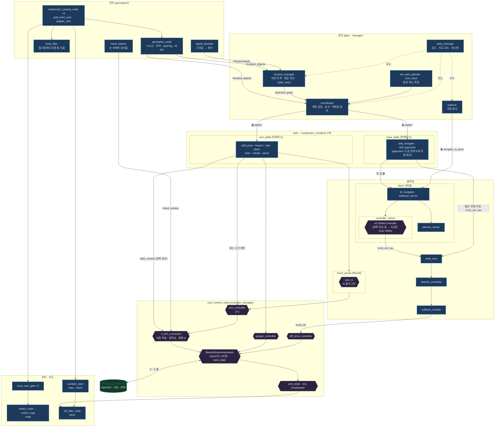

# 지금 구조 — 전체 흐름 · 노드 · 플러그인 (11-09 develop)

> develop `a6e5072` (11-09, #76~#92 병합 뒤) 코드 기준. launch 파일 · `controllers.yaml` · `nav2_params.yaml` · `skills.launch.py`에서 뽑았습니다.
> 문제 풀이 흐름도: [문제 풀이 흐름 (planner · mission_solver)](mission-solve.html) · 이전 그림: [전체 지도](system-map.html) (11-04) · [skill 노드 구성](skill-nodes.html) · [노드 흐름 (11-02, 옛 구조)](flow.html)

---

## 0. 읽는 법 — 노드 · 컴포넌트 노드 · 플러그인

| 종류 | 무엇인가 | 그림 모양 |
|---|---|---|
| **노드** | 혼자 도는 ROS 프로그램 (자기 프로세스). 토픽·서비스·액션을 직접 냄 | 네모 |
| **컴포넌트 노드** | 노드이지만 **컨테이너 프로세스 하나에 여러 개가 같이** 돎 (`component_container`). 노드처럼 이름·액션이 있음 | 네모 (컨테이너 상자 안) |
| **플러그인** | 노드가 아님. **다른 노드 안에 끼워져** 그 노드의 일부로 돎 (`pluginlib`). 혼자 못 뜸 · 자기 토픽이 있어도 호스트 노드 이름 아래 | 육각형 · 점선 (호스트 노드 상자 안) |

예: `rl_arm_correction`은 노드가 아니라 **ros2_control 컨트롤러 플러그인** — `controller_manager`(ros2_control_node) 안에서 100 Hz로 돕니다.
`RlNavController`도 노드가 아니라 **Nav2 controller_server 안의 플러그인**입니다.

---

## 1. 전체 흐름



---

## 2. 노드 (자기 프로세스 · 컴포넌트)

| 묶음 | 노드 | 형태 | 하는 일 | 패키지 (담당) |
|---|---|---|---|---|
| 인지 | `perception_node` | 노드 | YOLO 검출 · 추적(/tracked_objects) · AprilTag · 바코드 · 퍽 자세. 11-04부터 **본 것만** (안 보이면 2초 뒤 지움 — 기억은 mission_manager) | perception (전승혜) |
| | `body_filter` | 노드 | 기둥 카메라 점구름에서 로봇 몸·팔 지움 → Nav2 · 충돌 감시 입력 | perception |
| | `hand_relative` | 노드 | 손 카메라로 본 퍽·칸 상대 위치 → 팔 정책 입력 | perception |
| | `signal_decoder` | 노드 | 신호등 12회 점멸 → 색 순서 · 횟수 | perception |
| 판단 | `mission_manager` | 노드 | 주사위 미션 단계 (관측 → 조사 → 배치 → 재검증 → 복귀) · 정답 계산(mission_solver) · 순서 `planner: rule \| plan_next` | plan (권형중) |
| | `coordinator` | 노드 | 계획 검증 · 순서 · 물체 → 좌표 · 적재함 장부 · 모드 취소 → skill 액션 | plan |
| | `vlm_task_planner` · `user_input` | 노드 | 말로 하는 작업 → 계획 | plan |
| | `explorer` | 노드 | 지도 만들 때 자동 탐사 (프론티어 → Nav2) | plan |
| | `state_manager` | 노드 | 운영 모드 · 지도 모드 (매핑 ↔ 위치추정) · launch 재시작 | manager |
| skill | `skill_pose` · `skill_inspect` · `skill_pick` · `skill_place` · `skill_load` · `skill_unload` · `skill_stand` | **컴포넌트** (`arm_skills` 컨테이너) | 팔 skill — 액션 `/skills/<skill>`. 빈 공간 = MoveIt · 닿는 구간 = 시뮬과 같은 IK 궤적 → JTC · 정책 경로를 `/skill_context`로 | skills |
| | `skill_navigate` · `skill_approach` | **컴포넌트** (`base_skills` 컨테이너) | 주행 skill — navigate = Nav2 · approach = 마지막 몇 cm (돌기-직진-돌기 + 도킹 정책 4개 직접 계산) | skills |
| ML | `grasp_scorer` | 노드 | 파지 후보 점수 (`/score_grasps`) — 퍽 방향 · 옆 퍽 | ml (송정혁) |
| 안전 · 수동 | `arm_safety_monitor` · `manual_control` | 노드 | 팔 안전 감시 · 수동 조작 | control (김현하) |
| 위치 · 지도 | `cuvslam_slam` | 노드 | 시각 SLAM — map→odom (카메라만, IMU 안 씀) | ros_system |
| | `nvblox_node` · `nvblox_map` | 노드 | 깊이 → 3D → 2D 지도 → `/map` | ros_system |
| | `scan_cam_gate` ×2 | 노드 | 카메라 깊이를 지도에 넣을지 (자세 기준 문) | ros_system |
| | `ekf_filter_node` | 노드 | 바퀴 + IMU + cuVSLAM 속도 → odom | robot_localization |
| 움직임 | `move_group` | 노드 | MoveIt 계획 · 실행 | MoveIt |
| | `planner_server` · `controller_server` · `behavior_server` · `bt_navigator` · `velocity_smoother` · `collision_monitor` (+ lifecycle_manager) | 노드 | Nav2 | Nav2 |
| | `twist_mux` | 노드 | 자동 / 수동 속도 고르기 · 비상정지 잠금 | twist_mux |
| | `ros2_control_node` (`controller_manager`) | 노드 | 아래 플러그인들을 100 Hz로 돌림 | ros2_control |
| | `robot_state_publisher` | 노드 | URDF + /joint_states → TF | — |
| 기타 | `realsense2_camera_node` ×2 · `aggregator_node`(진단) · `map_saver` | 노드 | 카메라 · 진단 모음 · 지도 저장 | — |
| 테스트베드 대역 (`faker`, GPU·실기 없을 때) | `fake_opencr` · `fake_camera` ×2 · **`fake_cuvslam`** · **`fake_nvblox`** · `fake_grasp_scorer` · `monitor_manager` · `input_manager` · `service_action_monitor` · `service_action_bag_input` | 노드 | 하드웨어 · 카메라 · SLAM 대신 (11-08 #92: `fake_cuvslam` = 진짜 위치로 map→odom · `fake_nvblox` = 점구름 → `/map`, 예전 `map_server` 대신) | faker (visualkhh) |

**실행 기본값 (11-08 #92):** `bringup` `map:=none`(지도 없음이 기본 — 매핑은 `map:=slam`, 위치추정은 `map:=saved`) · `operation:=MANUAL`(state_manager 시작 모드) · 테스트베드는 `fake_slam:=true`면 cuVSLAM·nvblox 대신 위 대역

---

## 3. 플러그인 (다른 노드 안에서 도는 것)

| 붙는 곳 (호스트 노드) | 플러그인 | 종류 | 하는 일 | 우리가 만든 것 |
|---|---|---|---|---|
| `controller_manager` | **`BeebotSystemHardware`** | ros2_control 하드웨어 | OpenCR 시리얼(S·C 줄) ↔ 관절 상태·명령. **11-06 `twist_state`: joint2·3 상태 = 엔코더 + 처짐 d → TF가 실제 팔** | ✅ control |
| | **`rl_arm_correction`** (`ml/RlArmCorrection`) | chainable 컨트롤러 (JTC 뒤) | 명령 = JTC 궤적 + 처짐 적분 + **중력 앞먹임(11-06 기본 켬)** + 정책 Δ(닿는 구간만, skill 노드가 정책 경로를 알려 줌) · 발열 방지 · `~/debug` | ✅ ml |
| | `arm_controller` | JointTrajectoryController | 팔 궤적 따라가기 → rl_arm_correction 입력 | — |
| | `gripper_controller` | ParallelGripperActionController | 그리퍼 · 쥐는 힘(전류) | — |
| | `diff_drive_controller` | DiffDriveController | /cmd_vel → 바퀴 · 바퀴 odom | — |
| | `joint_state_broadcaster` · `imu_sensor_broadcaster` | broadcaster | /joint_states · /imu | — |
| `controller_server` (Nav2) | **`ml::RlNavController`** | Nav2 controller | 경로 따라가기 속도를 RL 정책이 직접 냄 (입력 51 = 경로점 · 가상 스캔 · 속도). **정책 학습 중 → 지금은 안쪽 DWB로 바이패스** | ✅ ml (visualkhh) |
| | `dwb_core::DWBLocalPlanner` (기본 · `inner_plugin`으로 `mppi` · `rpp` · `rotation_shim` 고를 수 있음, #92) | Nav2 controller (RlNavController 안쪽) | 정책이 없을 때 대신 — **주행 정책은 학습 중이라 지금은 이쪽이 돎** | — |
| | `SimpleGoalChecker` · `SimpleProgressChecker` | Nav2 | 도착 · 진행 판정 | — |
| `planner_server` | `NavfnPlanner` (A*) | Nav2 planner | 전역 경로 (`use_astar: true`) | — |
| `behavior_server` | `Spin` · `BackUp` · `Wait` | Nav2 behavior | 복구 동작 | — |
| `bt_navigator` | `NavigateToPoseNavigator` | Nav2 | navigate_to_pose 행동 트리 | — |
| costmap | 전역(planner 안): `StaticLayer` + `InflationLayer` (#92부터 `ObstacleLayer` 뺌 — 전역은 `/map`만) · 지역(controller 안): `VoxelLayer` + `InflationLayer` | Nav2 costmap | 전역 = 지도 기준 경로 · 지역 = 카메라 점구름으로 가까운 장애물 | — |
| `move_group` | `pick_ik` | MoveIt IK | 5축 팔 IK (위치 우선) | — |

---

## 4. 명령이 하드웨어까지 가는 길

**팔**
```
skill 노드 ─┬─ 빈 공간: move_group(pick_ik) ─┐
            └─ 닿는 구간: IK + 보간 궤적 ───┴→ arm_controller(JTC) → rl_arm_correction → BeebotSystemHardware → OpenCR
              /skill_context(정책 경로) ─────────────────────────↗        ↑ /hand_relative
```

**바퀴**
```
Nav2: planner(NavFn A*) → controller_server[RlNavController → 지금은 DWB] ┐
skill_approach (도킹 정책 4개, ≤0.12 m/s) ──────────────────────────────┴→ /cmd_vel_nav
→ twist_mux(자동·수동 · 비상정지) → velocity_smoother → collision_monitor → /cmd_vel → diff_drive_controller → BeebotSystemHardware
```

**위치**
```
기둥 카메라 → cuvslam_slam → map→odom      바퀴(diff_drive) + IMU + cuVSLAM 속도 → ekf → odom→base_footprint
기둥·손 카메라 깊이 → scan_cam_gate → nvblox_node → nvblox_map → /map
```

---

## 5. 11-04 이후 바뀐 것 (11-09까지)

| 언제 · PR | 바뀐 것 | 노드 / 플러그인 |
|---|---|---|
| 11-04 #63 | 인지가 물체 기억을 뺌 (본 것만) | 노드 `perception_node` |
| 11-05 #65 | `rl_nav_correction` · `rl_nav_tuner` **삭제** · Nav2 컨트롤러를 `RlNavController`로 · twist_mux 입력 `/cmd_vel_nav` | 노드 2개 삭제 · 플러그인 추가 |
| 11-05 직접 커밋 | stow 자세 `[0, −1.9024, 1.344, 0.9023, 0]` · 매핑 중 자동 스캔 자세 끔 | — |
| 11-06 #75 | `twist_state` (상태 = 실제 각) · 중력 앞먹임 기본 켬 · skill 세우기·집기 실기 수정 · Isaac 폴더 재구성 (`isaac/scripts/standalone` · `isaac/usda` · `isaac/rl/bee_isaac`) | 플러그인 `BeebotSystemHardware` · `rl_arm_correction` |
| 11-06 #76 | Isaac camera_info 발행 노드 끔 (메모리 계속 늘어나 25분 뒤 OOM) | Isaac 쪽 |
| 11-06 #77 | 연결 안 된 정책 경로 삭제 (`rl_policy_node` · `plan/arm_ik` · `rl_segment` · `stand_geometry` · 정책 사본 · `gravity_comp`) · ml CMake 중복 정리 | 6절 |
| 11-06 #78 | `stand_test` launch가 지워진 `rl_nav_correction`을 띄우던 것 · 옛 설명 | launch |
| 11-06 #79 | mission_manager가 퍽을 tag로 기억 — 집기 직전에 트랙 다시 찾기 | 노드 `mission_manager` |
| 11-07~08 #80 · #81 · #84 · #89 | inspect 상자 한 번 보기 · 인지(중복 퍽 합치기 · 태그 판독 재시도 · 차체 필터 · 퍽 중심 보정) · 적재함 칸 자세표 · 카메라 기울기 · joint1 영점 실측 | 노드 안 동작 (새 노드 없음) |
| 11-08 #82~#92 | 테스트베드 `fake_cuvslam` · `fake_nvblox` · CLI 정리 · ONNX GPU 빌드 선택 · 전역 코스트맵 `ObstacleLayer` 뺌 · `map:=none` 기본 · `RlNavController` 안쪽 controller 선택 | faker 노드 추가 · 플러그인 설정 |

---

## 6. 들어왔지만 연결 안 된 것 (#75) — ✅ PR #77로 삭제됨 (11-06 병합)

> 아래 표는 기록용 — develop에는 더 이상 없음. 같은 일은 표 오른쪽 경로가 함.

동료가 11-04 세우기 실기 시험(`292ec509`)에서 만든 것으로, coordinator가 팔을 직접 움직이던 **#59 이전 구조**용 코드입니다.
develop에 들어왔지만 빌드·실행 경로가 없고, **같은 일은 지금 구조에서 이미 다른 코드가 하고 있습니다** — 지워도 잃는 기능 없음.

| 연결 안 된 코드 | 하려던 일 | 연결 안 된 이유 | 같은 일을 지금 하는 곳 (실제로 도는 경로) |
|---|---|---|---|
| `ml/scripts/rl_policy_node.py` | 팔 잔차 정책(pick·place, PyTorch `.pt`)을 파이썬으로 50 Hz 계산 → `/rl_arm_correction/delta` | 설치·launch 없음 · 입력 `/rl_policy/context`를 내는 곳 없음 · `rl_arm_correction`이 `delta`를 구독 안 함 · `ml/policies/` 설치 안 됨 | skill 노드 → `/skill_context`(정책 경로) → **`rl_arm_correction` 플러그인이 제어 루프 안에서 C++로** (`model/skills/<skill>/<skill>.policy`) |
| `plan/arm_ik` | 손이 아래를 보는 IK — 수치해(Levenberg–Marquardt, `arm_base_link`) | `plan/CMakeLists.txt`에 없음 (시험도) | `skills/stand_plan` `ik_down` · `ik_down_sym` — 해석해 (`base_footprint`) → `ArmIO::ik_ee` · `ik_ee_yaw` → pick · inspect · stand |
| `plan/rl_segment` | 시뮬과 같은 RL 구간 시간표(단계 · 기준 궤적 · 사다리꼴 시간) + 1번 노드에 줄 JSON | 같음 | `ArmIO::contact_step` · `traj_step` (닿는 구간 = 시뮬과 같은 IK + 보간) · `stand_plan` `trapezoid_duration` · `move_s` · 구간 정보는 `/skill_context` |
| `plan/stand_geometry` | 세우기 손끝 경로(MoveIt 직교 경로용 자세) · 퍽 방향 · 받침 높이 맞추기(`snap_support`) | 같음 | `skills/stand_plan` `waypoints` · `plan_ik` (+ #75 대각선 끌기 — 주석 "기하는 실기 stand_geometry"). 받침 높이: 세우기 0.07 고정(`stand_box_top_m`) · 서 있는 퍽 `standing_grasp_z` |
| `model/arm_correction/*.onnx` · `ml/policies/*` | 위 1번이 쓰려던 정책 사본 | 참조하는 곳 없음 | `model/skills/<skill>/` (`.policy` · `.onnx` · `meta.yaml`) |

남은 확인은 이 코드와 상관없이 원래 해야 하는 것 — **실기에서 정책 보정을 켜고 끝까지 돌려 보기**.

---

## 7. 팔 정책은 어디서 도나 — 결정 (11-06)

> 두 방식 그림 · 자세한 비교: **[팔 정책은 어디서 도나 — 두 방식 비교](policy-path.html)** · 정리 PR #77

**배포 경로는 하나: skill 노드 → `/skill_context` → `rl_arm_correction`(컨트롤러 플러그인, C++)**

| 기준 | 지금 구조 (컨트롤러 안 C++) | 연결 안 된 방식 (파이썬 노드 → 토픽) |
|---|---|---|
| 시뮬과 같은 타이밍 | 정책이 제어 주기에 맞춰 50 Hz로 바로 계산 · 같은 주기에 명령에 들어감 = 학습 조건 | 토픽 왕복 지연 · 흔들림 — 잔차 정책은 Δ가 들어가는 시점에 민감 |
| 어떤 정책이 켜졌나 | skill 노드가 자기 단계에 맞춰 알림 — skill 상태와 정책이 한 곳 | 구간 JSON을 따로 보내야 함 (지금 구조엔 보낼 주체 없음) |
| 실패할 때 | 정책 없음·이상 → Δ = 0, 기준 동작만 · Δ 상한을 컨트롤러가 직접 자름 | 노드가 죽거나 늦으면 Δ 끊김·옛 값 남음 |
| Jetson | 작은 MLP를 C++로 — PyTorch 불필요 | PyTorch 필요 (메모리 · 시작 시간) |
| 층 나누기 | 하드웨어 = 처짐 상태 · 컨트롤러 = 앞먹임·적분·정책 Δ · skill = 언제 어떤 정책 | 정책 계산이 제어 루프 밖 층으로 하나 더 |

**약점과 막는 방법**

| 약점 | 막는 방법 |
|---|---|
| 학습 결과 `.pt` → `.policy` 변환 단계 — 틀리면 조용히 다르게 돎 | 같은 입력에 `.pt`와 `.policy`가 같은 출력인지 시험 (`plan_next`처럼) |
| 관측을 C++(`arm_obs`)로 다시 만듦 — 시뮬 관측이 바뀌면 같이 고쳐야 함 (#75 `twist_state`가 예) | `meta.yaml`에 관측 구성·크기 · CI에서 확인 |
| 실험은 파이썬이 빠름 (`.pt` 바로 꽂기) | "학습 → `.policy` 변환 → 같은 출력 시험"을 명령 하나로 |
| 큰 모델은 100 Hz 루프를 늦출 수 있음 (지금 정책은 1 ms 미만) | 모델이 커지면 다시 검토 |
| 실기에서 정책 보정 켜고 끝까지 돌린 적 없음 | 실기 확인 |
